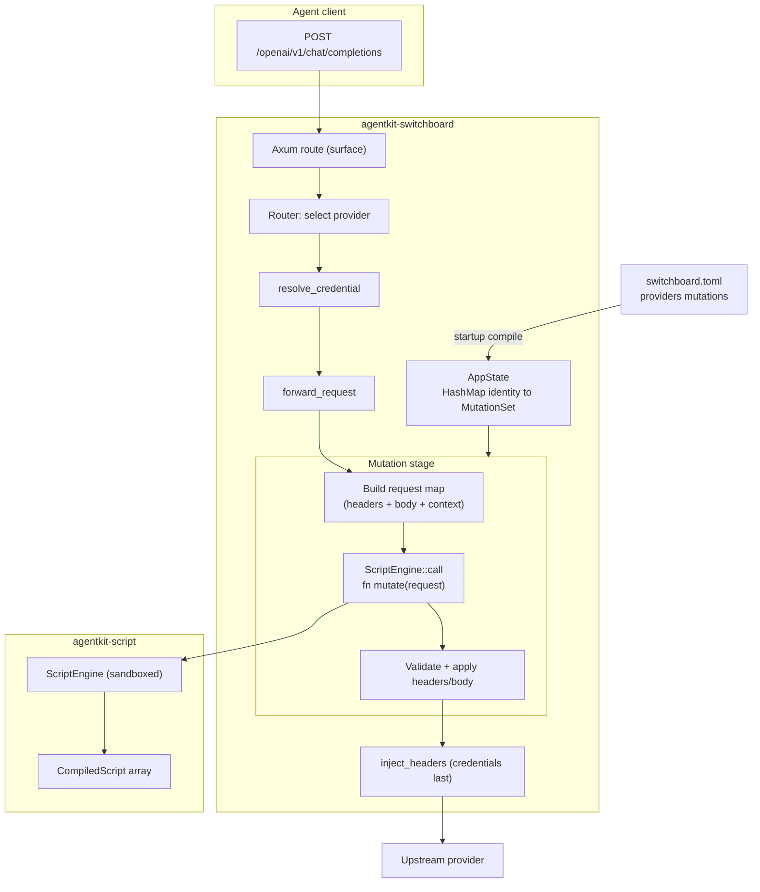

# Switchboard: Provider Request Mutations

## Approach

Introduce a new workspace crate, agentkit-script, providing a sandboxed Rhai execution engine with JSON-in/JSON-out and no host capabilities. Add a mutations list of script paths to each provider in switchboard config. Compile the scripts once at startup. At request time, after a provider is selected, run each script's fn mutate(request) against the assembled outbound request (headers + parsed JSON body + read-only context) before credential injection, then forward. Remove the static [providers.headers] table and user_agent field and delete the hardcoded tools/tool_choice rewrite from routes.rs. The provider workaround becomes a user-supplied script; none is shipped.

## Architecture

A provider's mutations are compiled once into a MutationSet held in AppState. On each request, proxy_handler selects a provider and resolves a credential; the forwarder assembles the outbound headers, then the mutation stage builds a request object map and calls each compiled script in order. Scripts mutate headers and body and return the map; the stage validates and applies the result, and credential injection runs last so scripts cannot see or override credentials. The engine is built with Engine::new_raw plus StandardPackage (no FileModuleResolver), has no host functions, disables eval/import/export, and enforces operation/depth/size limits plus a wall-clock timeout.

## Technologies

| Technology                                              | Role                                                      |
| ------------------------------------------------------- | --------------------------------------------------------- |
| rhai 1.26 (serde; sync; no_module; no_closure; no_time) | Sandboxed scripting engine; sync makes Engine Send + Sync |
| serde_json 1                                            | JSON to rhai::Dynamic conversion via rhai::serde          |
| thiserror 2                                             | ScriptError enum                                          |
| tokio 1                                                 | spawn_blocking and timeout around script calls (existing) |
| toml 1 / serde                                          | Provider mutations field and config parsing (existing)    |
| axum 0.8 / reqwest 0.12                                 | Proxy pipeline (existing)                                 |

## Components

### agentkit-script crate

Reusable sandboxed Rhai execution shared by switchboard and Tackle

New workspace crate at crates/agentkit-script with src/lib.rs, src/engine.rs, src/limits.rs, src/script.rs, src/error.rs. Public API:

pub struct Limits {
pub max_operations: u64, // default 100_000
pub max_call_levels: usize, // default 50
pub max_expr_depth: usize, // default 64
pub max_function_expr_depth: usize, // default 32
pub max_string_size: usize, // default 1_048_576
pub max_array_size: usize, // default 10_000
pub max_map_size: usize, // default 10_000
pub max_strings_interned: usize, // default 1_024
pub timeout: std::time::Duration, // default 100ms
}
impl Default for Limits { fn default() -> Self }

pub struct ScriptEngine { engine: rhai::Engine, limits: Limits }
impl ScriptEngine {
pub fn new() -> Self;
pub fn with_limits(limits: Limits) -> Self;
pub fn limits(&self) -> &Limits;
pub fn compile(&self, origin: impl Into<String>, source: &str) -> Result<CompiledScript, ScriptError>;
pub fn compile_file(&self, path: &std::path::Path) -> Result<CompiledScript, ScriptError>;
pub fn call(&self, script: &CompiledScript, function: &str, input: &serde_json::Value) -> Result<serde_json::Value, ScriptError>;
}

pub struct CompiledScript { origin: std::sync::Arc<str>, ast: rhai::AST }
impl CompiledScript {
pub fn origin(&self) -> &str;
pub fn defines(&self, function: &str, arity: usize) -> bool;
}

ScriptEngine is Send + Sync (rhai sync feature) and shared as Arc<ScriptEngine>. CompiledScript is cheap to clone and shared as Arc. No switchboard or Tackle types appear in this crate.

### ScriptError

Typed failures from every stage

pub enum ScriptError {
Read { path: std::path::PathBuf, source: std::io::Error },
Compile { origin: String, message: String },
MissingFunction { origin: String, function: String, arity: usize },
Runtime { origin: String, message: String },
LimitExceeded { origin: String, limit: &'static str },
Timeout { origin: String, timeout: std::time::Duration },
InvalidReturn { origin: String, message: String },
}

Derives Debug and thiserror::Error. Every variant carries the script origin (file path or an inline marker) for logging. LimitExceeded is produced by matching the Rhai termination token; Timeout is produced when the wall-clock deadline fires; Runtime wraps all other Rhai evaluation errors.

### Sandbox construction

Engine with no external access

Engine::new_raw() plus StandardPackage::new().register_into_engine(&mut engine) gives maps, arrays, strings, and operators without a FileModuleResolver. No host functions are registered. disable_symbol(eval), disable_symbol(import), disable_symbol(export). Limits applied via set_max_operations, set_max_call_levels, set_max_expr_depths, set_max_string_size, set_max_array_size, set_max_map_size, set_max_strings_interned. Cargo features on rhai: serde, sync, no_module, no_closure, no_time; the unchecked feature is never enabled. on_progress installs the wall-clock check.

### Call semantics

Conversion and timeout

call() requires script.defines(function, 1) or returns MissingFunction. It converts input with rhai::serde::to_dynamic (JSON null becomes Rhai unit), creates a fresh Scope, sets a per-thread deadline in a thread_local, and invokes engine.call_fn::<Dynamic>(&mut scope, &script.ast, function, (arg,)). The result is flattened with Dynamic::flatten and converted back with rhai::serde::from_dynamic. Rhai errors map to ScriptError; a termination token maps to Timeout or LimitExceeded. Switchboard additionally wraps call() in tokio::task::spawn_blocking with tokio::time::timeout as defence in depth; max_operations bounds any thread that outlives the timeout.

### Request object schema

The fn mutate contract

The switchboard defines the request map passed to fn mutate(request):

#{
provider: string, // read-only
surface: string, // read-only: openai-chat-completions | openai-responses | anthropic-messages
model: string, // read-only: parsed from the original request body
session_id: string or unit, // read-only: from X-Session-Id
headers: map of string to string, // mutable: lowercased keys, before credential injection
body: JSON value or unit, // mutable: parsed request JSON
}

The script mutates and returns the same map. Only headers and body are read back into the outbound request, so changes to context fields never reach upstream; the map returned by one script is passed to the next, so context changes are visible to later scripts. method and url are never supplied. Headers are replaced wholesale by the returned map; invalid header names or values fail the request.

### Switchboard mutation stage

Apply scripts to an outbound request

New module src/proxy/mutation.rs. MutationSet { engine: Arc<ScriptEngine>, scripts: Vec<CompiledScript> } with apply(&self, ctx: MutationContext, headers: &mut HeaderMap, body: &mut Vec<u8>) -> Result<(), MutationError>. MutationContext carries provider identity, surface, model, and session_id. apply() parses the current body as JSON (unit if not JSON), builds the request map, calls each script in declared order, reads back headers and body, validates header names and values, and serialises the body back to bytes. Errors are fatal: the request fails and no unmutated request is forwarded.

### Provider config

Declare mutations per provider

ProviderConfig: remove headers: HashMap<String, String> and user_agent: Option<String>; add mutations: Vec<PathBuf> with serde default. The loader resolves relative paths against the config file directory and rejects missing scripts at startup. Example:

[[providers]]
identity = example_provider
api_surface = openai-chat-completions
base_url = https://api.example.com/v1
mutations = [./mutations/example.rhai]

A provider with no mutations field behaves exactly as before. The switchboard ships no mutation scripts.

### Startup wiring

Compile once and store

main/server startup builds one ScriptEngine and compiles every provider's mutations once into a HashMap<String, MutationSet> stored in AppState. A missing file, parse error, or script without fn mutate(request) aborts startup with the provider identity and origin in the error. Compilation is not repeated per request.

### Forwarder and routes integration

Run mutations before credentials

routes.rs: delete the hardcoded tools and tool_choice rewrite and the unconditional body mutation. ForwardRequest replaces provider_user_agent and provider_headers with mutations: Option<&MutationSet> and surface. forward_request assembles out_headers (client headers minus hop-by-hop, default User-Agent), calls MutationSet::apply, then injects credentials last. Credential headers always win. Mutations run once per provider attempt, so failover to another provider re-runs that provider's mutations.

### Tests

Unit and integration coverage

agentkit-script unit tests: compile and call a script; missing function; runtime error; infinite loop hits max_operations; string/array/map size limits; eval/import blocked; wall-clock timeout; non-map return. Switchboard tests: header mutation reaches upstream; body tools mutation reaches upstream (fixture script under tests/fixtures/mutations/); ordering of two scripts; invalid header fails the request; no mutations preserves passthrough; removed config fields fail to parse. Existing proxy_request_body_tools_always_injected is replaced by a provider-scoped mutation test.

## Data Flow

A request arrives and the router selects a provider. proxy_handler resolves the credential. The forwarder assembles the outbound headers and calls the provider's MutationSet. Each compiled script receives the request map, mutates headers and body, and returns it. The stage validates and applies the result, then injects the credential and forwards upstream. Response handling is unchanged: bodies pass through and usage is recorded.

## Deployment

Single binary, no new runtime services. The agentkit-script crate adds the rhai dependency to the workspace. Users supply their own mutation scripts and reference them by path in switchboard.toml; nothing is bundled or fetched. Breaking config change: [providers.headers] and user_agent are removed, so existing configs must move those values into a mutation script.
