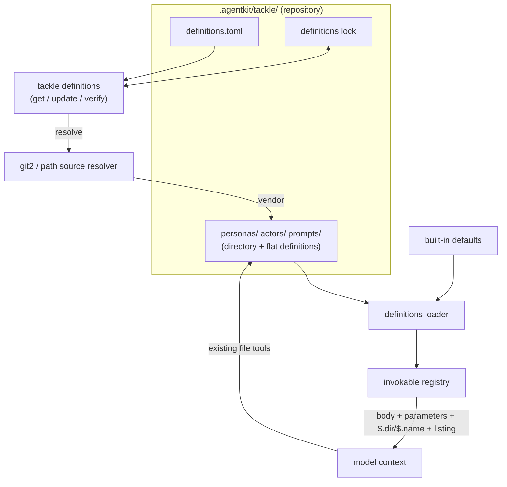

# Tackle Definition Packages Implementation Plan

## Approach

Incremental, dependency-ordered build across five milestones. The feature extends the existing definitions subsystem rather than introducing a parallel one: the loader gains directory discovery, the substitution engine gains a context-variable namespace, and a new sourcing layer (manifest, lock, vendoring) sits beside the loader without the loader depending on it. Each milestone closes a named set of spec requirements, is independently testable offline, and ships with its tests before the next begins.

M1 — Directory packages (FR-001, FR-002, FR-003, FR-013): extend discovery to directory definitions with per-kind entry points, make the definition layer repository-only, and keep built-ins as flat embedded assets at the lowest precedence. Exit: unit tests for directory discovery, entry-point mismatch, flat/directory collision, and built-in override.

M2 — Context variables and resource listing (FR-004, FR-005): add the $.dir and $.name namespace to the substitution engine and append a resource listing to model-facing bodies. Exit: substitution tests including a parameter named dir not colliding, and listing tests for prompts and personas.

M3 — Manifest and lock (FR-006, FR-007, FR-008, FR-009): the definitions.toml schema with source specs, selections, and extends, plus the definitions.lock schema and package hashing. Exit: parse and validation tests, including duplicate-name, missing-kind, and path-traversal rejection, and hashing stability across file order.

M4 — Sourcing and CLI (FR-010, FR-011, NFR-001, NFR-002, NFR-004): resolve git and path sources, vendor the resolved set into the tree, write the lock, and expose the tackle definitions subcommand. Exit: integration tests against local git and path fixtures; verify detects drift; get reproduces locked revisions.

M5 — Trust reframing (FR-012, NFR-005): retire per-file definition trust, deny project-scope host execution, keep the user-config opt-in, and reconcile security.mdx and the tackle ADR. Exit: tests that project-scope mcp_servers, client_tools, endpoints, and credential_helper are ignored while definitions and bounded scripts load without a prompt.

## Architecture

Structural decisions, each with the alternative rejected:

1. Extend the definitions subsystem, not a new component. Definitions, loading, and prompt expansion already live in one place; a package is a shape change to a definition, and a parallel module tree would duplicate the loader and the substitution engine. The sourcing layer (manifest, lock, source) is the only genuinely new part and it is self-contained.

2. The loader stays independent of the package manager. Loading is location-based and reads no manifest and no lock; the manifest controls sourcing only and the lock records integrity only. Rejected: manifest-as-registry, which would couple every session start to sourcing, break the deterministic once-at-startup load, and make a missing or stale lock a session-start failure.

3. No virtual filesystem. Resources are plain repository files the model reads with the tools it already has, so the only path exposed is a repository-relative directory. Rejected: a harness-side VFS with a permission-gated read tool, which duplicates reachability the repository already provides, adds a surface with no new capability, and reintroduces the compute coupling that in-repo delivery removes.

4. Context variables are a separate namespace. $.dir and $.name carry the $ sigil so they cannot collide with declared parameters, and substitution applies to every definition body — prompt expansion and persona system-prompt assembly alike. Rejected: bare names, which collide with a parameter legitimately named dir.

5. Trust is a boundary posture, not per-entry consent. Content confined to the sandbox — definition bodies, resources, and bounded Rhai scripts — loads without a prompt because launching in a repository already admits it; project-scope unbounded host execution (mcp_servers, client_tools, endpoints, credential_helper) is denied outright and enabled only from user configuration outside the repository. Rejected: keeping per-file TOFU, which is theater once definitions are repository-resident and has no ACP-native prompt surface at launch.

6. Integrity and authority are separated. Package hashes live in the lock and detect drift via verify; the trust decision is a project-scope policy, not a hash pin. Rejected: per-package trust hashing, which conflates the two and re-prompts on every legitimate definition edit.

## Technologies

| Technology | Role |
|------------|------|
| git2 | Source resolution and vendoring for git sources. Already a workspace dependency used by config::trust for project identity; clone or fetch at the pinned ref and resolve to a commit. No new dependency (NFR-004) |
| serde + toml | Manifest and lock parsing matching the workspace TOML convention with hand-rolled validation on top for the duplicate-name and kind and path-traversal invariants the config crate cannot express |
| sha2 | Package content hashing for the lock; the same SHA-256 already used for the TOFU trust records being retired |
| clap 4 | The tackle definitions subcommand and its def alias alongside the existing transport and auth subcommands |
| agentkit-path | config_dir for the user layer that remains (endpoints and credentials and scripts) after definitions become repository-only |

## Components

### definitions::loaders

Directory and flat definition discovery

M1 (FR-001; FR-002; FR-003). Scans the repository definition tree .agentkit/tackle/<kind>/ for directory definitions (<name>/<ENTRY>.md) and flat definitions (<name>.md) dispatching on the per-kind entry point name (PROMPT.md; PERSONA.md; ACTOR.md). The user layer is removed for definitions; built-ins register beneath. Errors name the path: a missing or misnamed entry point; a flat and directory definition of the same name; an oversized package. Tests: discovery ordering; both shapes; entry-point mismatch; collision

### definitions::types

The definition shape

M1 (FR-001; FR-013). Definition gains an optional directory and a resource listing (relative paths; sorted) alongside name and path and raw and frontmatter and body. A flat definition is a package of one with no resources. Definitions drops the user map for personas and actors and prompts; builtins and builtin_overrides are unchanged

### definitions::context

Context variables and resource listing

M2 (FR-004; FR-005). Resolves $.name and $.dir for a definition and renders the resource listing appended to model-facing bodies. One function feeds both prompt expansion and persona assembly so the two cannot diverge. $.dir is the repository-relative directory; a flat definition has $.dir empty and no listing

### invokables::registry

Prompt expansion with context variables

M2 (FR-004). The substitution map is extended from parameters alone to parameters plus the $ namespace so {{ $.dir }} and {{ $.name }} resolve while {{ name }} stays the parameter form. Invokable::Prompt carries the definition directory and resource listing so expand_user and expand_model can substitute and append without reaching back into the definitions map

### agent::prompt

Persona system-prompt assembly

M2 (FR-005). build_registry_and_system substitutes context variables into the persona body and appends the persona resource listing before the invokable manifest so personas gain resources on the same terms as prompts

### definitions::manifest

Manifest parsing and validation

M3 (FR-006; FR-007; FR-008). Parses .agentkit/tackle/definitions.toml: [[source]] with a required kind and a kind-named spec table (git url/ref/path or path dir); [definitions.<source>] selections keyed by kind; and [[extends]] delegation. Enforces the invariants: unique local names across the resolved set; kind present; source and definition paths confined to their roots; the PEP 508 git+ URL form accepted in url

### definitions::lock

Lock schema and package hashing

M3 (FR-009). Reads and writes .agentkit/tackle/definitions.lock: each source resolved to a commit; each definition to a hash over its sorted files (relpath + length + bytes). A flat definition hashes as bare file content so existing records stay stable. Integrity only; nothing here gates loading

### definitions::source

Source resolution and vendoring

M4 (FR-010; NFR-001; NFR-002; NFR-004). Resolves git sources through git2 (clone or fetch; checkout the ref; resolve the commit) and path sources from the local filesystem; walks extends transitively; and vendors the selected definitions into the repository tree. Fail closed: an unreachable source or a collision leaves the tree and lock unchanged

### cli::definitions

The definitions subcommand

M4 (FR-010; FR-011). tackle definitions with the def alias: init; add; remove; get; update; list; verify. get and update are the only network operations and both write the lock; verify re-hashes the tree against the lock and exits non-zero on drift; list reports declared and vendored definitions with status

### config::trust

Trust reframing

M5 (FR-012; NFR-005). Retires the per-path TOFU record for definitions and replaces it with a project-scope policy: context-bearing configuration and bounded scripts load without prompt while mcp_servers and client_tools and endpoints and credential_helper are ignored at project scope and honoured only from user configuration. security.mdx and the tackle ADR are reconciled in the same change

## Data Flow

Authoring and vendoring: an author edits a definition directory under .agentkit/tackle/ or declares a source in definitions.toml. tackle definitions get parses the manifest, resolves each source (git2 or local path), walks extends, validates the resolved set, vendors the selected definitions into the repository tree, and writes the lock with commits and package hashes. verify re-hashes the tree against the lock and reports drift without touching the network.

Session start: the loader scans the repository definition tree once, building directory and flat definitions plus built-ins, with no manifest or lock read. The registry and system prompt are built from that snapshot.

Prompt turn: a /name invocation or a model tool call expands the body, substituting declared parameters and the $ namespace and appending the resource listing; a persona body is substituted and listed the same way when the system prompt is assembled. The model reads any resource it needs from the repository with its own file tools, using the path exposed by $.dir.

## Deployment

Distributed in the existing tackle binary; no new process, service, or network peer. Sourcing adds git as an outbound peer for tackle definitions get and update only, alongside the model endpoint and MCP servers. The repository is the only place definitions live: .agentkit/tackle/definitions.toml and definitions.lock are committed, vendored definitions are committed beside them, and no definition state is written to the platform data or config directories. Fail-closed sourcing means a missing or stale lock is an error naming tackle definitions get rather than a silent partial load.

