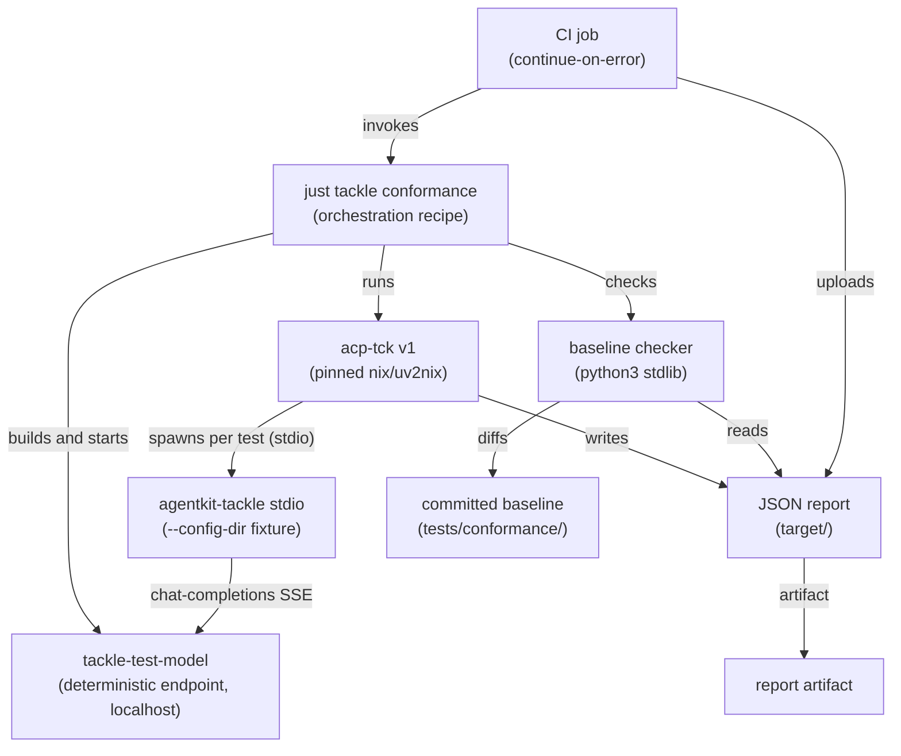

# Run acp-tck as a tackle conformance check — implementation plan

## Approach

Incremental, dependency-ordered build across five milestones. Nothing here changes the tackle product: the work adds a hermetic external toolchain, a deterministic test endpoint binary that is not shipped, committed fixtures, and runner/CI plumbing. Each milestone closes a named set of spec requirements, is independently testable offline, and ships with its tests before the next begins.

M1 — Pinned toolchain (FR-006, NFR-002): add the acp-tck repository as a nix flake input, package it with uv2nix so its Python environment resolves from its committed uv.lock, expose acp-tck in the dev shell, and confirm the pinned version. Exit: acp-tck --version resolves inside nix develop; flake.lock records the revision; no network fetch at run time.

M2 — Deterministic test model (FR-002, FR-003, NFR-006): a new bin target tackle-test-model in the agentkit-tackle crate serves an OpenAI chat-completions compatible endpoint over localhost from the request content alone, with a --cancel-sentinel that holds the response stream open until the connection is cancelled. Exit: unit tests for the normal streaming reply and the held-open sentinel; no randomness and no outbound network.

M3 — Fixtures and runner (FR-001, FR-004, FR-005, NFR-001, NFR-003, NFR-004): commit the tackle config fixture pointing at the endpoint, add crate-level just recipes (build binaries, start endpoint, run acp-tck with timeouts and --report-json, stop endpoint) and one orchestration recipe that invokes them in order, and wire the crate recipes into the root justfile. Exit: 'just tackle conformance' runs end to end locally, offline, and writes the report.

M4 — Baseline diff (FR-007, FR-008, EC-004, EC-005, AC-004, AC-005): a stdlib python3 script reads the JSON report, extracts the MANDATORY failures, diffs them against the committed baseline, reports new failures as errors and stale or now-passing baseline ids as drift, supports seeding the baseline from a first report, and always leaves the report on disk. Exit: fixture-driven tests over sample reports covering detected-new-failure, known-failure-tolerated, drift, stale-id, and missing-baseline.

M5 — CI and docs (FR-009, FR-010, NFR-005, AC-006, AC-008): a non-blocking reusable workflow invoked from the pull request workflow runs the orchestration recipe with continue-on-error and uploads the report artifact; the design docs record the conformance posture; the existing golden-transcript suite is verified untouched. Exit: workflow passes actionlint and zizmor; a simulated failure leaves the pull request and merge queue unaffected; cargo test still runs the transcript suite.

## Architecture

Structural decisions, each with the alternative rejected:

1. Run acp-tck as an external, locked tool rather than vendoring it. The repository enters as a nix flake input and is packaged with uv2nix, so its Python dependencies resolve from its own committed uv.lock and the flake lock records the exact revision. Rejected: a git submodule driven by uv at run time, which adds a floating Python environment and a submodule to maintain, and a CI-installed pinned git revision, which is not reproducible for local runs.

2. The model endpoint is a separate process launched by the runner, not an in-process mock. acp-tck drives tackle as a stdio subprocess and is itself a CLI, so the endpoint must be addressable over localhost; a bin target beside tackle-mcp-echo builds with the workspace and is never shipped. Rejected: an in-process wiremock inside a cargo test, which cannot serve a subprocess-driven external CLI and couples a Rust test to a Python tool; and a built-in test provider inside tackle, which adds product surface for a test-only concern.

3. Determinism is imposed at the endpoint, not the agent. The model is the only nondeterministic input, so deriving each reply solely from the request content makes the whole run reproducible without touching tackle's turn loop. Rejected: real model endpoints (cost, secrets, flake) and running with no endpoint at all (prompt and cancellation requirements become permanently NOT_TESTED, leaving no signal).

4. A committed baseline diff, not a conformance gate. The job stays non-blocking yet meaningful by comparing MANDATORY failures against a baseline of known gaps, mirroring acp-tck's own cross-check and the MCP conformance suite. Rejected: a hard CONFORMANT gate (red on the first run, with no incremental path) and a pure report (silent regressions).

5. One orchestration recipe is the entry point for both local and CI runs. Crate-level recipes do the discrete steps and a single recipe invokes them in order, so local and CI execute identical commands and committed fixtures. Rejected: CI-only workflow steps (local and CI drift) and a nix flake check (a binding endpoint inside a nix check is awkward to run and less debuggable).

6. Keep the in-repo golden-transcript suite. It is fast, offline, and part of every cargo test; acp-tck is slower and external. They answer different questions and both stay. Rejected: retiring the transcript suite once acp-tck is trusted, which loses fast feedback and coverage of behaviours the TCK does not check.

7. The baseline diff is a stdlib python3 script. The dev shell already provides python3 and acp-tck is a Python tool, so the checker adds no dependency and no build step. Rejected: a Rust bin (build and ship noise for a test helper) and jq or yq one-liners (awkward for drift reporting and stale-id handling).

## Technologies

| Technology | Role |
|------------|------|
| acp-tck | The external ACP Test Compatibility Kit, run as a CLI over stdio against the tackle binary. The v1 suite only; its requirements, tiers, and report format are the external oracle |
| nix flake input + uv2nix | Hermetic packaging of acp-tck and its Python environment: the repository pins the revision and uv2nix resolves dependencies from its uv.lock so nothing floats at run time (NFR-002) |
| axum 0.8 | HTTP server for the deterministic test model bin, already a dependency of agentkit-tackle. Serves the OpenAI chat-completions streaming SSE shape the tackle provider already speaks |
| just | Recipe orchestration: crate-level recipes for the discrete steps plus one orchestration recipe, wired into the workspace justfile so local and CI run the same commands (NFR-004) |
| python3 (stdlib) | The baseline diff and report summariser, already present in the dev shell; reads the JSON report, diffs the committed baseline, and reports new failures and drift |
| GitHub Actions | The non-blocking CI job: continue-on-error, invokes the orchestration recipe, and uploads the JSON report as an artifact (FR-009) |

## Components

### tackle-test-model (bin)

Deterministic OpenAI-compatible endpoint

M2 (FR-002; FR-003; NFR-006). A bin target src/bin/tackle-test-model.rs in agentkit-tackle. Serves POST chat-completions on localhost, answering streaming SSE derived solely from the request content (no randomness, no outbound network). A --cancel-sentinel value holds the stream open until the client disconnects so session/cancel is exercised. CLI flags name the bind address and the sentinel. Built by cargo; excluded from release and nix artifacts

### Conformance config fixture

Points tackle at the endpoint

M3 (FR-004). A committed config directory under crates/agentkit-tackle/tests/conformance/ whose endpoint base_url targets the test model's fixed localhost port and whose model has a known context window so usage reporting is live. Passed to tackle via --config-dir by the runner; used unchanged locally and in CI

### acp-tck baseline

Expected MANDATORY failures

M4 (FR-007). A committed file listing the MANDATORY requirement ids expected to fail, seeded from the first real report. Read by the baseline checker; edited only deliberately, and reported as drift when an entry starts passing

### Baseline checker

Diffs the report against the baseline

M4 (FR-007; FR-008; EC-004; EC-005). A stdlib python3 script: reads the JSON report, extracts MANDATORY failures, exits non-zero only on a failure absent from the baseline, reports stale baseline ids and now-passing ids as drift, and errors with seeding guidance when the baseline file is absent. Never deletes the report

### Crate just recipes

Discrete steps and one orchestration recipe

M3 (FR-001; FR-005; NFR-001; NFR-003; NFR-004). A new crates/agentkit-tackle/mod.just with recipes to build the binaries, start and stop the endpoint, run acp-tck (--protocol-version 1, explicit timeouts, --cancel-prompt, --report-json), and check the baseline, plus one orchestration recipe that runs them in order. Referenced from the root justfile as a module

### nix flake input

Pins acp-tck and its environment

M1 (FR-006; NFR-002). nix/flake.nix gains the acp-tck flake input, packaged with uv2nix and merged into the dev shell; nix/flake.lock records the revision. Updating the input is the only way the toolchain shifts

### CI conformance job

Non-blocking run and report artifact

M5 (FR-009; NFR-005; AC-006). A reusable workflow (workflow_call) invoked from pull-request.yaml with continue-on-error, on changes touching the tackle crate or the conformance inputs. Runs the orchestration recipe inside nix develop, always uploads the report, and never gates the pull request or the merge queue

### Design docs

Record the conformance posture

M5 (FR-010). docs/docs/dev/tackle/protocol.mdx gains a short conformance section: what acp-tck covers, that the check is non-blocking and baselined, and that the in-repo transcript suite remains the fast check. The tackle AGENTS-facing README is left unchanged unless a run command is added

### Golden-transcript suite

Retained fast protocol check

M5 (FR-010; AC-008). crates/agentkit-tackle/tests/acp_v1_conformance.rs and tests/transcripts/*.json stay as they are and keep running under cargo test. acp-tck is additive and does not modify them

## Data Flow

The run is: the orchestration recipe builds the tackle binary and the test model binary with cargo; starts tackle-test-model on the fixed localhost port; invokes the pinned acp-tck with --protocol-version 1 and --cancel-prompt set to the endpoint's sentinel, passing the tackle command 'agentkit-tackle stdio --config-dir <fixture>' after -- along with --report-json writing to target/; acp-tck spawns a fresh tackle process per test over stdio and drives initialize, session lifecycle, prompt turns, and cancellation; tackle resolves the fixture endpoint and its turn loop streams replies from the deterministic model, including the sentinel-held stream for cancellation tests; acp-tck writes the JSON report and prints the verdict; the baseline checker diffs MANDATORY failures against the committed baseline and exits non-zero only on new failures; the recipe stops the endpoint. The report is always left on disk for inspection and CI upload.

## Deployment

Nothing is deployed. The run is a development and CI concern: the test model binary builds from the workspace but is excluded from release artifacts and nix packages (NFR-006), and the tackle binary is unchanged. Local developers run the orchestration recipe inside nix develop; CI runs the same recipe in a non-blocking reusable workflow called from the pull request workflow. The only committed state is the fixtures and baseline under crates/agentkit-tackle/tests/conformance/ and the pinned flake input. The check has no network, credential, or model-provider requirement, so it runs on any runner and on a workstation with network disabled.

