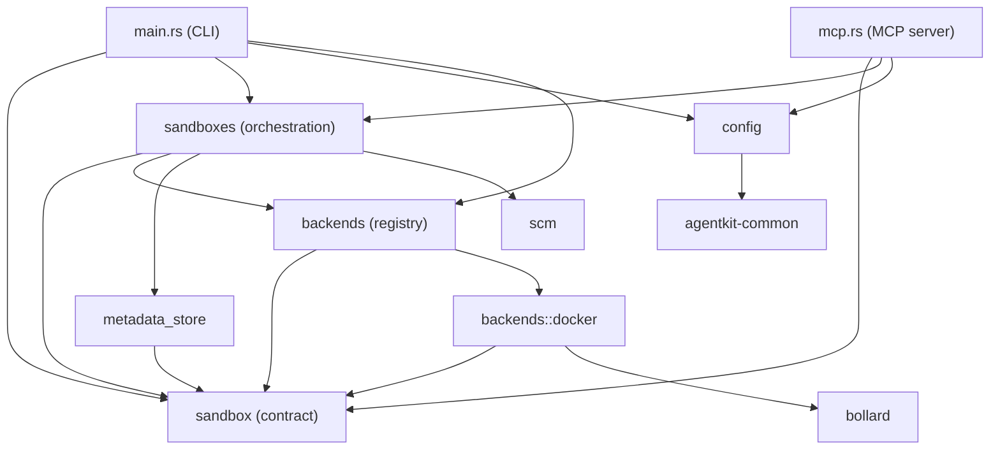

# Sandbox Provider Contract

## Approach

The spec marks no requirement as an assumption: every platform fact it leans on comes from the three spike ADRs, so this plan is built against facts rather than guesses. The work has two halves, and the order matters. The first half makes the Docker backend say what it means: its code moves under `src/backends/docker/`, its settings keep Docker's names, and the container vocabulary it currently leaks into generic surfaces stops crossing the crate. The second half puts a contract in `src/sandbox/` that describes a sandbox without describing a mechanism: identity by name, a lifecycle, structured reports, typed errors, an environment with provenance, an egress posture, and facets for the optional operations a mechanism may lack. The contract is written against the need to say no. Every operation a backend cannot perform gets a structured, typed answer, because the interesting differences between bubblewrap, Seatbelt and Docker are exactly the operations only some of them have. The generic surfaces are then rewritten to hold that contract, the persisted record gains a backend field, and a conformance suite is written so the second backend is measured against something other than Docker's habits. Nothing is migrated: this is pre-1.0 and a record written by an earlier release is reported, not read.

## Architecture

### Module layout

The crate moves from four flat files and three modules to one contract module, one directory per mechanism, and a composition root. The tree after the change:

```text
src/
├── sandbox/              contract; depends on nothing else in the crate
│   ├── mod.rs            `Sandbox` trait, re-exports
│   ├── facets.rs         `Lifecycle`, `Limits`, `Forwarding`
│   ├── report.rs         `Readiness`, `Check`, `Capability`, `EgressPosture`
│   ├── environment.rs    `Environment`, `Provenance`, workspace path
│   ├── record.rs         `SandboxRecord`, `Scope`, status vocabulary
│   ├── error.rs          `Error` taxonomy and per-surface mapping
│   └── conformance.rs    test-only generic suite and `TestBackend`
├── backends/
│   ├── mod.rs            the compiled-in set and the one construction point
│   └── docker/
│       ├── mod.rs        `DockerBackend`: `Sandbox` + `Lifecycle` + `Forwarding`
│       ├── compute.rs    moved from `compute/mod.rs`; Docker API only
│       ├── config.rs     `DockerConfig`, its own keys, `deny_unknown_fields`
│       ├── naming.rs     container naming, host port allocation
│       └── tests
├── sandboxes/            orchestration: branch, workspace, record and backend together
├── config/               user and project configuration, per-backend sections
├── metadata_store.rs     record persistence
├── main.rs               CLI
└── mcp.rs                MCP server
```




### The contract

`Sandbox` is object-safe: methods take `&self`, return `BoxFuture`, and name nothing a mechanism owns. It carries `create`, `list(scope)`, `exec`, `upload`, `download`, `inspect`, `delete`, `readiness` and `capabilities`. `inspect` returns neutral facts only: status, backend, egress posture, workspace path, environment provenance, forwards when the backend has them. Anything a backend knows that no other backend shares stays in its own record payload, not in the inspection.

### Facets

Optional operations are supertraits of `Sandbox`:

```rust
pub trait Sandbox {
    fn create(&self, req: &CreateRequest) -> BoxFuture<'_, Result<SandboxRecord, Error>>;
    fn list(&self, scope: Scope) -> BoxFuture<'_, Result<Vec<SandboxRecord>, Error>>;
    // exec, upload, download, inspect, delete, readiness, capabilities
}

pub trait Lifecycle: Sandbox {
    fn pause(&self, sandbox: &SandboxRecord) -> BoxFuture<'_, Result<(), Error>>;
    fn resume(&self, sandbox: &SandboxRecord) -> BoxFuture<'_, Result<(), Error>>;
}

pub trait Limits: Sandbox { /* set_limits */ }
pub trait Forwarding: Sandbox { /* forwards */ }
```

One `Arc<DockerBackend>` coerces into `Arc<dyn Sandbox>`, `Arc<dyn Lifecycle>` and `Arc<dyn Forwarding>`, so the registry returns one object viewed through the vtables the mechanism supports. That keeps compile-time gating for code generic over a facet and gives the CLI, which holds `dyn`, a runtime answer it can print.

### Orchestration

The pairing of a branch with compute is not the backend's business. `src/sandboxes/` owns it: it resolves the project, asks SCM for a branch, archives HEAD, stages the tree, asks the registry for the selected backend, calls `create` with a workspace source, persists the returned record, and removes the branch if the backend reports failure. Delete runs the other way, compute first and branch second, each half idempotent. Every command goes through this module, so the CLI and the MCP server never assemble a sandbox themselves and a mechanism never learns that a branch exists (FR-025).

### Configuration

Two scopes, resolved as defaults then user then project then repository-local override. User configuration lives at `~/.config/agentkit/litterbox/config.toml` via `agentkit-common`; project configuration stays at `.litterbox.toml` with the existing `.litterbox.local.toml` override, and moving it to `.agentkit/litterbox/config.toml` is left alone. The backend key is honoured only from user configuration or a per-invocation flag; the same key in a project or local file is ignored and reported, because the choice belongs to the person running the code.

Per-backend sections stay untyped in the core: the config holds a map from backend name to `toml::Value`, and each backend deserialises its own section with `deny_unknown_fields`. A key the backend does not define fails with the backend's own message. `setup-command` leaves `[docker]` and becomes project-scoped under `[project]`, because it describes the project rather than the mechanism; the old location is rejected with a message naming the new one.

### Records

```rust
// sandbox/contract.rs
pub struct SandboxRecord {
    pub name: String,
    pub backend: String,
    pub project_slug: String,
    pub data: toml::Value, // shape owned by the backend
}

// metadata_store.rs
pub struct StoredSandbox {
    pub sandbox: SandboxRecord,
    pub branch_name: String,
    pub remote: bool, // the SCM mode, kept out of the contract
}
```

Parsing goes through `toml::Value` first. A record with `container_id` and no `backend` is a legacy record: `list` reports it as unknown with a remedy, no operation addresses it, and nothing is synthesised from a name. The two fabrication paths that exist today, `metadata_for_slug` in `main.rs` and the fallback in `resolve_sandbox_metadata`, are deleted rather than ported.

### Decisions and rejections

1. The backend set is compiled in, listed in `backends/mod.rs`. A runtime registry or plugin loader would hide which mechanisms a given binary contains. Adding a backend is one entry plus one module; the contract does not change.
2. Facets are supertraits reached through `Arc` coercions, not a parallel family of objects. One implementation object, several vtable views, and no second place where a backend's state lives.
3. Per-backend configuration is typed once, in the backend. The core holds a map from backend name to `toml::Value` and never deserialises a mechanism's keys; `DockerConfig` lives in `backends/docker/config.rs`, carries `deny_unknown_fields`, and is the only place that knows what it accepts. Validation is the backend's too, because a required setting is a property of the mechanism.
4. No metadata migration. The record type changes; legacy files are reported and left on disk for the user to remove.
5. The conformance suite is an in-crate test module, not a published crate. Tests in this repository are modules selected by package and target, and a test-only crate would need a feature flag to stay out of the binary.
6. `agentkit-path` is renamed to `agentkit-common` and carries two things: the platform directories, whose `data_dir` for this component already matches the existing layout so no state moves, and the exit-code taxonomy, so every component that adopts it numbers the same failure the same way. It stays dependency-free: anything needing serde, tokio or a platform binding does not belong in it. Litterbox adopts it here; switchboard, tackle and credentials take the rename mechanically and adopt the taxonomy when next touched.
7. Exit codes are that shared taxonomy rather than a litterbox invention: 0 success, 1 failed, 2 reserved for CLI usage, 3 not found, 4 conflict, 5 unsupported, 6 denied, 7 unavailable. The mapping to MCP error classes sits beside the taxonomy in the same module.
8. The branch-and-compute pairing moves out of the backend into `src/sandboxes/`. Rejected: letting a backend depend on SCM, which would either relax FR-024 or make every mechanism re-implement branch creation, rollback and bare-repo cleanup. The backend receives a prepared workspace source and knows nothing about branches; the orchestrator owns the rollback that pairs with it, so atomicity splits along the same line as the code.

## Technologies

| Technology | Role |
|------------|------|
| Rust 2024 | The crate already builds on edition 2024 and nothing here needs a newer language feature |
| tokio | Existing async runtime; the contract keeps returning BoxFuture so no new async trait machinery is introduced |
| serde and toml | Records, configuration and per-backend sections; deny_unknown_fields is how a backend rejects keys it does not define |
| bollard | The Docker API client, now confined to backends/docker and named in no contract type |
| clap | CLI surface including the new backend introspection command and the per-invocation backend flag |
| rmcp and schemars | MCP tool definitions and schemas; tool names are unchanged, response shapes lose container vocabulary |
| arch-lint | Declarative module boundary check already wired into just lint and into the build-and-test workflow |
| agentkit-common | Platform directories and the shared exit-code taxonomy; the agentkit-path crate renamed, since only three other crates depend on it today |

## Components

### sandbox (contract)

The only thing a caller needs to know about a sandbox

Defines Sandbox (FR-001), the identity rule that a name denotes one sandbox in one backend (FR-002), Scope for repository versus machine enumeration, and the error taxonomy (FR-011). Depends on nothing else in the crate; every other module may depend on it.


### Facets

Optional operations a mechanism may or may not have

Lifecycle, Limits and Forwarding as supertraits of Sandbox (FR-004). Implemented by the backend, exposed by the registry as Option<Arc<dyn Trait>>, and reported as capabilities so the CLI can explain an absence instead of failing obscurely (FR-005).


### Reports

Structured answers to what can and cannot be done here

Readiness with per-primitive Check entries carrying state, reason, remedy and fallback (FR-006, NFR-003); Capability entries per operation; EgressPosture as denied, direct or proxied (FR-011). Every field is typed, so acceptance can assert on it rather than on prose.


### Environment descriptor

The environment with its provenance

Environment carries variables plus Provenance: origins and kind of change, never values (FR-008). Workspace path is reported here, and mapping only ever touches references to the workspace (FR-009). The backends that need to repoint HOME, TMPDIR or NIX_BUILD_TOP record it; Docker records that it changed nothing.


### Record store

Where a sandbox is remembered between processes

A stored envelope holding the contract record, the branch the orchestrator created and the SCM mode, so neither the contract nor a backend carries SCM vocabulary (FR-020, FR-025). Legacy files parse to a distinguishable state rather than an error, so list can report them and nothing can operate on them (AC-006). Replaces the container_id field and both fabrication paths.


### Sandbox orchestration

The one place a branch meets compute

Lives in src/sandboxes. Resolves the project, creates the branch, archives HEAD, stages the workspace, asks the registry for the backend, calls create, persists the record and removes the branch when create fails (FR-025, FR-015); delete removes compute then branch, each half idempotent; pause, resume and exec load the record and dispatch to the backend or its facet. The CLI and the MCP server call this module rather than assembling a sandbox themselves.


### Backend registry

The one construction point

A compiled-in set of backends, selection from configuration or the per-invocation flag (FR-022, FR-007), and a Selected value holding the core trait object plus whichever facet objects the mechanism supports. Selecting an absent or unready backend fails here with that backend's readiness report (FR-022).


### Docker backend

The first real mechanism

DockerBackend implements Sandbox, Lifecycle and Forwarding; receives a prepared workspace source and neither creates nor deletes a branch; keeps Docker's vocabulary in its own configuration, messages and errors (FR-016, FR-023); reports direct egress because the default bridge shares the host network (FR-011, AC-009); implements the forwarding facet with a loopback bind taken from user configuration (FR-013).


### Docker compute

The Docker API surface

The existing compute module moved under the backend with behaviour unchanged: image ensure and pull, container create, exec, upload, download, pause, resume, delete, inspect and list (FR-023). The name-prefix enumeration used by pause --all-repos moves here.


### Configuration

User and project configuration

Two files plus a local override, resolved in order (FR-021, FR-022). Backend selection is user-only; project files may declare ports and setup but not a mechanism. Per-backend sections are toml::Value in the core and typed inside the backend, so a backend rejects keys it does not define and the core never learns them. Directories come from agentkit-common.


### CLI

The user-facing surface

list, pause, resume, delete, shell, stdio and docgen keep their names; container vocabulary leaves their help, output and errors (FR-016). Every command goes through the orchestrator rather than assembling a sandbox from the registry and the store. pause and resume go through the lifecycle facet objects and report unsupported when absent. A new backends command lists available and selected backends with readiness and capability entries as a table, with --json for scripts and tests (FR-017); its final naming is settled here: backends, no arguments, no MCP equivalent. Exit codes come from the shared taxonomy in agentkit-common rather than from literals in each handler.


### MCP server

The agent-facing surface

Tool names, arguments and result shapes for read, write, patch, bash, ls, glob, grep and sandbox-create stay as they are; responses lose container ids and gain name, backend, status, egress and provenance by variable name (FR-019). Tools reach the orchestrator, never a backend or the store directly. No tool accepts a backend setting, and no response carries an environment value.


### MCP tool mapping

Neutral failures on the agent surface

One mapping from the error taxonomy to MCP error classes (FR-011, AC-015): not found, conflict, unsupported and denied are invalid_params with the structured reason; failed is internal_error. Written once, not per backend.


### Bulk operations

pause across a repository or a machine

The repository scope enumerates from SCM branches, the machine scope from each backend's list; both then use the lifecycle facet or report it unsupported (FR-018). A sandbox that vanishes mid-batch is skipped (EC-008), which replaces the current container-missing special case.


### Architecture lint

The calling conventions, enforced

Scopes for sandbox, backends, backends::docker, config, persistence, cli and mcp, with deny rules for every edge the diagram does not draw (FR-024, NFR-008): the contract may import nothing internal, a backend may import the contract only, the CLI and MCP may not import a backend module, persistence may import the contract only. A negative fixture in hack/ proves a violating import fails before the rules are relied on (AC-018).


### Conformance suite

The gate a second backend must pass

A generic exercise over Sandbox and its facets, run once against TestBackend as a unit test and once against Docker under the existing LITTERBOX_DOCKER_TESTS opt-in, with no backend-specific branch in the suite (AC-001, NFR-005). It asserts create, enumerate, exec, upload, download, inspect, delete, unsupported reports and atomic rollback.


## Data Flow

Creation over MCP: sandbox-create loads configuration and hands the name to the orchestrator. The orchestrator resolves the project, creates the branch, archives HEAD, stages the tree, asks the registry for the selected backend, and calls create with the staged workspace, the project's setup command and its requested ports; on failure it removes the branch it just created. The backend validates its own configuration (Docker fails here if its image is unset, in Docker's terms), establishes confinement, materialises the workspace, runs setup under the same environment and workspace path a later command sees, removes anything it created, and returns a record. The orchestrator persists the record; the server answers with name, backend, status and egress.

Creation over the CLI follows the same path through the same orchestrator and the same record store; there is no second implementation.

Command execution: a name resolves to a stored record; the record names a backend; the registry builds that backend; exec runs the command with the environment the backend owns and returns exit code, stdout and stderr. A name whose record names another backend is refused with both names (EC-004, AC-007).

Deletion: the orchestrator removes the compute through the backend, then the branch through SCM; either half already gone is not an error, so a second delete succeeds (FR-025, EC-007).

Pause and bulk pause: the registry exposes the lifecycle facet when the mechanism has one. Present, pause runs and a bulk operation iterates the scope; absent, the command reports unsupported with the mechanism's own reason and remedy (FR-004, AC-003).

Ports: the project declares expected ports, the user's configuration supplies the bind address, and the forwarding facet returns the forwards with their bind address, or unsupported when the mechanism has no forwarding (FR-013, AC-016).

Introspection: litterbox backends builds every compiled-in backend, asks each for readiness and capabilities, marks the selected one, and prints a table; --json emits the same as structured entries. No MCP tool reaches this path (AC-014).

Legacy records: a metadata file with a container id and no backend is detected on read, listed as unknown with a remedy, and refused by every operation. Nothing is migrated (AC-006).


## Deployment

One binary, unchanged distribution: `cargo build -p agentkit-litterbox` and the existing goreleaser configuration. Docker remains the default backend, so an existing user who upgrades and changes nothing gets the same behaviour, with one exception that is accepted pre-1.0: sandbox metadata written by an earlier release is reported rather than adopted, so an existing sandbox is re-created rather than reattached. Project configuration changes once: `setup-command` moves from `[docker]` to `[project]`, and the binary fails with a message naming the new key rather than silently ignoring the old one. The repository's own `.litterbox.toml` is migrated in the same change rather than left to fail, and the sample and documentation that show the old shape move with it.

The `agentkit-path` to `agentkit-common` rename lands first as a mechanical change: the crate directory and package name, four dependency entries, and the import paths in switchboard, tackle, credentials and litterbox. Litterbox then uses it for both directories and exit codes; the other components keep their current exit behaviour until they are next touched, so the rename does not smuggle a behaviour change into three components that this ADR does not otherwise mention.

Future improvement, explicitly out of scope: the backend set is compiled in. If a plugin or runtime-loaded backend is ever wanted, it would be a loader in front of the registry, and it would have to answer the same readiness and capability questions a compiled-in backend does.

Continuous integration already runs `arch-lint check` in the build-and-test workflow, so the new scopes and deny rules are enforced by the job that exists; the negative fixture runs beside it as a shell script in `hack/` and is wired into `just lint`. Cargo tests stay module-scoped and selectable by package and target; the Docker conformance run keeps the existing `LITTERBOX_DOCKER_TESTS` opt-in, and no new backend is built by this ADR, so the macOS job is unaffected.

Documentation: the generated CLI and MCP references are regenerated; the hand-written configuration reference under `docs/docs/user/litterbox/reference/` gains the user file, the per-backend section and the setup-command move, and a short backends page explains choosing a mechanism and reading a readiness report.

