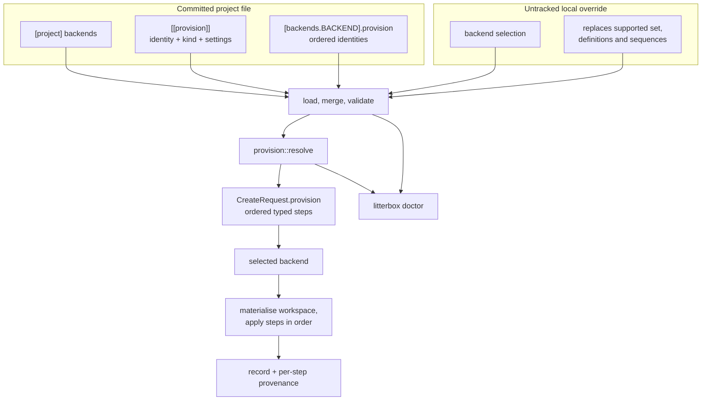

# Sandbox Provisioning

## Approach

The spec marks no requirement as an assumption: every fact it leans on is a reading of the current contract, configuration loader, orchestrator or Docker backend, and the design decisions were settled before it was written. So this plan builds against facts. The work has four layers, in dependency order. First the contract: `CreateRequest.environment` and `setup_command` become `provision: Vec<ProvisionStep>`, `ProvisionStep` is a typed enum with `Command { identity, run }`, `Backend` gains a typed `provision_support` report, and `EnvironmentSource` is deleted. Second the configuration: `[project] backends`, `[[provision]]` definitions and `[backends.<name>].provision` sequences, with the loader extracting `provision` from a backend table before the backend parses its own section, and rejecting `[project] setup-command` with the replacement named. Third the resolver: one pure module that checks the selected backend against the supported set, resolves identities in order and checks kind support, returning the ordered steps or a contract-class error. Fourth the consumers: the orchestrator calls the resolver before create and gates any resolved command step on the existing setup consent, the Docker backend applies command steps and rolls back on failure, the CLI gains `doctor`, the MCP server carries the same structured failures, and the test backend and conformance suite record and assert the resolved request. The `nix` kind is deliberately absent: the enum is closed and `nix-devshell-env-capture` adds the variant and its compile-time matches. That keeps this ADR shippable and testable with `command` alone, and means a configuration using `kind = "nix"` is rejected until that ADR lands.

## Architecture

### Module layout

The contract stays in `src/sandbox/`; the resolver is a new sibling module; the orchestrator and the Docker backend consume them.

```text
src/
├── sandbox/
│   ├── contract.rs       ProvisionStep, ProvisionKind, CreateRequest.provision,
│   │                     Backend::provision_support; EnvironmentSource removed
│   ├── environment.rs    Provisioned provenance: per-step variables and changes
│   └── facets.rs         Backend capability facets
├── testing.rs            TestBackend supports Command and records CreateRequest (test-only)
├── provision/
│   ├── mod.rs            module declarations and re-exports
│   └── resolve.rs        resolve(config, selected, support) -> Result<Vec<ProvisionStep>, Error>
│                         and preflight_steps for per-step reporting
├── config.rs             ProjectConfig.backends, ProvisionStep,
│                         Config.backend_sequences, merge rules
├── config_loader.rs      extraction, validation, setup-command rejection
├── orchestrator/service.rs  resolves before create; setup_command path removed
├── backends/docker/
│   ├── backend.rs        provision_support = [Command]; create applies steps in order
│   └── config.rs         still denies unknown keys; never sees `provision`
└── cli.rs                doctor command
```




### The contract

`ProvisionStep` is the backend-facing value and also the configuration value, so the resolver clones the selected backend's steps rather than converting a second type. A backend never receives the definition list, the supported set or another backend's name.

```rust
pub enum ProvisionKind { Command }

pub enum ProvisionStep {
    Command { identity: String, run: String },
}

pub struct CreateRequest {
    // name, project_slug, workspace, forward_bind, ports
    pub provision: Vec<ProvisionStep>,
}
```

`Backend` gains `fn provision_support(&self) -> Vec<ProvisionSupport>`, synchronous because it is a static property of the mechanism. `ProvisionSupport { kind, state, reason, remedy }` carries the degradation the resolver needs, and `capabilities()` reports the same facts as `provision:<kind>` entries generated from it, so the two cannot drift.

### Configuration

```toml
[project]
backends = ["bubblewrap", "docker"]

[[provision]]
identity = "fetch"
kind = "command"
run = "cargo fetch"

[backends.bubblewrap]
provision = ["fetch"]
```

`[project] backends` lives on `ProjectConfig`; `[[provision]]` is a new `Option<Vec<ProvisionStep>>` on `ProjectFile`; each backend's sequence is extracted from the untyped `backends` map into `Config.backend_sequences: BTreeMap<String, Vec<String>>` before the backend constructor sees its section. The project's table contributes only `provision`; the local table contributes its machine settings and, when present, a replacement sequence; any other project key is ignored with the existing notice. That extraction is what lets `DockerConfig` keep `deny_unknown_fields` and still allow a project-owned `provision` key. The local override replaces the supported set, the definitions and each backend's sequence wholesale; validation runs on the merged result.

Validation lives in `config_loader`: identity shape and uniqueness, every referenced identity exists, no identity repeats in one sequence, `[project] backends` present when `[[provision]]` is non-empty, no empty supported set with steps, and a warning (not an error) for a dead step or a sequence for an unsupported backend. `[project] setup-command` is detected by `reject_moved_sections` and rejected with a message showing the `[[provision]]` + `[backends.<name>].provision` equivalent.

### The resolver

`provision::resolve` is pure: no I/O, no backend, no async. Inputs are the merged `Config`, the selected backend's name, its `Vec<ProvisionSupport>` and `accept_degraded`. It returns `Result<Vec<ProvisionStep>, Error>` where `Error` is the contract's error type:

- selected backend not in `[project] backends` -> `Misconfigured`, naming both;
- identity not defined, or repeated in one sequence -> `Misconfigured`;
- kind absent or unavailable -> `Unsupported`, naming the backend, identity, kind and the backend's reason and remedy; a degraded kind follows the existing policy and is refused with `Unavailable` unless `accept-degraded` is set.

Doing this before `create` means a backend is never called with a shape it cannot apply, and the doctor can report the same resolution without creating anything.

### Docker

`DockerBackend::provision_support` reports `Command` as available. `create` materialises the workspace, then walks `request.provision` in order. A command step runs `sh -c <run>` with the workspace as its working directory, matching today's setup command (`backend.rs:196`). A non-zero exit rolls the container back and returns `Error::Failed` with the identity, exit code and output. The step's variable changes are recorded as provenance; they do not persist to later steps. The old `setup_command` branch is deleted, not left as a fallback. Consent is not Docker's business: the orchestrator refuses a command step before create when the project is not allowed to run one.

### Doctor

`litterbox doctor [--json]` loads the merged configuration, builds the configured backend with `registry::build` (an unready backend still reports why), asks for readiness and capabilities, then resolves the steps and prints: the selected backend; each readiness check; the supported set and whether the selected backend is in it; each step in order with its identity, kind, state and remedy. It never calls `create`, never writes a record and never runs a command. It exits non-zero when a required step is not ready, and `--json` emits the same structure for tests. It is CLI-only, like `backends`.

### Decisions and rejections

1. `ProvisionStep` lives in the contract, not in `provision`, because the backend consumes it. The provision module depends on the contract; the contract imports nothing internal, as the existing lint rule requires.
2. The resolver is a pure function, not a service. It holds no state, so the doctor and create cannot disagree about what the sequence is.
3. `provision` is extracted from the backend's table rather than teaching every backend about it. One extraction point keeps `deny_unknown_fields` honest and means a new backend does not have to remember a special key.
4. `[project] backends` is the election, not the presence of a `provision` key. This is the rejection of the earlier absent-versus-empty model: the supported set says which backends the project stands behind, and a sequence is only a list.
5. The kind set is closed and compiled in. A runtime registry would hide what a binary can actually apply, and the capture ADR needs a compile-time match anyway.
6. The resolver returns the contract's error type rather than a second taxonomy. The CLI and MCP already map those classes once, and a provisioning failure should not invent a third vocabulary.
7. The doctor is a new command rather than a flag on `backends`. `backends` answers what the machine has; the doctor answers whether this project can run here, which needs the project's configuration and steps.
8. No new dependency. The resolver is plain Rust over existing types. 9. Setup consent moves from the config key to the resolved command steps: a project with no command steps needs no consent, and a refusal names the step identity rather than a key and is classified `Denied`.

## Technologies

| Technology | Role |
|------------|------|
| Rust 2024 | The crate already builds on edition 2024; the resolver is plain synchronous Rust. |
| serde and toml | Project and local configuration; ProvisionStep is deserialised with the kind tag, and unknown keys stay rejected. |
| clap | The doctor command and its --json flag, beside the existing subcommands. |
| futures_util | The Backend trait already returns BoxFuture; provision_support is synchronous and adds no async machinery. |
| tracing | Warnings for dead steps and sequence mismatches, matching the loader's existing style. |
| arch-lint | A new litterbox-provision scope with deny rules, checked by the existing CI job. |
| agentkit-common | The shared exit-code taxonomy already used by the CLI; provisioning failures reuse it. |
| rmcp | The MCP server; no tool changes, only the structured error payload. |

## Components

### Contract types

The backend-facing provisioning value

ProvisionStep with Command { identity, run }; ProvisionKind as the closed kind set; CreateRequest.provision replaces environment and setup_command; Backend::provision_support with ProvisionSupport { kind, state, reason, remedy }; EnvironmentSource deleted, Environment and Provenance retained.


### Configuration schema

The project's supported set, definitions and sequences

ProjectConfig.backends, ProjectFile.provision: Option<Vec<ProvisionStep>>, Config.backend_sequences: BTreeMap<String, Vec<String>>; merge rules make the local override replace all three wholesale.


### Configuration loader

Validation and the setup-command rejection

Extracts provision from each backend table before the backend parses; validates identity shape and uniqueness, referenced identities, duplicate sequences, supported-set presence and empty-set-with-steps; rejects [project] setup-command with the replacement shown.


### Provision resolver

One place that turns identities into typed steps

src/provision/resolve.rs: takes Config, the selected backend name and its provision support; checks the supported set, resolves in order and checks kind support; `resolve` returns the steps or a contract error, and `preflight_steps` returns per-step outcomes; unit tests cover order, duplicates, unknown identities, unsupported kinds and unlisted backends.


### Orchestrator

Resolve before create

Selects the backend, reads provision_support, resolves, enforces the setup consent on any resolved command step as Denied, naming the identity and both settings, builds CreateRequest with the resolved steps, and keeps the existing rollback path; the setup_command field is removed from the request construction.


### Docker backend

The first consumer of the sequence

provision_support reports Command as available; create walks the steps in order, runs each command with sh -c in the workspace, records provenance and rolls back on non-zero; capabilities report provision:command.


### Doctor command

Preflight without mutation

litterbox doctor [--json]: loads configuration, builds the selected backend, reports readiness, supported-set compatibility and each resolved step's state and remedy; never creates, writes or executes.


### MCP surface

Unchanged names, structured failures

No new tool; sandbox-create returns the contract error, whose fields already carry the backend, operation, reason and remedy; the error data payload gains the step identity and kind for provisioning failures.


### Test backend and conformance

The gate for the resolver and every backend

TestBackend reports [Command] and records the CreateRequest it receives; the conformance suite asserts list order, per-backend selection, an empty sequence and that no other backend's name or the supported set crosses the boundary.


### Architecture lint

The resolver boundary, enforced

New litterbox-provision scope for src/provision/**; deny backends, CLI and MCP importing it; allow the orchestrator; a negative fixture in hack/ proves a violating import fails.


### Documentation

The configuration reference and generated surfaces

Document [project] backends, [[provision]], the command kind, per-backend sequences and the setup-command replacement; regenerate the CLI and MCP references and add the doctor command.


## Data Flow

Configuration: `load_final` reads the committed project file and the untracked local override, merges them, extracts each backend's `provision` sequence from the untyped table, and validates the supported set, identity shape and uniqueness, references, duplicates and the absence of `setup-command`. The result is a `Config` whose `backends` map still holds only machine-owned backend settings.

Create: a CLI or MCP call reaches the orchestrator. The orchestrator selects the backend through the registry (readiness checked as today), reads its `provision_support`, and calls `provision::resolve` with the selected name, the supported set, the definitions, the sequence and the degradation policy. The resolver returns the ordered `Vec<ProvisionStep>` or a contract error. If the steps contain a command and the project is not in `allowed-projects` while `allow-project-setup` is false, the orchestrator refuses with `Denied`, naming the step and both settings. Otherwise it builds `CreateRequest` with those steps, creates the branch and the workspace source, persists the record, and removes the branch if create fails. The backend materialises the workspace, applies each step in order, records per-step provenance and returns the record. A failing command step rolls back the compute, and the orchestrator removes the branch.

Doctor: `litterbox doctor` loads the same merged configuration, builds the selected backend without requiring it to be ready, asks for readiness and capabilities, resolves the steps through the same resolver, applies the same consent check and prints the selected backend, its checks, the supported set, the sequence and each step's state and remedy. It stops at the report: no branch, no workspace, no record, no command.


## Deployment

One binary, no new dependencies. Docker remains the default backend and a project with no `[[provision]]` section behaves exactly as today: the default environment, no setup command, no supported-set requirement. The breaking change is `[project] setup-command`, which fails to load with a message naming a `command` step and the backend sequences; this is pre-1.0 and no migration is written. The repository's own configuration, if it carries the key, is updated in the same change.

MCP tool names, arguments and result shapes are unchanged; only the error data payload gains the step identity and kind. The CLI reference is regenerated with the doctor command, and the configuration reference gains the provisioning section.

CI already runs `arch-lint check`; the new scope and deny rules land with it and the negative fixture runs beside the existing one. The Docker suite keeps its `LITTERBOX_DOCKER_TESTS` opt-in and its assertions; new tests cover the ordered sequence and the rollback. The resolver's tests are module-scoped and selected by package and target. The macOS job is unaffected: no backend is added here, and the `nix` kind is absent until `nix-devshell-env-capture`.

