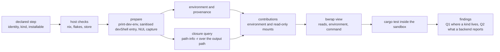

# DevShell Environment Prototype

## Approach

Build the smallest harness that can answer the two open questions, beside the ADR and imported by nothing. It models a step whose kind is a string and whose settings are its own, checks the host requirements, enters the devShell under a sanitised caller, derives the closure, and feeds the result to bwrap as read-only reads plus an environment. lbx-bwrap cannot take it: its validate rejects read grants under /nix, so the prototype drives bwrap directly and records the refusal (findings.md). The prototype decides nothing about the production types; it measures what a generic kind costs and what a backend had to be asked, and records both with the commands that produced them.

## Architecture

One standalone crate under adrs/2026-11-07-devshell-environment/poc/prepare, with its own Cargo.toml and no workspace membership, so nothing it defines can leak into the crate by accident. It owns a Step (identity, kind, settings), a Requirement list, and Contributions (environment, mounts). Prepare and closure are functions over the host; launch shells out to bwrap with the prepared environment and the closure as reads, and runs cargo test in this repository's workspace. Findings live beside the crate and are written before any production type is proposed. 

## Technologies

| Technology | Role |
|------------|------|
| Rust | std only plus serde_json: the harness for process invocation, NUL-separated parsing, and the step and contribution types |
| Nix | 2.34.9: print-dev-env for the baseline and the output path, path-info for validity and the closure, and the devShell entry that produces the environment |
| bubblewrap | 0.12 through lbx-bwrap, the existing launcher under adrs/2026-10-31-linux-bwrap-sandbox/poc/bwrap, fed with the prepared reads and environment |

## Components

### step-model

Measure what a generic step costs when a kind is a string

Step { identity, kind, settings }, Requirement { scope, name }, Contributions { environment, mounts }. Typed so a wrong setting fails at parse, not at launch. The finding is the number of places the harness had to branch on the kind: if a generic step needs no branch, the contract's closed enum buys nothing.

### host-checks

Refuse before doing any work when the host cannot serve the step

nix on PATH with its version, flakes enabled, the installable evaluates, and path-info reports the devShell valid. Each check returns a structured reason and remedy. A check that fails stops the run before print-dev-env, so no store write happens on an invalid devShell.

### prepare

Produce the environment and its provenance

print-dev-env --json for the baseline and the output path; then the devShell entered under env -i with only HOME and a minimal PATH, writing NUL-separated records to a file or spare descriptor. Values are the entered environment's; provenance is the variable names that differ from the baseline. Shell state and the backend-supplied values are dropped. The interesting measurement is the variable count against T-011's 91 and the absence of caller sockets.

### closure

Turn the store closure into mounts

path-info -r over the output path, de-duplicated and absolute, one read-only mount per path. A store-view switch selects the whole store instead. Records the count, the setup time and the bwrap argv size, which is what a backend needs to know before it validates its own limit.

### launch

Run a real workload with the contributions applied

Invoke lbx-bwrap with the closure as reads, the prepared environment, and cargo test -p agentkit-path as the command. The workload must run with no network and a read-only store; the success criterion is the same test passing that T-016 and T-022 ran, with the environment now produced by entering the devShell rather than by an earlier differential script.

### findings

Answer the two questions with evidence

Q1: does a step whose kind the contract does not name survive contact with a real launcher, and what would moving ProvisionKind and ProvisionStep to identity plus kind plus settings cost. Q2: what a backend must report - kind support, or requirements it can meet and contributions it can apply - evidenced by what the harness actually had to ask. Also record the counts, the timings and anything refuted, including the dirty-tree source write and the path-info refusal.

## Data Flow

A declared step is parsed into the harness's own Step. Host checks run and either refuse with a structured reason or pass. Prepare enters the devShell and produces the environment, provenance and the output path. The closure query turns the output path into mounts. Environment and mounts become Contributions, which become an lbx-bwrap view: reads, environment, command. bwrap runs cargo test in the workspace with no network and a read-only store. The findings file records the answers, the measurements and what the run refuted.

## Deployment

None. The prototype is not shipped, is not a workspace member, and no production module refers to it. It is run by hand on a Linux host with a valid devShell, and its findings gate the follow-up specification.

