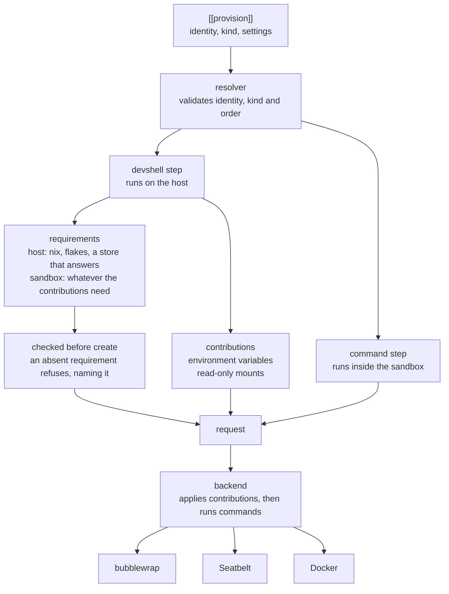
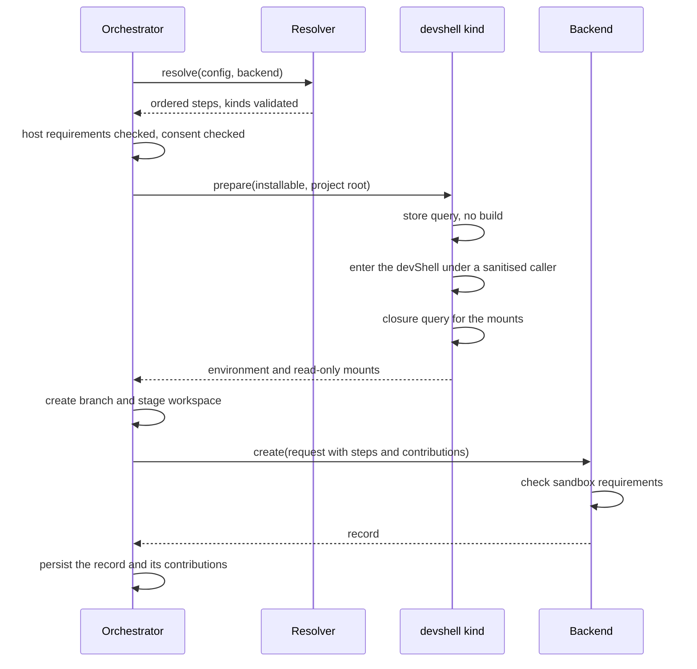

# DevShell Environment

**Status:** proposed  **Created:** 2026-11-07  **Author:** adrian

Litterbox provisions a sandbox from the project's `[[provision]]` steps (adrs/2026-11-05-sandbox-provisioning). Today the only kind is `command`, which runs inside the sandbox, and `CreateRequest` (crates/agentkit-litterbox/src/sandbox/contract.rs) carries no environment from the host and no store paths. A project that builds with Nix therefore has to run nix inside the sandbox, which the map excluded: with the daemon socket a confined command grew the host store and the daemon accepted builds outside the sandbox (maps/2026-10-31-nix-devshell-sandbox/evidence/T-018.md), and without it nix fails before it can evaluate anything. The same map established that a devShell can be entered on the host instead and its result applied to a sandbox: the environment a sanitised caller produces plus the shell hook's changes reach a bubblewrap holder intact (T-011, T-016), and the devShell's store closure is a sufficient set of paths to make visible (T-022). The contract as written has nowhere to carry either (T-023). This ADR adds a second step kind, `devshell`, that runs on the host and contributes two things a sandbox already understands: environment variables and read-only mounts. It also makes explicit what a step requires - on the host and inside the sandbox - so a mechanism whose dependencies are absent refuses before anything is created. There is no separate abstraction for what a step contributes beyond these two, and no shell state in the sandbox: entering the devShell produces an environment and a list of paths, and nothing else. Terminology is normative in crates/agentkit-litterbox/CONTEXT.md, upstream Nix terms are in .agentkit/tackle/prompts/nix/glossary.md, and the behaviours this specification relies on are verified in .agentkit/tackle/prompts/nix/PROMPT.md. Two questions decided the production shape, and the prototype settles both: a kind can live outside the contract's closed `ProvisionKind` for the cost of one parse site, and a backend needs contribution support rather than kind support. The answers, and what they refute, are recorded in `findings.md` beside this specification. This ADR specifies the design and produces a prototype that settles both against a real backend; it does not build the production implementation, which a follow-up ADR owns. 

## Problem

A project cannot express its devShell in configuration without either running nix inside the sandbox, which widens the host attack surface through the daemon socket, or hand-maintaining the environment variables and store paths that the flake already knows and that drift from it. The provisioning model has no place for a step that runs on the host and changes what the sandbox sees, and no way for a step to say what it needs to exist - on the host or inside the sandbox - so a mechanism that cannot satisfy it fails late, opaquely, or not at all.

## Goals

- Add a devshell host step kind that enters a devShell on the host and contributes its environment and mounts.
- Carry what a step contributes as data: environment variables and read-only mounts, with the vocabulary growing by amendment rather than by fitting kinds into a fixed enumeration.
- Make explicit what a step requires, on the host and inside the sandbox, and refuse before creating when a requirement is absent.
- Produce the environment by entering the devShell under a sanitised caller, never from the caller's session.
- Carry the store closure as read-only mounts, with the whole store as a machine option.
- Persist contributions with the sandbox, so later commands in later processes see the same environment.
- Refuse rather than realise, with a reason and a remedy the user can act on.
- Keep nix outside the sandbox: no daemon socket, no network.
- Settle the contract shape with a prototype before production types are committed.

## Non-goals

- Running nix inside the sandbox.
- Realising the devShell; the user runs nix develop on the host first.
- Binding mounts in a native backend; linux-bwrap-provider and darwin-sandbox-provider render them.
- Dynamic discovery or a plugin system for kinds; the two kinds are compiled in and registered in one place.
- Shell state in the sandbox: bash functions, aliases and shell options are not carried, because they are not environment.
- Any contribution beyond environment and mounts added for symmetry; a kind that needs one amends the contract deliberately.
- The egress proxy (egress-proxy) and automatic backend selection (automatic-backend-selection).
- Caching a prepared devShell across creates; it is derived from the store on each create.
- Migrating projects that hand-write environment variables to a devshell step.
- A Nix backend; a devShell is an environment, not a mechanism.
- The production implementation; a follow-up ADR consumes the prototype and implements it. The prototype ships no production type.

## Functional Requirements

### FR-001: Kind: DevShell Step

A step of kind `devshell` names an installable: `identity`, `kind = devshell` and `installable`. Settings are validated when configuration loads; an unknown key or a missing installable fails naming the step identity and the kind. At most one devshell step may appear in one backend's sequence; a second is Misconfigured and names both identities.

**Slug:** `devshell-step`

### FR-002: Arch: Two Kinds, Compiled In

Provisioning has two kinds: `command`, which runs inside the sandbox, and `devshell`, which runs on the host and changes what the sandbox sees. Both are compiled in and registered in one place, as backends are. There is no discovery, no plugin path and no dynamic loading; adding a kind is a module and a registration line, and it changes the contract only if it contributes something the contract cannot yet express.

**Slug:** `two-kinds`

### FR-003: Core: Contributions

A host step contributes data the backend applies: environment variables and read-only mounts, in step order. The contract defines those two, names no devShell, flake, nix, store or mechanism, and a backend applies them to every command in the sandbox. A contribution the backend cannot honour is refused before anything is created, naming the contribution, the backend, the reason and the remedy; nothing is approximated or dropped. The vocabulary is small today and grows by amendment when a kind needs a new sort of contribution; it is not a fixed enumeration a kind has to fit into.

**Slug:** `contributions`

### FR-004: Core: Requirements

A step declares what must exist for it to be applied, in two scopes. Host requirements are checked by the orchestrator before create: for `devshell`, nix on PATH with a recorded version, flakes enabled, and a store that answers. Create additionally requires an installable that evaluates and a devShell valid in the store, and refuses with the same structure when either is absent; neither is a readiness check, because evaluation writes to the store. Sandbox requirements say what must exist inside for the contributions to be usable; for environment and mounts this is empty today, and a later contribution that needs a shell, a path or a binary declares it. A backend reports what its sandboxes provide and refuses a request whose requirement it cannot meet, naming the requirement, the backend, the reason and the remedy, before creating anything. An absent requirement is never approximated, deferred or skipped.

**Slug:** `requirements`

### FR-005: Step: Host Placement

A devshell step is a host step: the orchestrator runs it during create, after resolution and the requirement and consent checks and before the branch is created, so a failure leaves no branch, workspace or compute. It reads the project root, not the staged workspace, because the installable is relative to the checkout the user is in. It produces contributions; it runs no sandbox and needs no backend.

**Slug:** `host-placement`

### FR-006: Step: Environment

The environment is the one the devShell produces when entered from a sanitised caller: only HOME and a minimal PATH are supplied, the shell hook runs once, and the result is read as NUL-separated records from a file rather than from stdout where the hook can corrupt it. The caller's session never crosses, so agent sockets, D-Bus, Docker and Wayland variables are absent because they were never present, not because a filter removed them. print-dev-env supplies the baseline against which the hook's additions and overrides are recorded as provenance. Everything else the entered shell sets is contributed, including the names `print-dev-env` marks exported with an empty value and the build-phase variables the hook leaves set: `nix develop` sets them and direnv restores them, so they are the devShell's environment. Only the shell's own state (`PWD`, `OLDPWD`, `SHLVL`, `_`), HOME and the six names T-030 restores (`NIX_BUILD_TOP`, `TMP`, `TMPDIR`, `TEMP`, `TEMPDIR`, `terminfo`) are dropped: their entered values name host scratch paths and a host terminal database that the sandbox does not have.

**Slug:** `environment`

### FR-007: Step: Store Closure

The step derives the devShell's store closure with a host query over the output path print-dev-env reports, de-duplicated and absolute, and contributes one read-only mount per path. The closure is the default view. The contract sets no path ceiling and this ADR invents none: a backend that cannot mount the set validates it against its own limit before creating anything and refuses with that limit, the contribution, the reason and the remedy. Whether a closure larger than this repository's 238 paths is mountable is untested, and that risk belongs to the backend ADRs that mount it.

**Slug:** `store-closure`

### FR-008: Core: No Shell State

Nothing that exists only inside a shell crosses into the sandbox: bash functions, aliases, shell options and the hook itself are not carried. The hook runs once on the host when the step prepares the environment; re-running it inside the sandbox would run project code per command and duplicate its side effects. A command that needs a shell function states a sandbox requirement for the shell and the definition it loads, which this ADR does not provide; the absence is reported rather than papered over with a file nothing sources.

**Slug:** `no-shell-state`

### FR-009: Host: Readiness

The kind reports host readiness, structured and without mutating anything: the nix executable is present and reports a version, flakes are enabled, and the store answers. Each check names the primitive, the reason and a remedy the user can run on the host, and the report is available as text and as JSON. The same report is produced by the doctor and by create, from one implementation, and neither evaluates the installable nor prepares the devShell: evaluation writes to the store and belongs to create, which reports an unevaluable installable or an unrealised devShell as its own failure.

**Slug:** `host-readiness`

### FR-010: Host: No Realisation

The validity check is a store query, not a build: an unbuilt devShell is reported not valid and no output path is created. A step on an unrealised devShell fails create as Unavailable, naming the installable and the remedy of running nix develop on the host. print-dev-env may still copy the flake source to the store and may build a source derivation for a dirty tree; that is a store write, not a realisation of the devShell, and the reason and remedy say so rather than claiming nothing was written. It may also realise the devShell's environment derivation and whatever that derivation needs to build, because the output path the step validates is only reported after evaluation; the guarantee that nothing is realised therefore holds where the store already has the devShell, and the step checks validity immediately after evaluating and refuses before the hook runs. The doctor does not evaluate at all, so its guarantee is unaffected.

**Slug:** `no-realisation`

### FR-011: Config: Consent

Preparing a devShell evaluates project code and runs its hook on the host, so it is consent-gated exactly as a command step is: the project's namespace is in allowed-projects, or allow-project-setup permits every project. A refusal is Denied, names the step identity and both settings, and no evaluation, query or backend call happens. Cloning a repository is never consent to evaluate its flake.

**Slug:** `consent`

### FR-012: Core: Persistence

Contributions persist with the sandbox, so every later command in every process sees the same environment and mounts: the backend stores them in its record payload and exec, inspect and delete read them from there. A prepared devShell is derived at create; a later change to the flake or the host does not reach a running sandbox, and creating again prepares it again. Delete removes the contributions with the record.

**Slug:** `persistence`

### FR-013: Core: Workspace Mapping

The step records which environment values name the project root, such as CARGO_HOME, RUSTUP_HOME and the leading PATH entry, and the backend rewrites only those when it presents the workspace at a path other than the host's, as the contract requires. Store paths, including the NIX_ variables and toolchain paths, are never rewritten, because the store is mounted at its own path. A value naming a host path outside the store and the workspace is reported as a host path and never made visible.

**Slug:** `workspace-mapping`

### FR-014: Core: Failure Classes

A missing nix, disabled flakes, an installable that does not evaluate, or a devShell that is not valid in the store is Unavailable, each with the primitive, reason and remedy. An installable that evaluates to something without a devShell environment is Misconfigured. A shell hook that exits non-zero is Failed with the step identity and bounded output. A backend that cannot meet a requirement or honour a contribution is Unsupported. A refused step is Denied. These are the existing provisioning classes, not new ones.

**Slug:** `failure-classes`

### FR-015: CLI: Doctor

The doctor reports, without creating or mutating anything: the selected backend and its readiness; each devshell step with its identity, state, reason and remedy; the host requirements and whether each holds; the installable and the store view in force. It creates no sandbox, workspace, branch or store path, and it neither evaluates the installable nor prepares a devShell, so a store listing is unchanged before and after.

**Slug:** `doctor`

### FR-016: Core: No Nix Inside

The contributions give the sandbox no route to nix: no daemon socket, no store write and no network. The devShell's closure contains no nix executable, verified in this repository, and a nix binary found elsewhere could not reach the daemon because the socket is not contributed and the network is unshared. A command that expects to evaluate or build fails as it would on a host without nix; the remedy is to run nix on the host and create again.

**Slug:** `no-nix-inside`

## Non-functional Requirements

### NFR-001: Shared: No New Dependency

The step spawns nix and reads its output with the standard library and the serde_json already in the tree. It adds no crate, no async runtime and no platform library.

**Slug:** `no-new-dependency`

### NFR-002: Shared: Legible Unavailability

Every failed requirement, refused contribution or failed check names the primitive or requirement, the reason and a remedy the user can act on. A bare failure is a defect, and each report is structured so a test asserts its fields.

**Slug:** `legible-unavailability`

### NFR-003: Shared: Fail Closed

No sandbox is created with a partial set of contributions: a hook that fails, an environment that cannot be produced, a closure that cannot be derived, a requirement that is absent or a contribution the backend cannot honour fails create and leaves nothing behind. The only way to run without the devShell environment is to remove the step from the sequence.

**Slug:** `fail-closed`

### NFR-004: Arch: Host Boundary

The devshell kind lives in its own module under src/provision/, reached by the orchestrator and never by a backend. A backend receives contributions and cannot invoke nix. The boundary is declared in arch-lint.toml and a violation fails the build.

**Slug:** `host-boundary`

### NFR-005: Shared: No Values On Surfaces

No CLI output, MCP response, log line or persisted provenance carries an environment value. A test asserts that rendered provenance and inspection do not contain a fixture secret.

**Slug:** `no-values-on-surfaces`

### NFR-006: Shared: Test Selection

Parsing and contribution construction are unit-tested against recorded command output, with no nix and no network. Tests that need a real nix and a valid devShell are host tests, selected separately, and never build a derivation. Tests live in the module and are selectable by package and target.

**Slug:** `test-selection`

### NFR-007: Shared: Compatibility

A project with no devshell step behaves exactly as it does today; MCP tool names and arguments do not change; Docker continues to report the kind as unsupported rather than changing behaviour.

**Slug:** `compatibility`

### NFR-008: Shared: Documentation

The configuration reference documents the devshell step, its installable, the store view and the consent it needs. The doctor output is documented with the other preflight output, and CONTEXT.md plus the nix capability prompt carry the vocabulary.

**Slug:** `documentation`

### NFR-009: Shared: Prototype Is Not Shipped

The prototype lives beside this ADR, under adrs/2026-11-07-devshell-environment/poc/, and no production module refers to it. Its findings are recorded beside it before the follow-up specification begins. A production type is not committed unless the findings support it.

**Slug:** `prototype-not-shipped`

## Acceptance Criteria

### AC-001: Step: Environment Is The DevShell's

Against this repository's flake, the environment holds the devShell's variables and the hook's changes, the caller's RUSTFLAGS is absent from the result, PATH still leads with the devShell's CARGO_HOME entry, and SSH_AUTH_SOCK, BITWARDEN_SSH_AUTH_SOCK, DOCKER_HOST, DBUS_SESSION_BUS_ADDRESS and WAYLAND_DISPLAY are absent. The shell's own state and the values the backend supplies are dropped.

**Slug:** `environment-is-devshells`

### AC-002: Shared: Contributions At Step Position

A recording backend receives the environment and mounts keyed to the devshell step's position: a command step before it sees the default environment, one after it sees the prepared environment, and a backend whose sequence does not name the step receives none of its contributions.

**Slug:** `contributions-at-position`

### AC-003: Step: Closure Equals Query

The mounts equal the de-duplicated output of the host closure query over the devShell's output path, one mount per path, and the count matches the query. With the store view whole, the mounts are the store root alone. The doctor reports the count and the view.

**Slug:** `closure-equals-query`

### AC-004: Host: Unrealised Refused

With the devShell not valid in the store, create fails as Unavailable naming the installable and nix develop <installable>, the doctor reports the same, and the store gains no output path for it. A host test observes only the derivation being written.

**Slug:** `unrealised-refused`

### AC-005: Host: No Nix Refused

With no nix on PATH, readiness and create fail as Unavailable naming the primitive and the remedy, and the doctor reports it without creating anything.

**Slug:** `no-nix-refused`

### AC-006: Config: Consent Gate

A devshell step in a project outside allowed-projects is refused as Denied naming the identity and both settings and no nix process starts; the same project in allowed-projects prepares; allow-project-setup permits every project.

**Slug:** `consent-gate`

### AC-007: Core: Persistence Across Processes

A sandbox created with a devshell step reports the same environment and mounts to a second process's exec and inspect, and delete removes the contributions from the record.

**Slug:** `persistence-across-processes`

### AC-008: Core: No Shell State

A bash function defined in the devShell is not available to a command in the sandbox, no file is written to make it appear, and inspection says the sandbox carries no shell state rather than implying otherwise.

**Slug:** `no-shell-state-accepted`

### AC-009: Core: No Socket Or Network Access

The request carries no daemon socket, no store write and no network access; its read-only mounts are the closure members, the workspace, and an explicit list of host files, and a test asserts the mount set exactly.

**Slug:** `no-socket-or-network`

### AC-010: Config: Step Shape Refused

A devshell step with an unknown key or a missing installable fails at load naming the key and the kind, and a second devshell step in one backend's sequence is refused naming both identities.

**Slug:** `step-shape-refused`

### AC-011: CLI: Doctor Does Not Mutate

Running the doctor on a project with a devshell step creates no sandbox, workspace or branch, and the store gains no path; a host test compares the store listing before and after.

**Slug:** `doctor-no-mutation`

### AC-012: Shared: Provenance Carries No Value

Inspection and MCP responses carry the step's identity, kind and changed variable names with change kinds, and no value; a fixture secret appears in no rendered output.

**Slug:** `provenance-no-value`

### AC-013: Arch: Boundaries

The architecture lint denies a backend importing the provisioning module and denies the module importing a backend, and a negative fixture fails the build.

**Slug:** `boundaries`

### AC-014: Shared: Requirement Refused

A step whose sandbox requirement the backend cannot meet is refused before anything is created, naming the requirement, the backend, the reason and the remedy; the backend is never called and the doctor reports the same.

**Slug:** `requirement-refused`

### AC-015: Prototype: Boundary Proven

The prototype declares a step whose kind is not named in the contract, checks a host requirement, and has a real backend apply its environment and mounts without importing the kind. The findings record which of the two open questions the result settles, what it refutes, and what the follow-up ADR must decide.

**Slug:** `boundary-proven`

## Edge Cases

### EC-001: Step: Hook Fails

A shell hook that exits non-zero fails create as Failed with the step identity and bounded output and leaves no branch, workspace or compute; the doctor reports the same reason.

**Slug:** `hook-fails`
### EC-002: Step: Hook Prints

A shell hook that prints to stdout does not corrupt the environment, because records go to a file or spare descriptor; a test with a banner-printing hook asserts every record is a well-formed assignment.

**Slug:** `hook-prints`
### EC-003: Step: Not A DevShell

An installable that evaluates but produces no devShell environment, such as a package rather than a shell, fails as Misconfigured naming the installable and what it produced.

**Slug:** `not-a-devshell`
### EC-004: Host: Flakes Disabled

With flakes disabled in the host's Nix configuration, readiness and create fail as Unavailable naming the experimental feature and the setting that enables it.

**Slug:** `flakes-disabled`
### EC-005: Core: Backend Cannot Mount

A backend that cannot mount the closure refuses the request with its own limit, the contribution, the reason and the remedy, and the user can select the whole store view or a backend that can; no path is silently dropped.

**Slug:** `backend-cannot-mount`
### EC-006: Core: Workspace Elsewhere

When the workspace is presented at a path other than the project root, the recorded workspace-rooted values are rewritten and no store path is; a translation that would rewrite a store path is a defect and fails its test.

**Slug:** `workspace-elsewhere`
### EC-007: Step: Shell Hook Execs A Shell

A shell hook or a caller's shell rc that execs another shell changes what the hook sees before it returns; the step takes the environment that is left when the hook exits, and does not follow the exec. Recorded as a risk, not handled.

**Slug:** `hook-execs-shell`
### EC-008: Host: Dirty Tree

A dirty Git tree changes the flake source, so print-dev-env may write a source path to the store and the closure may differ from a clean checkout's. A create that fails after this leaves that store write behind, and the report does not claim otherwise.

**Slug:** `dirty-tree`
### EC-009: Shared: Docker Selected

With a devshell step in the project and Docker selected, create fails as Unsupported naming the backend, step and contribution and Docker is never called; the doctor reports the same.

**Slug:** `docker-selected`
### EC-010: Step: DevShell Changed After Create

A sandbox created before the flake changed keeps the contributions it was created with; creating again prepares them again and may differ, and inspection names the preparation's origin so the difference is visible.

**Slug:** `devshell-changed`
### EC-011: Shared: Command Needs Shell State

A command that relies on a devShell bash function fails as it would in a plain shell, because no shell state is carried; the doctor says the sandbox carries none, and the remedy is a command that does not depend on it or a future contribution that adds it deliberately.

**Slug:** `command-needs-shell-state`

