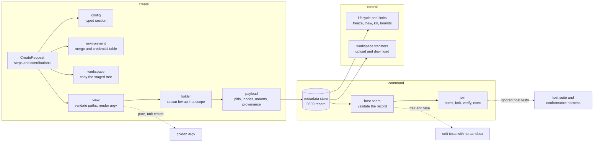

# Linux Bubblewrap Provider Plan

## Approach

The questions the spec would otherwise have carried as assumptions were probed before planning, and the answers are T-033 to T-041 on the map. The host `sleep` holds pid 1 with a large integer duration. A client killed while its command runs leaves no zombie. 1779 individual binds reach a usable view in 4.2s and run a command, and the mount table holds one entry for each path. The seven namespace inodes stay identical across commands. This host has cgroup v2, a user manager and a scope that starts. The cgroup namespace can be joined unprivileged. The status document arrives long before the view is built. Four answers changed the design. The join enters seven namespaces because T-038 allows it, and it enters the namespace that owns the others first because T-041 shows the obvious order fails. create waits for the recorded mounts rather than for the status document, because T-039 measures a 4.2s gap on a large view and T-040 shows the last mount is the moment the view becomes usable. The payload validation expects one mount for each recorded path, because T-035 shows bwrap does not merge them. The backend is a new module beside Docker, at `src/backends/bubblewrap/`, reached through one new entry in the registry table. The Docker module is the shape to copy. It has a typed configuration section that only it parses, a payload type for its own record, the trait implementation, and unit tests beside each part. The work is staged so the tree compiles at every step and each stage is testable without a sandbox. First the pure core, which is the view, the path validation and the argv with its golden tests. Second the host seam, the payload and its validation, which are unit-testable against a fake. Third create, which covers the workspace copy, the environment and the holder with its status report. Fourth the join. Fifth lifecycle, limits and the degraded mode. Sixth enumeration, teardown, transfers and the crate's conformance suite. Seventh the registry entry, the documentation and the architecture rules. Two helpers move out of the Docker module instead of being copied. They are the provisioning step runner, and the create budget, transfer deadline and output cap, so the two backends cannot drift. Two registry tests use bubblewrap as the name of a backend that is not compiled in, and they move to a name no backend will take. The credential table is data in the backend module and is deliberately not configuration.

## Architecture

### Module layout

```text
src/
├── backends/
│   ├── registry.rs            one new table entry; two tests renamed
│   ├── shared.rs              run_steps, create budget, transfer deadline
│   │                          and output cap, moved out of Docker
│   ├── docker/                unchanged behaviour; uses the shared helpers
│   └── bubblewrap/
│       ├── mod.rs             BACKEND const, construct::build
│       ├── config.rs          memory-mb, tasks; unknown key is Misconfigured
│       ├── credentials.rs     the table as data, one test per family
│       ├── host.rs            Host trait, SystemHost, FakeHost for tests
│       ├── view.rs            Mount, path validation, argv
│       ├── holder.rs          the holder command, scope, spawn, status, teardown
│       ├── environment.rs     merge, withhold, read back from /proc
│       ├── workspace.rs       copy the staged tree, upload, download
│       ├── join.rs            descriptors, setns, second fork, statuses
│       ├── payload.rs         BubblewrapData v1 and its validation
│       └── backend.rs         the traits, readiness, capabilities
├── provision/prepare/         unchanged; produces the contributions
└── docs/docs/user/litterbox/  backends page and configuration reference
```




One trait covers every host read the backend makes. It reads a pid's existence, state, start time, uid, namespace inodes, environment and mount table. It reads and writes the scope's freeze, thaw, kill and limit files. It resolves binaries and reads a clock. `SystemHost` answers from `/proc`, cgroupfs and the file system. `FakeHost` answers from a table that a test fills in. That split is what lets the payload validation, readiness and lifecycle be unit-tested with no sandbox and no bwrap. The view is a value. It holds an ordered list of mounts, and each mount has a sandbox path and an access. The backend builds it from the request's contributions plus the holder command. Validation and rendering both take that value, so the object validated is the object rendered, and the golden test asserts the vector for a view the test constructed rather than for a request. The payload is the only thing that passes between processes. create writes it. Every later operation reads it through one validation function, and that function reports a different outcome for each operation, so teardown and inspection still work when the sandbox process is gone. Nothing in the module reads the caller's environment, the current configuration or another sandbox's state. The record is the whole input.

## Technologies

| Technology | Role |
|------------|------|
| Rust | The implementation language, edition 2024, with the standard library for paths, processes and maps. |
| libc | The one new direct dependency. It gives setns, fork, chroot, chdir, prctl, setresuid, setresgid, capset, execve, openat2 and waitpid. The crate is already in the tree through tokio and bollard. |
| bubblewrap | 0.8.0 or newer. It creates the namespaces, the private view and the status descriptor, and it blocks nested user namespaces. |
| systemd | The user manager. It gives the holder a transient scope, and gives pause, teardown and limits freeze, thaw, kill, memory.max and pids.max. The backend calls systemd-run at create and writes cgroupfs afterwards. |
| serde and toml | The record payload, which is versioned and refused when the version does not match. |
| tokio | The existing runtime. Starting the holder and waiting for its status runs on a blocking thread, as host preparation already does. |
| arch-lint | The repository's dependency rules. It gets a scope for the backend module and deny edges for what the module may not reach. |

## Components

### registry-entry

Make the backend selectable without changing the default

Add `(bubblewrap::BACKEND, bubblewrap::construct::build)` to the BACKENDS table behind `cfg(target_os = 'linux')`, and keep DEFAULT as docker. `construct::build` parses the section through `config.rs` and returns Selected with the lifecycle and limits facets and no forwarding facet. Rename the two tests that use bubblewrap as an absent backend to a name no backend will take. Add a test that asserts the entry exists on Linux and is absent elsewhere.


### config

Declare the section's keys in one place

`BubblewrapConfig` holds `memory-mb` and `tasks`, both optional, and both refused when zero. The type denies unknown fields, so a typo fails as Misconfigured and names the key. A project file that sets either key is reported and ignored, through the loader's existing rule. `settings()` returns `BubblewrapSettings` and mirrors `DockerConfig`.


### credentials

Withhold a credential before it is ever carried

The table is a const slice of lower-case name fragments in this module, grouped by family. The families are token, secret, password, key, signing, the source hosts and the cloud providers. One function takes a variable name and returns whether to withhold it, by substring match after lower-casing. No configuration key, no environment variable and no project input can change it. One unit test for each family names a real variable of that family.


### host-seam

Make every host read injectable

A `Host` trait declares the reads and writes listed in the architecture. `SystemHost` implements it over `/proc`, cgroupfs and the file system. `FakeHost` implements it over a table that a test fills in. The backend holds an `Arc<dyn Host>`, so a test constructs the backend directly. Nothing in the backend opens `/proc` except through this trait.


### view

Build, validate and render the sandbox view

`Mount` holds a sandbox path and an access of ReadOnly or ReadWrite. `View` holds the ordered mounts plus the workspace and the root. `build()` validates each contributed path. The path must sit beneath the store root, must not be a protected root, the home, the metadata directory or the state directory, must not be a socket, device or FIFO, and must not overlap the workspace. The backend opens each accepted path once with `O_PATH` through `openat2` with `RESOLVE_NO_SYMLINKS | RESOLVE_NO_MAGICLINKS`, and the renderer emits the descriptor, so the golden argv holds `/proc/self/fd` numbers. `render()` produces the whole vector, which covers the seven namespaces, the nested-userns block, the private root and its proc, dev, tmpfs and home, and the holder command's binds. A version constant in this module names the view rules that a payload was written under.


### holder command

Resolve the command that keeps the sandbox alive

Resolve `sh` and `sleep` from the host PATH, validate each one the way bwrap is validated, which means root-owned, not group or world writable, and a canonical path, and bind them with the interpreter and libraries the host's loader resolves for them. This is the mechanism's only requirement: the sandbox's own userland is what the provisioning steps contribute, and the backend assembles no `PATH`. Readiness reports a missing or untrusted holder command as Unavailable and names the requirement.


### environment

Assemble the sandbox environment and read it back

`merge()` folds the contributions in order through `Contributions::environment_for` with the sandbox workspace path. It then applies the credential table and the ungranted-path rule, which splits a value on ':' and withholds the variable when an absolute element is neither equal to nor beneath a granted mount. Finally it sets HOME, TMPDIR, PWD and PATH. The result goes to the launcher spawn with a cleared environment, and the renderer emits neither `--setenv` nor `--clearenv`, so no value reaches an argv. `read_back()` parses `/proc/<sandbox pid>/environ`, which is NUL separated, for a command. Provenance records withheld names as Removed and the backend's own names as Set.


### workspace

Materialise and transfer the workspace

`copy_from()` copies the staged TempDir into the workspace inside the state directory, opening each component without following a link. A symlink, device or FIFO is refused and named. `transfer_in()` and `transfer_out()` resolve inside an `O_PATH` descriptor for the workspace, with `RESOLVE_BENEATH | RESOLVE_NO_SYMLINKS`. download copies a directory recursively, keeps its modes and keeps a symlink as a symlink, which is what the orchestrator's snapshot commits. Every path the backend gives bwrap comes from the state root and the sandbox name, so a source path with spaces never reaches the argv.


### holder

Start the sandbox and prove it started

Builds the spawn. It is bwrap with the rendered argv, all three standard streams null, a cleared environment that holds only the assembled sandbox environment, and `systemd-run --user --scope --unit` when a scope is available. Reads the status report from its descriptor with a timeout. Then waits for the view, polling the mount table until every recorded mount is present with its recorded access, because the status report arrives before setup finishes (T-039). Returns no sandbox when the report is absent or malformed, or when the view does not complete within the budget, which is a create failure that names the stage and carries a bounded excerpt of stderr. The sandbox is detached: no parent-death tie and no new session. `teardown()` kills the sandbox pid, writes `cgroup.kill` when a scope exists, waits for the namespace to empty, and then removes the state directory.


### join

Run one command inside the sandbox

Opens the seven namespace descriptors and the root descriptor before joining anything, then forks. The child joins the user namespace that owns the other namespaces first, which it reaches through the descriptor with `NS_GET_USERNS`, then the six namespaces, then the sandbox's own user namespace, because the order that `nsenter` accepts fails with EPERM when the calls are made directly (T-041). It forks again, so the grandchild is a member of the pid namespace. The grandchild closes descriptors above 2, chroots through the pinned root descriptor, changes to the workspace, sets no-new-privileges, calls setresuid and setresgid with the already-mapped ids, clears capabilities, reads `/proc/self/ns` and compares it with the record, and then calls execve with the environment read back from the sandbox. It never calls setgroups. Reserved statuses come from one table with one status for each step, and the parent maps each status to an error.


### payload

Hold everything a later process needs

`BubblewrapData` version 1 holds the payload version, both pids with their start times, the seven inode numbers, the uid, the root device and inode, the mounts with their access, the host and sandbox workspace paths, the scope unit, the paused flag and the provenance. `from_record()` refuses a higher version as unreadable, and refuses a lower version or a missing field as Unavailable with the remedy of deleting and recreating. `into_value()` serialises to toml. This module asserts the metadata store's 0600 file and 0700 directory instead of assuming them.


### payload-validation

Decide for each operation whether the record still describes a live sandbox

One function returns an outcome rather than an error. The outcomes are Absent, Forbidden, Editions and Live. The checks are that the pid exists, is not a zombie, its uid and start time match, all seven inodes match, the root descriptor's device and inode match, and the live mount table holds each recorded mount with its recorded access and no other host path. exec, pause, resume, set_limits, upload and download turn Absent into NotFound. inspect and list turn it into Missing. delete treats it as already torn down. Forbidden becomes Denied and Editions becomes Unavailable.


### lifecycle-limits

Give pause, resume and bounds a meaning at the sandbox level

Lifecycle writes `cgroup.freeze` and confirms the pause by sampling cumulative CPU time from `/proc` until the value stops changing within a fixed window. It thaws and reports a failure if the value never settles. Resume thaws and records the sandbox as running. Without a scope, and only after the user accepts, pause is a stop-and-rescan loop over the pid namespace and resume continues every member. Limits writes `memory.max` and `pids.max` on the scope and reports a failed write as a failure. Readiness reports the scope as Degraded with a Fallback entry when it is absent, and `capabilities()` replaces the facet's pause and limits entries with that state, so the listing cannot offer a bound the host cannot apply.


### backend-impl

Implement the contract and the facets

`Backend` has create, list, exec, upload, download, inspect, delete, readiness, capabilities and `contribution_support` with both sorts Available. `Lifecycle` and `Limits` are described above. create refuses ports with Unsupported and names forwarding, refuses on any readiness check that is not available except the cgroup one, and refuses a duplicate name with Conflict before it starts a process. inspect reports egress Denied, the workspace path, the recorded provenance and no forwards. list rebuilds the payload from the state directory for both scopes and reports a corrupt entry instead of dropping it. create runs the sandbox steps through the shared runner and the shared budget.


### shared-provisioning

Stop the two backends from drifting

Move `run_steps`, the create budget, the upload deadline and the output cap out of `backends/docker/backend.rs` into `backends/shared.rs` with `pub(crate)` visibility. Docker imports them and changes no behaviour. The provenance and failure types stay where they are, and only the runner and the constants move. Docker's existing tests must pass untouched, which is what proves the move changed nothing.


### tests

Cover the refusals as well as the happy path

Unit tests use `FakeHost` and the renderer. They cover the golden argv and its invariants, the payload round trip and both version directions, each validation outcome, the credential families, the ungranted-path rule, the holder command, the readiness states and remedies, and the mapping from reserved status to error. The host suite is ignored by default and skips with the missing requirement named. It covers create, two commands, the shared pid and loopback, and delete. It keeps the probes from T-033 to T-041 as regression checks, including that create does not return before the view is built. It covers a recycled pid, a foreign holder with a writable root, a symlink planted in the workspace, and the crate's conformance suite for duplicate create, transfers, delete idempotency and inspection after delete.


### registration-and-docs

Make the backend usable and keep the rules honest

Add the registry entry and its platform test. Extend the backends page with the bubblewrap section, its keys, its readiness lines, the degraded mode and the ports refusal. Extend the user configuration reference. Add the record and mount vocabulary to CONTEXT.md. Add an arch-lint scope for `src/backends/bubblewrap/**` with deny edges to the orchestrator, the command line and MCP code, persistence, SCM and provision preparation, and add a negative fixture for each edge.


## Data Flow

Create resolves the sequence and prepares the host steps before the branch exists, exactly as it does for Docker, so the request arrives with the contributions already captured. The backend merges those contributions in order, withholds whatever the credential table or the ungranted-path rule rejects, and adds HOME, TMPDIR and PWD. It copies the staged workspace into its state directory. It builds the view from the holder command plus the contributed mounts, validates every path and keeps the descriptors it opened. Then it renders one argv and starts bwrap inside a user scope with a cleared environment. It waits for the status report, waits for every recorded host path to appear in the mount table, and on success writes the payload, which holds both pids with their start times, the seven inodes, the uid, the root identity, the mounts with their access, the workspace paths, the scope unit and the provenance. The orchestrator stores that record together with the branch. A later command comes from a different process. That process reads the record, asks the host seam whether the record still describes a live sandbox, and only then opens the seven descriptors, forks, calls setns, forks again, drops what it inherited and execs with the environment read from the sandbox. Inspection, pause, resume and delete run the same check first. delete treats an absent sandbox as already torn down, so a crashed sandbox stays removable. Machine-wide pause reads the state directory, rebuilds each payload and drives the lifecycle facet, which is the same path a project-scoped listing takes.


## Deployment

There is no new binary, service or dependency beyond one crate that is already in the tree. Everything goes into agentkit-litterbox and is compiled on Linux only. On another platform the registry does not list the backend, and no other backend changes. A machine that selects nothing keeps Docker, and a project that lists only docker is refused before create as it is today. The backend needs bubblewrap and a shell on the host, and it needs systemd only for the scoped mode. Without a scope it still creates sandboxes once the user accepts the degradation. The state directory sits beside the metadata store under the application data directory, with one tree for each sandbox, and delete removes it. Host tests are selected separately from unit tests, so a CI machine without bubblewrap skips them and names the missing requirement instead of passing without testing anything. The project's architecture rules gain a scope and its deny edges in the same change, so the module cannot reach the orchestrator, the tools, persistence or SCM by accident.

