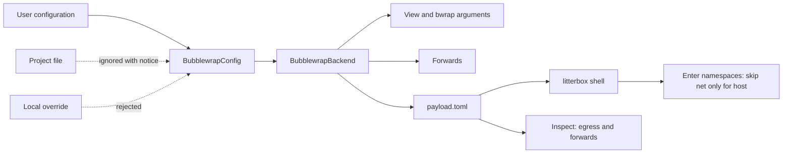

# Bubblewrap Network Setting Plan

## Approach

The `network` setting and its documentation already exist. This plan corrects the places where the code disagrees with the setting, and adds the proof the spec requires. Four code paths change. `join.rs` stops comparing the caller's namespaces and skips only the network namespace when `payload.toml` says `host`; it still checks all seven namespace numbers. `backend.rs` reports the `egress` field from `payload.toml` for both live and dead sandboxes, and returns the payload error when the file cannot be read. The `Forward` construction becomes fallible, so a bad port name is an error rather than a dropped port. `view.rs` keeps the host DNS and TLS mounts and gets tests for both settings. No lifecycle code, payload version, holder code or state directory is touched. Tests come in three layers: unit tests for parsing and decisions, golden argument tests per setting, and ignored real-sandbox tests for the namespace numbers and the listener. The provider spec's FR-003 is amended to match the new skip rule. The one fact the spec asserts without a probe in this repository is that entering the host's network namespace fails with EPERM. The brief reports that `nsenter --net=/proc/1/ns/net` fails; the ignored test in FR-006 is the direct check. The plan keeps the skip for both outcomes: if entering the host network namespace unexpectedly succeeds, entering it adds nothing because the sandbox already shares it, so skipping remains correct.

## Architecture

## Technologies

| Technology | Role |
|------------|------|
| Rust | The implementation language for the backend and its tests |
| libc | Provides setns, fork, waitpid and execve for entering namespaces |
| bubblewrap | Creates the sandbox and its namespaces |
| systemd user scope | Keeps the sandbox alive and provides freeze, kill and limits; unchanged by this work |
| serde and toml | Reads and writes payload.toml |
| nc | Starts the listener inside the sandbox for the real-sandbox test; /run/current-system/sw/bin/nc on this host |

## Components

### config.rs and config_loader.rs

Parse and enforce the setting

Add explicit tests for denied, host, the default, an unknown value, an unknown key, the project-file notice and the local-override error. No merge logic changes: the existing split already ignores project backend settings and rejects local ones.

### backend.rs: create

Build forwards and refuse ports

Replace the filter_map with a function returning Result<Vec<Forward>, Error>; a bad forwarded_port_env_var is an error. Keep Unsupported for denied with ports.

### backend.rs: inspect

Report the recorded egress

Use data.network for both the live and absent branches; the absent branch currently hardcodes Denied. An unreadable payload remains Verdict::Editions.

### view.rs

Render the arguments and the host mounts

Add tests that denied has --unshare-net and host does not, and that host requests /etc/resolv.conf, /etc/hosts, /etc/nsswitch.conf and /etc/ssl. The renderer already does this; the tests are the work.

### join.rs

Skip only the host network namespace

Replace the seven-way caller comparison with a pure function of data.network. The child skips CLONE_NEWNET only for host; namespaces_match still compares all seven. A unit test checks the decision; the ignored host test checks the real numbers.

### payload.rs

Record the posture and forwards

The v2 fields already exist. Add a round-trip test for network = host and a Forward. Do not change the version or add v1 compatibility.

### Tests and evidence

Prove it

Add the ignored host and denied tests, run them, and write the commands, namespace numbers and listener output to evidence.md. Amend the provider spec's FR-003.

## Data Flow

A user runs create through the MCP `sandbox-create` tool. The configuration loader merges the user configuration and the project file. The project's `network` is ignored and the user's value or the default is used. The backend builds the view and the forwards, renders the bubblewrap arguments, and writes `payload.toml`. A later `litterbox shell` reads `payload.toml`, opens `/proc/<sandbox-pid>/ns/*`, and decides whether to skip the network namespace. It enters the remaining namespaces, forks, checks the seven numbers, and execs. A later inspection reads `payload.toml` and returns `egress` and `forwards`.

## Deployment

Linux only, as today. No new package, daemon, socket, proxy or process. The host setting needs `/etc/resolv.conf`, `/etc/hosts`, `/etc/nsswitch.conf` and `/etc/ssl`; a missing path is skipped and the sandbox still has the host's network. The ignored real-sandbox tests need bubblewrap, unprivileged user namespaces and a cgroup scope, all of which this host has. They run with `cargo test -p agentkit-litterbox -- --ignored` and write `evidence.md`. Docker and the default denied setting are unchanged.

