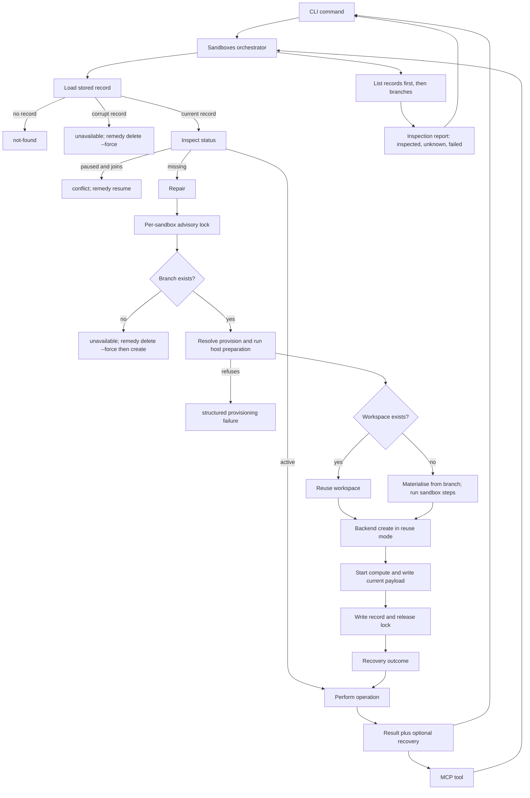

# Sandbox Lifecycle Consistency and Recovery

## Approach

No requirement in the spec is marked as an assumption. The plan treats the motivating incident as the shape to satisfy: a current record, a live branch, an existing workspace, dead recorded pids and an unreadable version 1 payload. The implementation is one gate in the orchestrator, not a new lifecycle verb. Every operation that needs live compute calls the gate; the gate loads the record, asks the backend for status, refuses a paused sandbox before a join, and repairs a missing one by asking the backend to create compute against the existing name, branch and workspace. The backend's status check reads only the recorded pids, so an unsupported payload version still reports missing when the compute is gone. Create and repair therefore share the compute phase, and repair never creates or deletes a branch. A per-sandbox cross-process advisory lock serialises the check-repair-write sequence so two callers cannot both start compute. The backend gains a create mode that distinguishes a fresh sandbox from one whose state directory already exists; bubblewrap reuses the workspace, materialises from the branch only when the workspace is gone, writes a current payload, and leaves the previous state alone on failure. Docker keeps its behaviour and reports the reuse mode as unsupported with a delete-and-recreate remedy. Port forwarding and egress posture stay with the network ADR; this plan only fixes whether those operations repair or block. The surfaces gain no new verbs: the CLI prints a warning and MCP appends a structured recovery block, both produced from the same orchestrator outcome. Teardown moves its confirmation into the orchestrator so missing and corrupt records have one path, and enumeration becomes record-first so a record without a branch is visible.

## Architecture

The change stays inside `agentkit-litterbox` and crosses four boundaries that already exist.

```text
src/
├── sandbox/
│   ├── contract.rs        Error::Paused, CreateMode, Teardown, Backend::delete signature
│   └── mapping.rs         paused maps to conflict
├── orchestrator/
│   ├── service.rs         ensure-live gate, create/repair split, record-first list, delete policy
│   ├── lock.rs            per-sandbox flock plus in-process guard
│   └── outcome.rs         Performed<T>, Recovery, InspectionReport, Deletion
├── backends/
│   ├── bubblewrap/
│   │   ├── backend.rs     create in Fresh and ReuseExisting modes, atomic payload, Teardown
│   │   ├── payload.rs     version-tolerant pid probe for liveness
│   │   └── workspace.rs   state directory lookup and materialise-or-reuse helper
│   └── docker/backend.rs  ReuseExisting reports Unsupported; delete returns Teardown
├── cli.rs                 paused report, record-first listing, delete --force, recovery warning
├── mcp.rs                 recovery content block; no new tool names
├── mcp/error.rs           paused reason and remedy in the error data
├── docgen.rs              lifecycle tables and recovery prose
└── metadata_store.rs      enumerate every record file, including corrupt ones
```

The contract gains the smallest vocabulary the surfaces need. `Error::Paused` is one variant, not a per-surface string. `CreateMode` is `Fresh` or `ReuseExisting`. `Backend::delete` returns `Teardown` so the orchestrator can say whether compute was stopped and which state paths were removed without knowing a backend's layout. Recovery, `Performed<T>`, `InspectionReport` and `Deletion` stay in the orchestrator because they describe an orchestrated outcome rather than a mechanism.

The gate is `Sandboxes::ensure_live(name, PausedPolicy)`. It loads the stored record, selects the backend that wrote it, asks for inspection, and then does one of four things: returns no recovery for active, returns `Error::Paused` when the policy is `Refuse`, repairs when missing, or returns the backend's neutral failure when it cannot be asked. Repair takes the lock, re-reads status, confirms the branch exists, resolves provisioning against current project configuration, stages the branch as the fallback workspace source, and calls the backend's create in `ReuseExisting` mode. The record is rewritten only after the backend returns a live record. The branch is never created here.




## Technologies

| Technology | Role |
|------------|------|
| Rust 2024 | The crate already builds on edition 2024; the work uses existing language features and adds no crate |
| tokio | Existing async runtime; the lock holds an async in-process guard and performs the blocking flock call on a blocking task |
| serde and toml | Records, recovery blocks and inspection reports; the existing derive style is reused |
| libc | `flock` for the cross-process per-sandbox lock; already a dependency and already used by the bubblewrap backend |
| git2 and the SCM module | Branch existence checks and branch archives; repair stages the sandbox branch rather than HEAD |
| clap | The existing CLI surface; `delete --force` help and the new listing output |
| rmcp and schemars | Existing MCP tools; the recovery block is another content block and the tool list is unchanged |
| agentkit-common and adr-build | Platform directories and the existing exit taxonomy; spec and plan rendering stay with the existing scripts |

## Components

### Contract additions

The vocabulary shared by every surface

Add `Error::Paused { name }` with a message that names `litterbox resume <name>` and maps to `FailureClass::Conflict` (FR-008, FR-009). Add `CreateMode { Fresh, ReuseExisting }` to `CreateRequest`; every constructor and test fixture sets `Fresh` except the repair path (FR-002). Add `Teardown { compute_stopped: bool, state_paths: Vec<PathBuf>, detail: Option<String> }` and change `Backend::delete` to return it, so teardown can report what it removed and what it could not stop (FR-012, FR-013). No container or namespace vocabulary enters the contract.


### Orchestrator outcomes

One outcome type for recovery, listing and deletion

Add `Recovery { sandbox, from: SandboxStatus, action, branch }`, `Performed<T> { value, recovery: Option<Recovery> }`, `InspectionReport { Inspected(Inspection), Status { name, backend, status: SandboxStatus, reason } }` and `Deletion { record_path, state_paths, branch, compute_stopped }`. The status-only variant carries `SandboxStatus::Unknown` when the backend cannot be asked and `SandboxStatus::Error` when it answered with a refusal, so the declared vocabulary is actually constructed. These are serialised only where MCP needs them; the CLI formats them itself. `Performed` is returned by create, exec, upload, download and snapshot so every repair has exactly one carrier (FR-014).


### Ensure-live gate

One place decides live, paused or missing

`Sandboxes::ensure_live(name, policy)` loads the current record, selects the backend that owns it, inspects once and branches. Missing acquires the lock, re-inspects, confirms the branch through `Scm::list_sandboxes`, resolves provisioning, stages the branch and calls create with `ReuseExisting` (FR-001, FR-002). Active returns no recovery. Paused returns `Error::Paused` when the policy is `Refuse`. A backend that cannot be asked returns its neutral failure. The gate is idempotent and is called by exec, upload, download and snapshot; forwards and sandbox-ports do not call it (FR-001).


### Repair failure paths

Refuse without half-repairing

A missing branch returns `unavailable` with the remedy `litterbox delete --force <name>` followed by create; the branch is never recreated. A record without a branch is still listed, and delete can remove it. A preparation refusal returns its structured provisioning failure and starts no compute. A backend that cannot be asked returns its readiness failure. A spawn or readiness failure tears down what started and leaves the previous payload and workspace in place. No path writes a partial payload, deletes the branch, or leaves a half-repaired directory (FR-006, NFR-001, NFR-003, EC-003, EC-005, EC-007, EC-009, EC-014, EC-017).


### Create and repair split

Create and repair share the compute phase

Split `create` into branch creation, provisioning resolution and compute creation. Fresh create keeps the current order: create the branch, stage HEAD, create compute, persist the record, and remove the branch if compute fails. Repair skips branch creation, stages the sandbox branch only as the fallback workspace source, calls compute creation, and rewrites the record. `create` on an existing active or paused record returns conflict; on an orphan branch it returns conflict and does not adopt it (FR-002, FR-007, EC-008, EC-012).


### Per-sandbox lock

One repair per sandbox across processes

`orchestrator/lock.rs` creates `records_dir/.locks`, takes an async in-process guard keyed by sandbox name, then opens `<name>.lock` and takes `flock(LOCK_EX)` on a blocking task. The guard is held from the status re-check through the record write. Drop closes the file and releases the advisory lock; process exit releases it too. Non-unix builds fall back to the in-process guard only (FR-005, NFR-004, AC-009).


### Paused refusal

No join into a frozen sandbox

`Sandboxes::exec` inspects the status before selecting the join path. A paused sandbox returns `Error::Paused` and the backend is never asked to exec (FR-008). Upload, download and snapshot pass `PausedPolicy::Allow`; they do not join. `list`, `forwards`, pause and resume keep their paths. The mapping layer derives exit 4 and MCP `invalid_params` from the one variant, and `mcp/error.rs` adds `reason` and `remedy` to the error data (FR-009).


### Record-first listing

Every record and every branch

Add `metadata_store::entries_in(dir)` returning one entry per `.toml` file with either a loaded record or the read error, so a corrupt or unreadable record is not silently dropped. `Sandboxes::list` fills current and corrupt records first, sorts them, then enumerates branches and adds only those whose name has no record to `orphans`. A branch enumeration failure is recorded in `Listing::branch_error` rather than discarding the records (FR-011, AC-003).


### Inspection reports

Unknown is a report, not a fabricated inspection

`Sandboxes::inspect_listing` returns `Vec<(String, InspectionReport)>`. A backend selection or readiness failure maps every record to `Status { status: Unknown, reason }`. A per-record ownership or inspect failure maps to `Status { status: Error { reason }, ... }`. Only a successful backend inspection becomes `Inspected` (FR-010). `cli.rs` renders the status with `status_label`, prints `unknown` only for `Unknown`, `error: ...` for `Error`, and exits 1 for either. Missing status stays exit 0 (AC-003).


### Teardown policy

Delete states what it removes and needs confirmation

Move the active check into `Sandboxes::delete(name, force)`. A current record is inspected: active, missing, unknown or error without `--force` returns `Denied` with a message naming record, workspace and branch and the unmerged-work warning; paused keeps its current path. With force, the backend deletes compute and returns `Teardown`, the branch is deleted, the record is removed, and `Deletion` is returned to the CLI (FR-012). A corrupt or unreadable record with force skips payload parsing, removes the record file, deletes the deterministic branch, calls the backend best-effort with an empty payload, and reports `compute_stopped: false` when the backend cannot identify compute (FR-013, EC-013, EC-019).


### Version-tolerant liveness probe

Missing is decided without the full payload

`payload.rs` parses only the recorded pids and their start times, regardless of payload version. `validate` uses that probe before it judges the full payload: a gone pid is `Absent`, so inspect reports `Missing` for the incident's version 1 record; a live pid with an unsupported payload is `Unavailable`, not `Missing`, so repair cannot take over compute it cannot validate; a payload with no readable pid is `Unavailable` and repair refuses with the delete remedy (NFR-002, EC-001, EC-004). The probe never feeds a join, a signal or a cgroup write. It only decides absence.


### Bubblewrap create modes

Reuse or materialise the workspace without reading the payload

`BubblewrapBackend::create` checks `CreateMode`. `Fresh` keeps the existing state-directory conflict and copy-from-source path. `ReuseExisting` checks liveness through the pid probe: absent proceeds, live returns conflict, no readable pid returns unavailable with the delete remedy. It does not call the full payload reader. It reuses `workspace/` when it exists and sets `materialised = false`; otherwise it creates the workspace from the request source and sets `materialised = true`. It builds the view and environment from the resolved request, starts the holder, waits for readiness, applies limits, runs sandbox provisioning steps only when `materialised`, and writes the payload atomically after readiness. Stale status and diagnostic files are overwritten when the new holder starts. On failure it tears down the holder and removes only a workspace it created, leaving the previous payload and workspace in place (FR-003, FR-004, NFR-002, EC-017, EC-018).


### Bubblewrap teardown

Report compute and state paths

`delete` parses the payload when it can, tears down a live sandbox and reports `compute_stopped: true`; an unreadable payload yields `compute_stopped: false` with the reason. It removes the state directory and returns it in `Teardown.state_paths`. The Docker backend returns its container-level equivalent; the test backend returns an empty path list.


### Docker backend

No behaviour change

Docker keeps its current create path for `Fresh`. `ReuseExisting` returns `Unsupported`, naming the missing recovery path and the remedy `litterbox delete --force <name>` followed by create. `delete` returns `Teardown` with the container id in `detail` and no state paths. No Docker record format changes (NFR-005).


### CLI surface

Warnings, confirmation and record-first output

`handle_shell` prints `performed.recovery` as a stderr warning before stdout. `handle_list` renders `InspectionReport` and the new record-first `Listing`. `handle_delete` passes `force` to the orchestrator and prints `Deletion` fields. The `delete --force` help says it covers active and missing sandboxes and that a missing sandbox's branch may hold unmerged work. No command is added (FR-015, FR-016).


### MCP surface

Recovery block, same tool set

Add a helper that turns `Option<Recovery>` into a second `ContentBlock::json` block. `sandbox-create`, `bash`, `read`, `write`, `patch`, `ls`, `glob` and `grep` append it when the orchestrator reports a repair; `sandbox-ports` never does. `exec_in_sandbox` and the helpers it feeds return `Performed<T>` so a repair inside a write or patch is not lost. A failed snapshot after a successful write keeps its existing warn-and-succeed behaviour, but a snapshot that repairs also contributes its recovery block (FR-014, FR-015).


### Documentation and docgen

One lifecycle story on every page

Update `lifecycle.mdx` state diagram and matrices: missing repairs on the next operation; paused commands refuse with conflict; delete on missing needs `--force`; corrupt records are removed with `--force`; list reports records and branches including unpaired entries; sandbox-ports is record-only. Mirror the operation tables in `docgen.rs`, add the recovery prose, and regenerate `reference/cli.mdx` and `reference/mcp.mdx` with `cargo run -p agentkit-litterbox -- docgen cli` and `cargo run -p agentkit-litterbox -- docgen mcp` (FR-016, NFR-007).


### Lifecycle tests

Every matrix cell and the incident

Add a table-driven orchestrator test over active, paused, missing, corrupt and orphan records for list, exec, upload, download, snapshot, pause, resume, delete and create. Extend `TestBackend` with a missing state, a `CreateMode` log and an exec counter so repair, skip-on-active, paused refusal and single-repair-under-concurrency are observable. Add a regression fixture with a current record, a live branch, a state directory, dead pids and a v1 payload; assert the backend is called with `ReuseExisting`, the branch from the record, the existing workspace preserved and a recovery outcome returned. Add probe tests for a v1 dead pid, a v1 live pid and a v1 payload with no readable pid. Add tests for a branch that is gone, a record without a branch, a preparation refusal, a stale status file and an unreadable-payload delete without force. Add an ignored host test against real bubblewrap for create, kill, exec-repair and workspace preservation (NFR-006, AC-001, AC-004, AC-009).


## Data Flow

A command tool call enters the MCP helper or `litterbox shell`. The orchestrator loads the record and asks the selected backend to inspect. Active returns no recovery and the operation proceeds. Paused and joining returns `Error::Paused`; the CLI prints the resume command and exits 4, and MCP returns `invalid_params` with class `conflict`, the reason and the remedy. Missing takes the per-sandbox lock, re-inspects, confirms the branch, resolves provisioning against current project configuration, stages the branch as the fallback source, and calls the backend create with `ReuseExisting`. Bubblewrap reuses the workspace when it exists, otherwise materialises it from the branch and reruns the sandbox steps, starts compute, waits for readiness and writes a current payload. The orchestrator rewrites the record, releases the lock, returns `Recovery`, and the operation runs against the new compute. If the branch is gone, the record is unreadable, the backend is unavailable or preparation refuses, the gate returns the neutral failure and leaves the record and workspace untouched. The CLI writes the recovery warning to stderr; MCP appends the structured block to the tool result. `sandbox-create` follows the same repair path when the name is missing and returns conflict otherwise.

Enumeration starts from the metadata directory, not from branches. Every record is loaded and classified as current, corrupt or unreadable; branches are then read and only names with no record become orphans. Each current record is inspected; a backend that cannot be asked yields `SandboxStatus::Unknown` for every record, a per-record refusal yields `SandboxStatus::Error` with the reason, and missing remains a normal status. The backend's inspect reports missing for a dead pid even when the full payload is an unsupported version; a live pid with an unsupported payload is unavailable, not missing. `delete` inspects a current record, refuses active or missing without force, and with force removes compute through the backend, then the branch, then the record. A corrupt record skips the payload and reports compute it could not stop.


## Deployment

No new binary, service, crate or runtime. The binary and package are unchanged, and the existing `cargo test` and `cargo clippy` commands verify the change. The metadata directory gains a `.locks` subdirectory; records and state directory layout are unchanged. Lock files are empty and are ignored by record enumeration because it reads only `.toml` files. An upgrade needs no migration: a record with an unreadable payload remains reported, becomes removable with `delete --force`, and becomes repairable from its branch and workspace. Docker keeps its current behaviour and refuses the reuse mode with the delete-and-recreate remedy, so Docker users see no change beyond the documented paused refusal and the `delete` confirmation. The generated reference pages are regenerated in the same change; a hand edit is still lost on the next `docgen` run. The architecture rules in `arch-lint.toml` do not change because the new modules sit inside the existing orchestrator and backend scopes.

