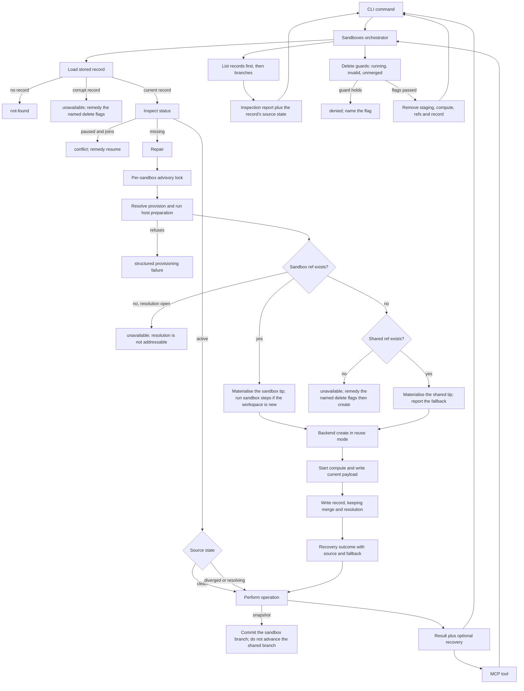

# Sandbox Lifecycle Consistency and Recovery

## Approach

No requirement in the spec is marked as an assumption. The plan treats the motivating incident as the shape to satisfy: a current record, a live branch, an existing workspace, dead recorded pids and an unreadable version 1 payload. The implementation is one gate in the orchestrator, not a new lifecycle verb. Every operation that needs live compute calls the gate; the gate loads the record, asks the backend for status, refuses a paused sandbox before a join, and repairs a missing one by asking the backend to create compute against the existing name, branch and workspace. The backend's status check reads only the recorded pids, so an unsupported payload version still reports missing when the compute is gone. Create and repair therefore share the compute phase, and repair never creates or deletes a branch. A per-sandbox cross-process advisory lock serialises the check-repair-write sequence so two callers cannot both start compute. The backend gains a create mode that distinguishes a fresh sandbox from one whose state directory already exists; bubblewrap reuses the workspace, materialises from the branch only when the workspace is gone, writes a current payload, and leaves the previous state alone on failure. Docker keeps its behaviour and reports the reuse mode as unsupported with a delete-and-recreate remedy. Port forwarding and egress posture stay with the network ADR; this plan only fixes whether those operations repair or block. The surfaces gain no new verbs: the CLI prints a warning and MCP appends a structured recovery block, both produced from the same orchestrator outcome. Teardown moves its confirmation into the orchestrator so missing and corrupt records have one path, and enumeration becomes record-first so a record without a branch is visible.

## Amendment 2026-11-24

The split in `adrs/2026-11-22-adopt-rewritten-branches` changed the durable state under this plan. The gate and the lock stay; the repair source, the state vocabulary and the delete policy change.

- **Repair source.** `repair` reads `sandbox_tip` (`refs/litterbox/workspaces/<name>`) before `tip` (`litterbox/<name>`). It materialises the sandbox tip whenever that ref exists; it falls back to the shared tip only when the sandbox ref is absent, and `Recovery` gains `source` and `fallback` so the CLI and MCP report which happened. When both are absent it keeps the existing `unavailable` remedy. The one exception is an open resolution with no sandbox ref: the revision under resolution is not addressable, so repair refuses with the recorded `synced`/`ours` and the VCS recovery (reflog/fsck or op log/workspace add), and both status surfaces show the same continuation instead of failing.
- **Source states.** `WorkspaceBlock.state` becomes `clean`, `diverged` or `resolving`. `diverged` replaces `held`; `resolving` is derived from `StoredResolution::is_some()` and wins when both hold. `source_status` reports the same three values with the reason and the resolution. Neither state changes the gate: no tool is refused and compute is not touched.
- **Paused refusal.** `begin_resolution`, `finish_resolution` and `abandon_resolution` call the same paused check as `exec` before they touch the workspace. `source_status` does not, so `sandbox-status` answers while paused.
- **Delete guards.** `delete(name, force)` becomes `delete(name, guards)`, where the guards are three booleans carried from `--ignore-running`, `--ignore-invalid` and `--ignore-unmerged`. `--force` is removed. Each guard is checked and reported separately; `Deletion` carries the refs and staging workspace it removed so the CLI can print them. Missing and paused records need no compute guard.
- **Documentation and tests.** The lifecycle page, `docgen.rs` and both generated pages gain the source-state matrix and the delete flags. The matrix tests gain a `diverged` repair that materialises the sandbox branch, a paused `sandbox-reconcile` refusal, and one case per delete guard and per combination.

The amendment adds no crate, no module outside `orchestrator`, `cli` and `mcp`, and no VCS implementation detail. `Vcs::sandbox_tip` already exists; the orchestrator only chooses which revision to hand `materialise`.

## Architecture

The change stays inside `agentkit-litterbox` and crosses four boundaries that already exist.

```text
src/
├── sandbox/
│   ├── contract.rs        Error::Paused, CreateMode, Teardown, Backend::delete signature
│   └── mapping.rs         paused maps to conflict
├── orchestrator/
│   ├── service.rs         ensure-live gate, create/repair split, repair source, record-first list, delete guards, source status
│   ├── source.rs          the pure plan and the clean/diverged/resolving axes
│   ├── reconcile.rs       the plan adapter; the workspace block
│   ├── resolve.rs         begin, finish and abandon; paused check, keeps the record
│   ├── lock.rs            per-sandbox flock plus in-process guard
│   └── outcome.rs         Performed<T>, Recovery with source/fallback, InspectionReport, Deletion
├── backends/
│   ├── bubblewrap/
│   │   ├── backend.rs     create in Fresh and ReuseExisting modes, atomic payload, Teardown
│   │   ├── payload.rs     version-tolerant pid probe for liveness
│   │   └── workspace.rs   state directory lookup and materialise-or-reuse helper
│   └── docker/backend.rs  ReuseExisting reports Unsupported; delete returns Teardown
├── cli.rs                 paused report, record-first listing, delete guards, recovery warning
├── mcp.rs                 recovery content block; same tool names
├── mcp/error.rs           paused reason and remedy in the error data
├── docgen.rs              lifecycle tables, source matrix and recovery prose
└── metadata_store.rs      enumerate every record file, including corrupt ones
```

The contract gains the smallest vocabulary the surfaces need. `Error::Paused` is one variant, not a per-surface string. `CreateMode` is `Fresh` or `ReuseExisting`. `Backend::delete` returns `Teardown` so the orchestrator can say whether compute was stopped and which state paths were removed without knowing a backend's layout. Recovery, `Performed<T>`, `InspectionReport`, `Deletion` and `DeleteGuards` stay in the orchestrator because they describe an orchestrated outcome rather than a mechanism.

The gate is `Sandboxes::ensure_live(name, PausedPolicy)`. It loads the stored record, selects the backend that wrote it, asks for inspection, and then does one of four things: returns no recovery for active, returns `Error::Paused` when the policy is `Refuse`, repairs when missing, or returns the backend's neutral failure when it cannot be asked. Repair takes the lock, re-reads status, reads both branch tips, chooses the sandbox tip as the fallback workspace source, resolves provisioning against current project configuration, and calls the backend's create in `ReuseExisting` mode. The record is rewritten only after the backend returns a live record. Neither branch is created here.




## Technologies

| Technology | Role |
|------------|------|
| Rust 2024 | The crate already builds on edition 2024; the work uses existing language features and adds no crate |
| tokio | Existing async runtime; the lock holds an async in-process guard and performs the blocking flock call on a blocking task |
| serde and toml | Records, recovery blocks and inspection reports; the existing derive style is reused |
| libc | `flock` for the cross-process per-sandbox lock; already a dependency and already used by the bubblewrap backend |
| git2 and the VCS module | Branch existence checks and branch archives; repair materialises the sandbox branch rather than HEAD or the shared branch |
| clap | The existing CLI surface; `delete --ignore-running`, `--ignore-invalid`, `--ignore-unmerged`, and the listing output |
| rmcp and schemars | Existing MCP tools; the recovery block is another content block and the tool list is unchanged |
| agentkit-common and adr-build | Platform directories and the existing exit taxonomy; spec and plan rendering stay with the existing scripts |

## Components

### Contract additions

The vocabulary shared by every surface

Add `Error::Paused { name }` with a message that names `litterbox resume <name>` and maps to `FailureClass::Conflict` (FR-008, FR-009). Add `CreateMode { Fresh, ReuseExisting }` to `CreateRequest`; every constructor and test fixture sets `Fresh` except the repair path (FR-002). Add `Teardown { compute_stopped: bool, state_paths: Vec<PathBuf>, detail: Option<String> }` and change `Backend::delete` to return it, so teardown can report what it removed and what it could not stop (FR-012, FR-013). No container or namespace vocabulary enters the contract.

Delete options are not contract vocabulary: `DeleteGuards { running, invalid, unmerged }` lives in the orchestrator beside the policy it implements, and the CLI maps the three flags onto it. The contract keeps `Teardown` unchanged.


### Orchestrator outcomes

One outcome type for recovery, listing and deletion

Add `Recovery { sandbox, from: SandboxStatus, action, branch, source, fallback }`, `Performed<T> { value, recovery: Option<Recovery> }`, `InspectionReport { Inspected(Inspection), Status { name, backend, status: SandboxStatus, reason } }` and `Deletion { record_path, state_paths, branch, branches, compute_stopped, staging, unused }`. `source` is `sandbox` or `shared`; `fallback` names the missing sandbox ref when `shared` was used. `Deletion.branches` names the shared branch, the sandbox branch and the synced ref; `staging` names a removed staging workspace; `unused` names the guards whose flags were passed without their condition holding. The status-only variant carries `SandboxStatus::Unknown` when the backend cannot be asked and `SandboxStatus::Error` when it answered with a refusal, so the declared vocabulary is actually constructed. These are serialised only where MCP needs them; the CLI formats them itself. `Performed` is returned by create, exec, upload, download and snapshot so every repair has exactly one carrier (FR-014).


### Ensure-live gate

One place decides live, paused or missing

`Sandboxes::ensure_live(name, policy)` loads the current record, selects the backend that owns it, inspects once and branches. Missing acquires the lock, re-inspects, confirms the durable refs through the VCS, resolves provisioning, materialises the sandbox branch as the fallback workspace source, and calls create with `ReuseExisting` (FR-001, FR-002, FR-003). Active returns no recovery. Paused returns `Error::Paused` when the policy is `Refuse`. A backend that cannot be asked returns its neutral failure. The gate is idempotent and is called by exec, upload, download and snapshot; forwards and sandbox-ports do not call it (FR-001). A `diverged` or `resolving` record is live, so the gate neither refuses nor repairs it (FR-017).


### Repair failure paths

Refuse without half-repairing

A record with neither ref returns `unavailable` with the remedy `litterbox delete <name>` using the flags its refusal names, followed by create; neither ref is recreated. An absent sandbox ref alone falls back to the shared ref and is reported. A record with no refs is still listed, and delete can remove it. An open resolution with no sandbox ref refuses rather than falling back; that refusal and both status surfaces name the recorded `synced`/`ours` and the VCS continuation from FR-018. A preparation refusal returns its structured provisioning failure and starts no compute. A backend that cannot be asked returns its readiness failure. A spawn or readiness failure tears down what started and leaves the previous payload and workspace in place. No path writes a partial payload, deletes a ref, or leaves a half-repaired directory (FR-006, NFR-001, NFR-003, EC-003, EC-005, EC-007, EC-009, EC-014, EC-017, EC-020, EC-024).


### Create and repair split

Create and repair share the compute phase

Split `create` into branch creation, provisioning resolution and compute creation. Fresh create keeps the current order: create the branch, stage HEAD, create compute, persist the record, and remove the branch if compute fails. Repair skips branch creation, selects the materialise source from the sandbox tip first and the shared tip only as the reported fallback, calls compute creation, and rewrites the record. The record's `merge` and `resolution` are copied unchanged, so a held advance and an open resolution survive; an open resolution with no sandbox ref refuses rather than being cleared (FR-002, FR-003, FR-007, FR-018, EC-008, EC-012).


### Repair source

The sandbox branch before the shared branch

`repair` calls `Vcs::sandbox_tip` and `Vcs::tip` and chooses the revision it hands `Vcs::materialise` for the fallback workspace source. An `Ok(sandbox_tip)` is used whether or not it equals the shared tip; a `NotFound` from `tip` alone does not block repair when the sandbox ref exists. `NotFound` from `sandbox_tip` falls back to the shared tip only when `stored.resolution` is `None`; the recovery outcome records `source: shared` and a `fallback` naming `refs/litterbox/workspaces/<name>` and the VCS recovery (Git `fsck --lost-found` and `update-ref`, jj `op log` and `workspace add`). Two `NotFound` answers return the `unavailable` remedy from FR-006. With an open resolution, `NotFound` returns the same class with a reason naming the resolution, because `StoredResolution { synced, ours }` is not enough to rebuild the revision under resolution once its ref is gone (FR-003, FR-006, FR-014, FR-018, EC-020, EC-024).

The choice affects only the copied fallback source. A bound workspace is read in place and is never overwritten by repair; a copied workspace that already exists is reused by the backend's `ReuseExisting` mode. This is why the bug this fixes only bites when the workspace is gone or a bound directory was removed.


### Source states

`clean`, `diverged` and `resolving`

`WorkspaceBlock.state` and `SourceStatus.state` return `clean`, `diverged` or `resolving`. `diverged` replaces `held` and is set when the record has a stored merge or the shared tip reports conflicts. `resolving` is set when `stored.resolution` is `Some` and wins over `diverged`. `SourceStatus` gains a `reason` naming which divergence it is, and `WorkspaceBlock.reason` carries the same distinction: an unsaved-work divergence or a conflicted shared tip. `list` adds the record's source state without inspecting the workspace. No plan step changes: `proceed` still runs the tool, the snapshot still commits to the sandbox branch, and only the branch advance waits. `source_status` returns conflicts from the shared tip for `diverged`, and the resolution view for `resolving`. The resolver's `begin`, `finish` and `abandon` behaviour is unchanged; only the paused gate and the source-state reporting are new (FR-017).


### Repair with an open resolution

Keep, never clear

`repair` copies `stored.resolution` into the rewritten record. The workspace source is the sandbox tip, which is the revision under resolution; the Resolver continues to read the revision from the working copy. Repair does not call `resolve_begin`, does not call `set_sandbox_tip` and does not move the shared branch. Only `finish` and `abandon` clear the record field (`orchestrator/resolve.rs`). An absent sandbox ref with an open resolution returns `unavailable` per FR-018 with the shared continuation helper (FR-002, FR-018, EC-021, EC-024).


### Absent sandbox status

Answer with the recorded revisions, not an error

`Sandboxes::source_status` and `Sandboxes::report` load the record first. When the sandbox revision cannot be read and `stored.resolution` is `Some`, they return `state: resolving`, `sandbox: None`, the recorded `synced`/`ours`, and a `next` built by the same helper as the repair refusal. `SourceStatus` gains `ours` and `next` and a nullable `sandbox`; `Report` gains `next` and a nullable `sandbox`. The helper names the VCS-specific recovery from FR-018 and the store path from `Vcs::state_path`. Any other VCS error still propagates. `litterbox status` prints `sandbox absent` and the `next`; `sandbox-status` carries the same fields (FR-017, FR-018, AC-015, EC-024).


### Per-sandbox lock

One repair per sandbox across processes

`orchestrator/lock.rs` creates `records_dir/.locks`, takes an async in-process guard keyed by sandbox name, then opens `<name>.lock` and takes `flock(LOCK_EX)` on a blocking task. The guard is held from the status re-check through the record write. Drop closes the file and releases the advisory lock; process exit releases it too. Non-unix builds fall back to the in-process guard only (FR-005, NFR-004, AC-009).


### Paused refusal

No join into a frozen sandbox

`Sandboxes::exec` inspects the status before selecting the join path. A paused sandbox returns `Error::Paused` and the backend is never asked to exec (FR-008). `begin_resolution`, `finish_resolution` and `abandon_resolution` call the same check before they inspect or write the workspace, so all three reconcile actions are refused. `source_status` does not call the check, so `sandbox-status` answers while paused. Upload, download and snapshot pass `PausedPolicy::Allow`; they do not join. `list`, `forwards`, pause and resume keep their paths. The mapping layer derives exit 4 and MCP `invalid_params` from the one variant, and `mcp/error.rs` adds `reason` and `remedy` to the error data (FR-009).


### Record-first listing

Every record and every branch

Add `metadata_store::entries_in(dir)` returning one entry per `.toml` file with either a loaded record or the read error, so a corrupt or unreadable record is not silently dropped. `Sandboxes::list` fills current and corrupt records first, sorts them, then enumerates branches and adds only those whose name has no record to `orphans`. A branch enumeration failure is recorded in `Listing::branch_error` rather than discarding the records. Each current entry carries the record's stored merge and open resolution, so the CLI can render `diverged` or `resolving` without inspecting the workspace (FR-011, FR-017, AC-003).


### Inspection reports

Unknown is a report, not a fabricated inspection

`Sandboxes::inspect_listing` returns `Vec<(String, InspectionReport)>`. A backend selection or readiness failure maps every record to `Status { status: Unknown, reason }`. A per-record ownership or inspect failure maps to `Status { status: Error { reason }, ... }`. Only a successful backend inspection becomes `Inspected` (FR-010). `cli.rs` renders the status with `status_label`, prints `unknown` only for `Unknown`, `error: ...` for `Error`, and exits 1 for either. Missing status stays exit 0 (AC-003).


### Teardown policy

Delete names the guard and the flag

Move the checks into `Sandboxes::delete(name, guards)`. The guards are three independent booleans: running (compute `active`), invalid (status `unknown`/`error`, or a corrupt record) and unmerged (the sandbox tip is not an ancestor of the shared tip, the shared ref is absent while the sandbox ref exists, an open resolution exists, or a staging workspace exists). A current record is inspected; every guard that holds and has not been passed adds its flag to a `Denied` refusal naming the record, both branches and the staging workspace. `paused` and `missing` do not set the running guard. With the required guards, the backend deletes compute, the staging workspace is discarded, the shared branch, sandbox branch and synced ref are deleted, the record is removed, and `Deletion` carries what was removed to the CLI (FR-012). A corrupt or unreadable record needs `invalid` and, when its addressable sandbox branch holds work, `unmerged`; it skips payload parsing, removes the record file, deletes the deterministic refs and calls the backend best-effort, reporting `compute_stopped: false` when it cannot identify compute (FR-013, EC-013, EC-019, EC-025).


### Version-tolerant liveness probe

Missing is decided without the full payload

`payload.rs` parses only the recorded pids and their start times, regardless of payload version. `validate` uses that probe before it judges the full payload: a gone pid is `Absent`, so inspect reports `Missing` for the incident's version 1 record; a live pid with an unsupported payload is `Unavailable`, not `Missing`, so repair cannot take over compute it cannot validate; a payload with no readable pid is `Unavailable` and repair refuses with the delete remedy (NFR-002, EC-001, EC-004). The probe never feeds a join, a signal or a cgroup write. It only decides absence.


### Bubblewrap create modes

Reuse or materialise the workspace without reading the payload

`BubblewrapBackend::create` checks `CreateMode`. `Fresh` keeps the existing state-directory conflict and copy-from-source path. `ReuseExisting` checks liveness through the pid probe: absent proceeds, live returns conflict, no readable pid returns unavailable with the delete remedy. It does not call the full payload reader. It reuses `workspace/` when it exists and sets `materialised = false`; otherwise it creates the workspace from the request source and sets `materialised = true`. It builds the view and environment from the resolved request, starts the holder, waits for readiness, applies limits, runs sandbox provisioning steps only when `materialised`, and writes the payload atomically after readiness. Stale status and diagnostic files are overwritten when the new holder starts. On failure it tears down the holder and removes only a workspace it created, leaving the previous payload and workspace in place (FR-003, FR-004, NFR-002, EC-017, EC-018).


### Bubblewrap teardown

Report compute and state paths

`delete` parses the payload when it can, tears down a live sandbox and reports `compute_stopped: true`; an unreadable payload yields `compute_stopped: false` with the reason. It removes the state directory and returns it in `Teardown.state_paths`. The Docker backend returns its container-level equivalent; the test backend returns an empty path list.


### Docker backend

No behaviour change

Docker keeps its current create path for `Fresh`. `ReuseExisting` returns `Unsupported`, naming the missing recovery path and the remedy `litterbox delete <name>` with the flags its refusal names, followed by create. `delete` returns `Teardown` with the container id in `detail` and no state paths. No Docker record format changes (NFR-005).


### CLI surface

Warnings, confirmation and record-first output

`handle_shell` prints `performed.recovery` as a stderr warning before stdout, including the `source` and `fallback`. `handle_list` renders `InspectionReport`, the record's source state and the new record-first `Listing`. `handle_delete` builds `DeleteGuards` from `--ignore-running`, `--ignore-invalid` and `--ignore-unmerged`, passes them to the orchestrator and prints the `Deletion` fields, including each ref and the staging workspace. `handle_status` prints `sandbox absent` and the `next` line when an open resolution's sandbox revision is gone. The `delete` help describes each guard, says a missing sandbox still needs `--ignore-unmerged` when its branch has work, and says `--force` no longer exists. No command is added (FR-012, FR-015, FR-016, FR-017, FR-018).


### MCP surface

Recovery block, same tool set

Add a helper that turns `Option<Recovery>` into a second `ContentBlock::json` block. `sandbox-create`, `bash`, `read`, `write`, `patch`, `ls`, `glob` and `grep` append it when the orchestrator reports a repair; `sandbox-ports` never does. `exec_in_sandbox` and the helpers it feeds return `Performed<T>` so a repair inside a write or patch is not lost. A failed snapshot after a successful write keeps its existing warn-and-succeed behaviour, but a snapshot that repairs also contributes its recovery block. `sandbox-status` returns the nullable `sandbox`, `ours` and `next` from the absent-sandbox status component. No tool is added or removed (FR-014, FR-015, FR-017, FR-018).


### Documentation and docgen

One lifecycle story on every page

Update `lifecycle.mdx` state diagram and matrices: missing repairs on the next operation from the sandbox branch; `diverged` and `resolving` are source states with their own matrix and no tool refusal; a paused command, including `sandbox-reconcile`, refuses with conflict while `sandbox-status` answers; an absent sandbox revision with an open resolution is reported by both status surfaces with the recorded `synced`/`ours` and the reflog/op-log continuation; delete has one flag per guard; corrupt records are removed with `--ignore-invalid`; list reports records and branches including unpaired entries; sandbox-ports is record-only. Mirror the operation tables in `docgen.rs`, add the recovery prose naming the materialise source, the fallback and the absent-sandbox continuation, and regenerate `reference/cli.mdx` and `reference/mcp.mdx` with `cargo run -p agentkit-litterbox -- docgen cli` and `cargo run -p agentkit-litterbox -- docgen mcp` (FR-016, NFR-007).


### Lifecycle tests

Every matrix cell and the incident

Add a table-driven orchestrator test over active, paused, missing, corrupt and orphan records for list, exec, upload, download, snapshot, pause, resume, delete and create. Extend `TestBackend` with a missing state, a `CreateMode` log and an exec counter so repair, skip-on-active, paused refusal and single-repair-under-concurrency are observable. Extend `TestVcs` with configurable `tip`, `sandbox_tip`, absent-ref failures and a materialise log. Add a regression fixture with a current record, a live shared branch, a live sandbox branch holding different work, a state directory, dead pids and a v1 payload; assert repair is called with `ReuseExisting`, materialises the sandbox tip, preserves the workspace and returns a recovery whose `source` is `sandbox`. Add the fallback fixture (sandbox ref absent, shared ref live) asserting `source: shared` and a `fallback` naming the missing ref, and the both-absent refusal. Add probe tests for a v1 dead pid, a v1 live pid and a v1 payload with no readable pid. Add tests for a shared branch that is gone but a sandbox branch that is live, a record with neither ref, a preparation refusal, a stale status file, an open resolution surviving repair and an absent sandbox ref with an open resolution refusing. Add the absent-sandbox-revision fixture: status returns `resolving` with `sandbox: null`, the recorded `synced`/`ours` and the continuation, and repair refuses with the same text. Add the source matrix: `clean`, `diverged` and `resolving` against list, shell and the command tools, pause, resume, delete, sandbox-create, sandbox-status, sandbox-reconcile and repair, including a `Pending` repair and a paused `sandbox-reconcile` refusal. Add one test per delete guard and per combination. Add an ignored host test against real bubblewrap for create, kill, exec-repair and workspace preservation (NFR-006, AC-001, AC-004, AC-009, AC-013, AC-014, AC-015, EC-024).


## Data Flow

A command tool call enters the MCP helper or `litterbox shell`. The orchestrator loads the record and asks the selected backend to inspect. Active returns no recovery and the operation proceeds. Paused and joining returns `Error::Paused`; the CLI prints the resume command and exits 4, and MCP returns `invalid_params` with class `conflict`, the reason and the remedy. Missing takes the per-sandbox lock, re-inspects, resolves provisioning against current project configuration, reads the sandbox tip and the shared tip, materialises the sandbox tip as the fallback source (or the shared tip when the sandbox ref is absent, recording the fallback), and calls the backend create with `ReuseExisting`. Bubblewrap reuses the workspace when it exists, otherwise materialises it from the chosen revision and reruns the sandbox steps, starts compute, waits for readiness and writes a current payload. The orchestrator copies the stored `merge` and `resolution` into the rewritten record, releases the lock, returns `Recovery` with its `source` and `fallback`, and the operation runs against the new compute. If both refs are gone, the record is unreadable, the backend is unavailable, preparation refuses or an open resolution has no addressable sandbox ref, the gate returns the neutral failure and leaves the record and workspace untouched. The CLI writes the recovery warning to stderr; MCP appends the structured block to the tool result. `sandbox-create` follows the same repair path when the name is missing and returns conflict otherwise.

Enumeration starts from the metadata directory, not from branches. Every record is loaded and classified as current, corrupt or unreadable; branches are then read and only names with no record become orphans. Each current record is inspected; a backend that cannot be asked yields `SandboxStatus::Unknown` for every record, a per-record refusal yields `SandboxStatus::Error` with the reason, and missing remains a normal status. The backend's inspect reports missing for a dead pid even when the full payload is an unsupported version; a live pid with an unsupported payload is unavailable, not missing. `delete` inspects a current record, checks the running, invalid and unmerged guards independently, and refuses with every missing flag named; with the required flags it removes the staging workspace, compute through the backend, the shared branch, the sandbox branch, the synced ref and the record. A corrupt record needs `invalid`, skips the payload and reports compute it could not stop. `sandbox-status` and the `workspace` block read the refs and the record and report `clean`, `diverged` or `resolving` without a join. When only the sandbox revision is absent and a resolution is open, both status surfaces return `resolving` with `sandbox: null`, the recorded `synced`/`ours` and the continuation instead of failing.


## Deployment

No new binary, service, crate or runtime. The binary and package are unchanged, and the existing `cargo test`, `cargo clippy`, `arch-lint check` and `bash hack/arch-lint-negative.sh` commands verify the change. The metadata directory gains a `.locks` subdirectory; records and state directory layout are unchanged. Lock files are empty and are ignored by record enumeration because it reads only `.toml` files. An upgrade needs no migration: a record with an unreadable payload remains reported, becomes removable with `--ignore-invalid`, and becomes repairable from its sandbox branch and workspace. A record written before the branch split has no sandbox ref; repair reports the shared-branch fallback until the next plan initialises the bookkeeping refs. Docker keeps its current behaviour and refuses the reuse mode with the delete-and-recreate remedy, so Docker users see the documented paused refusal, the source states and the `delete` flags. The generated reference pages are regenerated in the same change; a hand edit is still lost on the next `docgen` run. The architecture rules in `arch-lint.toml` do not change because the new code sits inside the existing orchestrator, CLI and MCP scopes.

