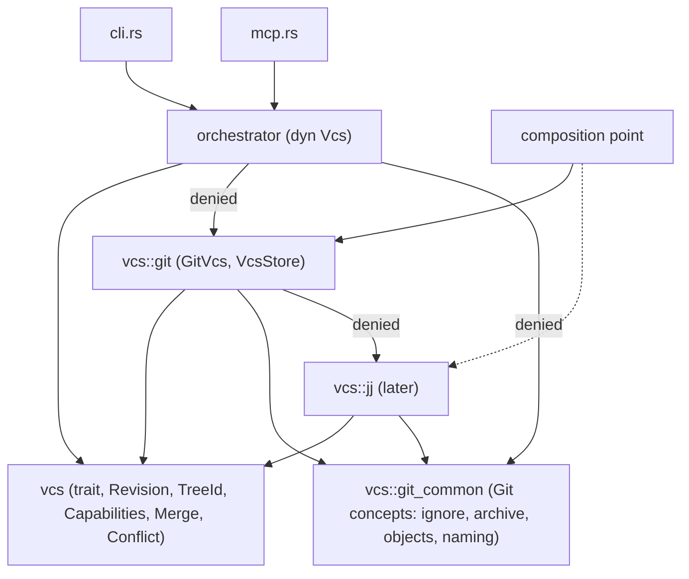
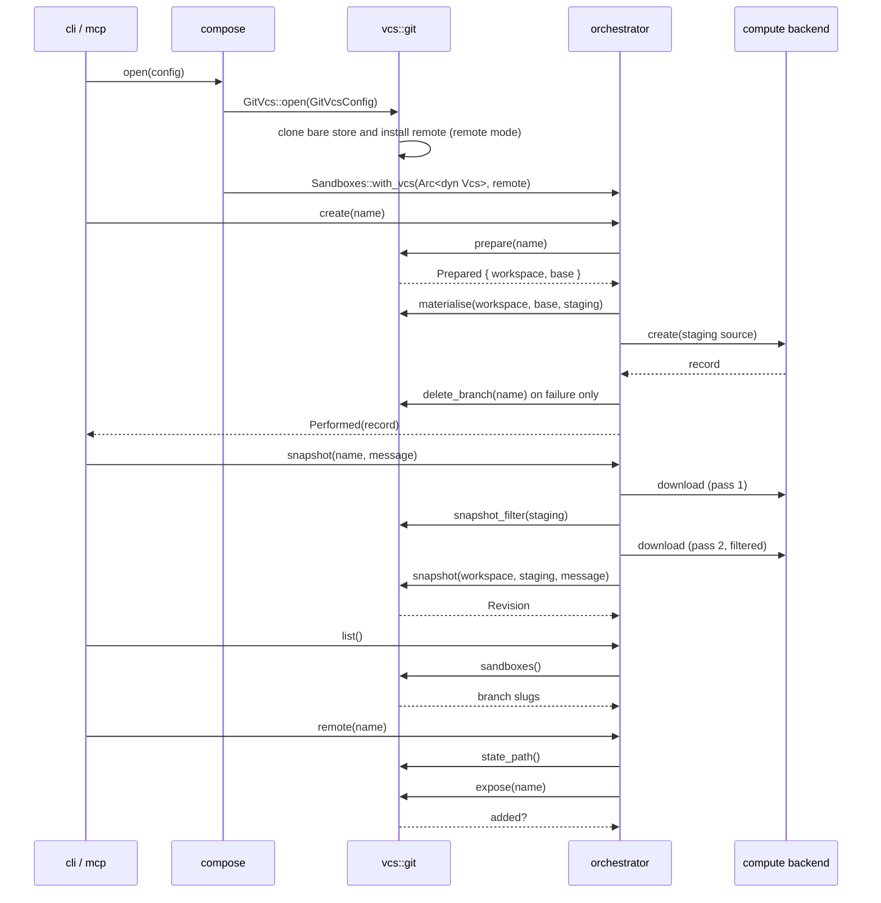

# Decouple VCS From Orchestration

## Approach

Move first, rewire second, enforce third. No requirement in the spec is marked `assumption`; the three open items it delegated (signatures, error variants, composition internals) are settled in this plan.

1. Add `src/vcs` with the opaque types, the trait and `vcs::Error`. `scm` keeps compiling beside it, so the tree is green after every step.
2. Move the Git primitives into `vcs::git_common`: `IgnoreFiles`, `SnapshotFilter`, archive building and the `git2::Tree` walk, tar unpacking and `branch_name_for`. It may use `git2`. `scm` delegates to `git_common` while it still exists.
3. Move `scm/mod.rs` and `vcs_store/**` under `src/vcs/git/`, rename `GitScm`/`ThreadSafeScm` to `GitVcs`, and implement the trait. Algorithms, ref names, retries, signatures and messages move unchanged.
4. Replace `Sandboxes.scm: ThreadSafeScm` with `vcs: Arc<dyn Vcs>` plus `remote: bool`. Delete `with_branch_scm`, `snapshot_scm`, `stage`, `stage_reference`, `open_scm`, `scm()`, `expose_store` and `store_path`; each call site goes through the trait.
5. Add `src/compose.rs`, move `open` there, and point `cli.rs` and `mcp.rs` at it. Compose reads the Git configuration, builds `GitVcs`, and hands the orchestrator a `dyn Vcs`.
6. Replace the `litterbox-scm` and `litterbox-vcs-store` scopes with the VCS scopes, add allow-lists and deny rules, extend the negative fixture, then delete `scm` and `vcs_store`.
7. Split tests by what they assert: Git behaviour under `vcs::git`, orchestration behaviour against a recording `TestVcs` in `src/testing.rs`.

The shape that makes step 4 small is branch addressing: the backend resolves a branch to the repository that owns it, so one `Arc<dyn Vcs>` per project serves records created in either locality. `make_archive` already does exactly this for the remote case (`scm/mod.rs` lines 366-386): it looks in the bare clone first and falls back to the host repository for a reference the clone does not hold.

## Architecture

Four layers replace two Git modules. `vcs` is the contract the orchestrator names; `vcs::git_common` holds the Git concepts both Git-backed backends reuse; `vcs::git` is the Git backend, and within the VCS tree only `vcs::git_common` and `vcs::git` see `git2`; `src/compose.rs` is the only module that constructs a backend. `cli` and `mcp` may name `vcs` types but never a backend, and `orchestrator/**` may name neither `vcs::git` nor `vcs::git_common`.




First-cut trait. Object-safe, synchronous, `&self`, no generics, no associated types; `Arc<dyn Vcs>` is the handle the orchestrator stores.

```rust
pub struct BranchName(String);
pub struct Revision(String);
pub struct TreeId(String);
pub struct Workspace { branch: BranchName }
pub struct Prepared { pub workspace: Workspace, pub base: Revision }

pub struct Capabilities {
    pub conflict_model: ConflictModel,
    pub op_log: bool,
    pub bindings: BindingSupport,
    pub export: ExportSupport,
}

pub trait Vcs: Send + Sync {
    fn capabilities(&self) -> Capabilities;

    fn prepare(&self, sandbox: &str) -> Result<Prepared, Error>;
    fn masked_paths(&self, workspace: &Workspace) -> Vec<PathBuf>;
    fn identity(&self, workspace: &Workspace) -> Result<TreeId, Error>;
    fn materialise(&self, workspace: &Workspace, revision: &Revision, into: &Path) -> Result<(), Error>;
    fn snapshot_filter(&self, rules_root: &Path) -> Result<Arc<dyn SnapshotSelector>, Error>;
    fn snapshot(&self, workspace: &Workspace, staging: &Path, message: &str) -> Result<Revision, Error>;

    fn sandboxes(&self) -> Result<Vec<String>, Error>;
    fn delete_branch(&self, sandbox: &str) -> Result<(), Error>;
    fn state_path(&self) -> Option<PathBuf>;
    fn expose(&self, name: &str) -> Result<bool, Error>;
    fn prune(&self) -> Result<(), Error>;

    fn tip(&self, workspace: &Workspace) -> Result<Revision, Error>;
    fn set_tip(&self, workspace: &Workspace, revision: &Revision) -> Result<(), Error>;
    fn synced(&self, workspace: &Workspace) -> Result<Revision, Error>;
    fn set_synced(&self, workspace: &Workspace, revision: &Revision) -> Result<(), Error>;

    fn merge(&self, base: &Revision, ours: &Revision, theirs: &Revision) -> Result<Merge, Error>;
    fn conflicts(&self, revision: &Revision) -> Result<Vec<Conflict>, Error>;
    fn conflict_sides(&self, revision: &Revision, path: &Path) -> Result<ConflictSides, Error>;
    fn resolve(&self, revision: &Revision, paths: &[PathBuf]) -> Result<Revision, Error>;
    fn abort(&self, revision: &Revision) -> Result<(), Error>;
    fn history(&self, workspace: &Workspace, keep: &HistoryPolicy) -> Result<Vec<Revision>, Error>;
    fn restore(&self, workspace: &Workspace, revision: &Revision, mode: RestoreMode) -> Result<(), Error>;
    fn export(&self) -> Result<(), Error>;
}
```

Why the signatures differ from T-017's sketch. The map's sketch was illustrative; the first cut must reproduce today's flow without rewriting it. `materialise` and `snapshot` take a directory because the orchestrator owns staging and the two-pass download (`service.rs` lines 1441-1457). `prepare` returns `Prepared` so the base revision comes from the backend rather than the orchestrator naming `HEAD`. `sandboxes` is scoped to the configured locality, exactly like `list_sandboxes` is today, so `list` keeps its current output. `delete_branch` and `tip` are branch-addressed instead: they resolve a record's branch in the bare clone first and fall back to the host repository, which is how `with_branch_scm` and `snapshot_scm` pick a repository today. `state_path`, `expose` and `prune` carry the three `vcs_store` operations the orchestrator performs. `merge` through `restore` are declared and return the neutral unsupported error until the conflict and history ADRs implement them.

Errors. `vcs::Error` is an enum: `Exists { name }`, `NotFound { name }`, `Unsupported { operation, backend, primitive, reason, remedy }`, `Backend { operation, message }` and `Io(#[from] std::io::Error)`. The Git module keeps the old Git-specific variants as `GitError` internally and converts them to `Backend` carrying the same display text. `domain` gains `SandboxError::Vcs { message }` and loses `SandboxError::Scm` and `ScmError`; the orchestrator maps `Exists`/`NotFound`/`Io` into the existing sandbox variants, and the rest into `Vcs`. `domain` never imports `vcs`, so the shared kernel does not depend on the contract. `SandboxError::Vcs` displays as `SCM error: {message}` so the contract's failure message is byte-identical to today.

The one dependency inversion. `snapshot_filter` returns `Arc<dyn SnapshotSelector>`, which is defined in `sandbox::contract` because the backends' transfer API consumes it. `vcs` therefore depends on `litterbox-contract`; `litterbox-contract` still imports nothing, and its deny rule keeps it from importing `vcs`, so this is one-way and acyclic. `SnapshotFilter` and `IgnoreFiles` keep their `SnapshotSelector` impls when they move to `vcs::git_common`.

## Technologies

| Technology | Role |
|------------|------|
| Rust 2024 | The workspace language and edition; no new dependency is added |
| git2 0.21 | The Git implementation; confined to the VCS tree (`vcs::git` and `vcs::git_common`) |
| arch-lint 0.11.0 | Path scopes, allow-lists and deny rules; pinned in `nix/flake.nix` |
| tar and tempfile | Archive materialisation and staging directories, moved into `vcs::git_common` |
| cargo, clippy, just | Test, lint and fixture gates; `just lint` already runs arch-lint and the negative fixture |

## Components

### vcs (contract)

Owns the trait, the opaque types and the neutral error

`src/vcs/mod.rs` plus `types.rs`, `capabilities.rs`, `conflict.rs` and `error.rs`. Defines `BranchName`, `Revision`, `TreeId`, `Workspace`, `Prepared`, `Capabilities` (`ConflictModel`, `BindingSupport`, `ExportSupport`), `Merge`, `Conflict`, `ConflictSides`, `HistoryPolicy`, `RestoreMode` and `Error`. `Workspace::from_branch` lets the orchestrator address a record's branch without a backend handle. Re-exports nothing from `git_common` and imports only `sandbox::contract` (for `SnapshotSelector`). FR-001, NFR-002.


### vcs::git_common

Holds the Git concepts Git-backed backends reuse

`src/vcs/git_common/{ignore,filter,archive,unpack,naming}.rs`. Moves `IgnoreFiles` (`scm/mod.rs` line 804), `SnapshotFilter` (line 682), `branch_name_for` (line 824), the tar builder and `git2::Tree` walk (lines 366-392, 449-480), and the unpack loop the orchestrator keeps in `stage` (`service.rs` lines 853-859), including the path confinement `tar` enforces. It is Git-specific, not VCS-neutral, and may use `git2`; within the VCS tree that use is confined to `src/vcs/git_common/**` and `src/vcs/git/**`. `GitError` (the old `ScmError`) lives here. `SnapshotFilter` and `IgnoreFiles` keep their `contract::SnapshotSelector` impls. It imports neither `vcs::git` nor `vcs::jj`; it may import `vcs` for `Error` and `contract` for the selector trait. Workspace binding and masking are not Git concepts and do not live here. FR-002, NFR-003, NFR-004.


### vcs::git

The one Git implementation behind the contract

`src/vcs/git/{mod,scm,store,remote,path}.rs`. `GitVcs` holds `Mutex<GitScm>` (the old `ThreadSafeScm` interior) and a `GitVcsConfig { remote, project_slug, host }` built by compose. It owns the host repository and resolves the bare store path on demand, so a record created in remote mode stays reachable after the configuration switches to direct, exactly as `with_branch_scm` re-clones the bare store per call today. Branch addressing: every branch operation looks in the bare clone first and falls back to the host repository, as `make_archive` already does. `VcsStore`, `remote.rs` and `path.rs` move under `git/`. `vcs::git_common::GitError` keeps the old `ScmError` variants and converts to `vcs::Error::Backend` with identical text. Implements `capabilities`, `prepare`, `masked_paths` (empty), `identity`, `materialise`, `snapshot_filter`, `snapshot`, `sandboxes`, `delete_branch`, `state_path`, `expose`, `prune`, `tip` and `export`; `set_tip`, `synced`, `set_synced` and the conflict and history methods return `Unsupported` in this cut. FR-003, FR-010, FR-011.


### orchestrator

Holds the contract and performs no Git work

`Sandboxes` gains `vcs: Arc<dyn Vcs>` and `remote: bool`, and loses `scm`. Call-site mapping: `create_branch` becomes `prepare`; `make_archive` plus unpack becomes `materialise(prepared.base)`; `set_snapshot_branch` plus `commit_snapshot_from_staging` becomes `snapshot(workspace, staging, message)`; `snapshot_filter` maps one-to-one; `list_sandboxes` becomes `sandboxes`; `delete_branch` maps one-to-one; `mode()` becomes the constructor's `remote`; `store_path` becomes `state_path`; `expose_store` becomes `expose`; `VcsStore::destroy_bare` becomes `prune`. `Sandboxes::expose_remote(name) -> Result<(PathBuf, bool), Error>` wraps `state_path` and `expose` for the CLI. `with_branch_scm`, `snapshot_scm`, `stage`, `stage_reference`, `open_scm`, `scm()`, `expose_store` and `store_path` are deleted. Repair builds `Workspace::from_branch`, takes `tip(workspace)` and maps `NotFound` to the existing Unavailable refusal, then materialises that revision; it no longer lists branches. Delete still calls `prune` only when the record is remote. Errors map through one `From<vcs::Error> for SandboxError` impl. FR-004, FR-005, FR-011.


### compose

The only module that constructs a backend

`src/compose.rs`: `pub fn open(config: Config) -> Result<Sandboxes, SandboxError>`. Computes the project slug with the existing `resolve_project_slug`, reads `config.git.snapshot_mode` (default `Remote`, as today), builds `GitVcsConfig`, calls `GitVcs::open`, and returns `Sandboxes::with_vcs(config, Arc::new(git), remote)`. The `[vcs] tool` selector and `[vcs.<tool>]` sections land with T-010; until then Git is the only arm. Scoped as `litterbox-compose` with an allow-list so it cannot reach `cli`, `mcp` or the backends. FR-006, AC-006.


### arch-lint

Makes the boundary load-bearing

`arch-lint.toml`: add scopes `litterbox-vcs` (`src/vcs/*.rs`), `litterbox-vcs-git-common`, `litterbox-vcs-git` and `litterbox-compose`; delete `litterbox-scm` and `litterbox-vcs-store` and replace both in the twelve deny lists that name them. Allow-lists: `vcs` to `contract`; `git-common` to `contract` and `vcs`; `git` to `vcs`, `git-common` and `contract`; `compose` to `vcs`, `git`, `orchestrator`, `config`, `shared` and `contract`. Deny rules: orchestrator to `git-common` and `git`; `vcs` to every backend; `git-common` to `git`; CLI and MCP to `git-common` and `git`; contract, backends, registry, config, persistence, provision, kinds and prepare to all three VCS scopes. `litterbox-vcs` excludes the two subdirectories so the scopes are disjoint. The `litterbox-vcs-jj` scope and `[[independent]]` land with the first jj file. FR-007, FR-008, EC-002, EC-005.


### testing

Tests say what they test

`src/testing.rs` gains `TestVcs`, a recording `Vcs` beside `TestBackend`: it records `prepare`, `materialise`, `snapshot`, `delete_branch` and `expose`, and returns configured `Prepared`, `Revision`, `sandboxes` and `tip` values. `Sandboxes::for_test` takes `Arc<dyn Vcs>` plus `remote`. The six orchestrator test sites stop opening `git2` repositories and assert on recorded calls; tests that assert refs, commit contents, archive bytes or ignore matching move to `vcs::git` and `vcs::git_common` tests next to the code. The double is `#[cfg(test)]` and never a construction path. EC-003, AC-002.


### surfaces (cli and mcp)

Reach VCS through the orchestrator and name no backend

`mcp.rs` replaces `Sandboxes::open(config)` with `compose::open(config)`; nothing else changes. `cli.rs` does the same in `project()`, and `handle_remote` becomes `project(config)?.expose_remote(&name)` so it no longer calls `store_path` or `expose_store`; it still prints the path and the `git fetch` line. Neither file imports `vcs::git_common` or `vcs::git`; the arch-lint deny rules prove it. FR-006, FR-007, AC-006.


## Data Flow




Create. `compose::open` builds `GitVcs` once (in remote mode it clones the bare store and installs the remote, exactly as `open_scm` does today). `create` calls `prepare(name)`, which creates the branch in the configured locality and returns `Prepared { workspace, base }`; `materialise(workspace, base, staging)` unpacks the base into a `TempDir`; the backend creates compute from that directory; the record stores `workspace.branch()` and `remote`. Any failure after `prepare` deletes the branch as today.

Snapshot. The backend downloads the workspace into staging unfiltered, `snapshot_filter(staging)` returns the selector the backend's filtered download consumes, and `snapshot(workspace, staging, message)` commits the filtered tree to the branch, preserving the signature fallback and the eight-attempt retry.

Repair. The orchestrator builds `Workspace::from_branch(stored.branch_name)`, checks `sandboxes()` contains the sandbox, takes `tip(workspace)`, and materialises it into staging before reusing the existing compute path. No branch is created and the record is unchanged.

Delete and list. `delete_branch` resolves the record's branch against the same backend instance; no per-record SCM is opened. When a remote record is deleted, `prune` destroys the bare clone only if no sandbox branches remain, as `VcsStore::destroy_bare` is guarded today. `list` uses `sandboxes`, which stays scoped to the configured locality. The `remote` command asks `state_path()` and `expose(name)` through the orchestrator.


## Deployment

No runtime, configuration or on-disk change: same binary, same config keys, same bare-store path, same refs and record files. The boundary is enforced at compile time and in CI. Land as one change or a short stack; the tree stays green at each stage because `scm` delegates to `vcs::git_common` until it is deleted, and because the arch-lint scopes are added with the new paths before the old modules go.

Gates, all already in `just lint` or the build workflow: `cargo test -p agentkit-litterbox`, `cargo clippy -p agentkit-litterbox --all-targets -- -D warnings`, `arch-lint check`, and `bash hack/arch-lint-negative.sh`. Add a manual smoke on a scratch repository for both `snapshot-mode` values: create, exec, snapshot, list, delete, and `remote <name>` followed by the printed `git fetch`.

