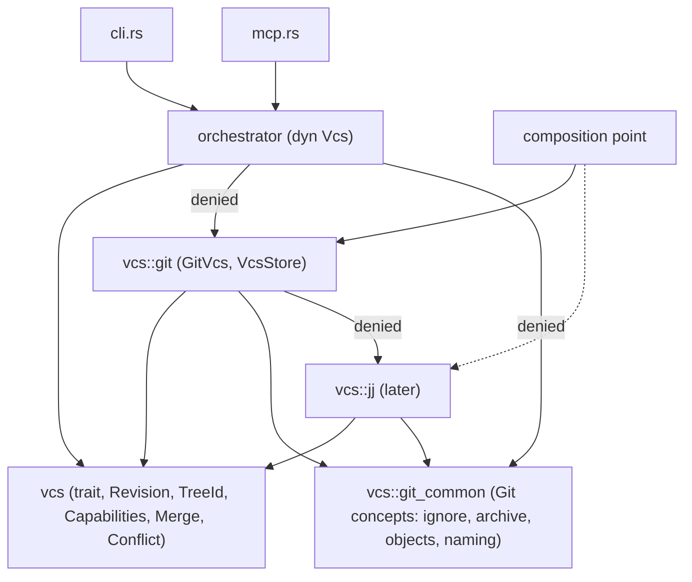

# Decouple VCS From Orchestration

**Status:** implemented  **Created:** 2026-11-19  **Author:** adrian

Litterbox pairs a sandbox with a Git branch. That pairing lives in `crates/agentkit-litterbox/src/orchestrator/service.rs`, which imports `Scm`, `ThreadSafeScm`, `ScmMode` and `VcsStore` (lines 11 and 24-25) and stores `scm: ThreadSafeScm` on `Sandboxes` (lines 33-35). `crates/agentkit-litterbox/src/scm/mod.rs` holds the `Scm` trait (line 13), `GitScm` over `git2::Repository` (line 23), `ThreadSafeScm` (line 208), the snapshot filter and ignore matcher (lines 682 and 804) and `branch_name_for` (line 824). `crates/agentkit-litterbox/src/vcs_store/mod.rs` is a bare-clone store built on `git2` (lines 7-12). Both modules are declared at the crate root (`lib.rs` lines 12 and 15).

The map `maps/2026-11-18-litterbox-vcs-history-sync/map.toon` settles the destination: Git and jj sit behind one VCS trait with opaque revisions and capabilities; define `vcs` and `vcs::git_common` first; add arch-lint rules; adapt the existing Git implementation; add jj later. Its T-017 evidence records the interface, the Git-common split and the arch-lint boundary; T-013 records the current Git coupling.

This ADR is the first step of that decision and nothing more: the contract, the Git common module, the Git backend behind the contract, the construction point and the build-time boundary. It changes no behaviour and adds no jj code.

Two findings shape the requirements. First, `git2::Error` is part of the shared kernel: `domain::SandboxError::Scm` wraps `domain::ScmError` (`domain/mod.rs` lines 11-12) whose variants all name `git2::Error` (lines 20-93). A backend-neutral contract cannot be built on an error type only Git can produce. Second, the orchestrator does more with VCS than the map's interface list covers: it creates and deletes branches, enumerates sandbox branches, archives a tree, filters and commits snapshots through `Scm` (`scm/mod.rs` lines 13-21 and 262-275). `Sandboxes::open` is the single entry point both surfaces already use (`cli.rs` line 194, `mcp.rs` line 374), and the concrete `ThreadSafeScm` is chosen inside the orchestrator by `open_scm` (`service.rs` line 1264).

`adrs/2026-11-03-sandbox-provider-contract` FR-024 lists SCM as a legitimate orchestrator dependency. This ADR narrows that clause to `vcs` only; it does not change the contract, the backends or the record.

Settled at alignment: the error boundary moves `git2` out of the shared kernel, the construction point is a composition module outside `orchestrator/**`, the trait is synchronous and object-safe with no new dependency, the full target surface is declared while today's subset is implemented, tests are split by what they assert, the CLI and MCP server may name `vcs` types but no backend, and each VCS is constructed from its own configuration section, so binding is configuration rather than a call argument. Open items carried to the plan: exact signatures, the error-variant inventory and the composition module's internals.

## Problem

Orchestration cannot be separated from Git. `Sandboxes` holds a `ThreadSafeScm` built from `git2::Repository`, calls branch creation, archive, patch and snapshot methods directly, and reaches the bare-clone store by name. A second VCS cannot implement `Scm` without rewriting it, the shared kernel's error type can only be produced by Git, and nothing in the build stops orchestration from reaching deeper into Git. The boundary therefore rests on review attention rather than on the compiler and CI.

## Goals

- `vcs` is the only VCS vocabulary the orchestrator names: the trait plus `Revision`, `TreeId`, `Capabilities`, `Merge`, `Conflict` and `ConflictSides`.
- `vcs::git_common` holds the Git primitives that Git-backed backends reuse, so `vcs::jj` never calls the Git backend and never reimplements them.
- `GitVcs` is one implementation behind the contract and behaves exactly as `scm` does today.
- One composition point outside the orchestrator constructs the backend, and the CLI and MCP server keep a single entry point and name nothing backend-shaped.
- The build fails when orchestration reaches a backend, or when a backend reaches its sibling.
- The negative fixture proves each rule fails for the intended reason, and restores the tree.
- No Git type appears in a public contract signature, and the orchestrator, CLI and MCP import neither Git module.
- Adding `vcs::jj` later changes no file in `vcs`, `vcs::git_common`, the orchestrator, the CLI or MCP.

## Non-goals

- Adding jj. The `vcs::jj` module and the backend mutual-exclusion rule land with it.
- Conflict mechanics: merge, resolve and abort semantics beyond the shape of the contract.
- The `plan`, the source-state axes and the `workspace` block.
- Configuration and record fields: `[vcs] tool`, the per-VCS sections that replace `[workspace] binding`, merge state and `synced`.
- Any MCP tool or CLI command, and any output or exit code change.
- The bare-clone (remote) behaviour and the `remote` record field.
- Settling exact signatures, the error-variant inventory or the composition module's internals; the plan decides these.

## Functional Requirements

### FR-001: The contract

`vcs` owns the trait and the neutral types: `Revision` and `TreeId` are opaque newtypes with no `git2` or jj type inside; `Capabilities` reports the conflict model, op log, binding support and export support; `Merge` is clean or blocked; `Conflict` and `ConflictSides` name a path and the base/ours/theirs sides. The trait covers at least the target surface: capabilities, prepare, masked_paths, identity, materialise, snapshot, tip/set_tip, synced/set_synced, merge, conflicts, conflict_sides, resolve, abort, history/restore and export. The first cut also declares the operations orchestration performs today (FR-005). A backend is constructed from its own configuration section, as a compute backend is from its backend section, and reports the result through `Capabilities`; no trait method takes a binding argument. No type in a public signature is a backend type, and the errors the trait returns are defined in `vcs`.

**Slug:** `vcs-contract`

### FR-002: Git common

`vcs::git_common` owns the Git concepts that anything using the Git storage backend reuses: ignore matching (`IgnoreFiles`), the snapshot filter, Git tree walking, archive and tar materialisation, object and ref primitives, path safety and confinement, and branch and sandbox naming (`branch_name_for`), plus `GitError` (the old `ScmError`). It is Git-specific, not VCS-neutral: a non-Git-backed VCS would not use it. It may use `git2`, which is confined to `src/vcs/git_common/**` and `src/vcs/git/**`. It imports neither `vcs::git` nor `vcs::jj`. Workspace binding and masking are not Git concepts and do not live here: a backend that binds implements them in its own module. The unit tests that cover these algorithms move with them and keep their expectations.

**Slug:** `git-common`

### FR-003: The Git backend

`vcs::git` owns `GitVcs`, the adapted `GitScm`/`ThreadSafeScm` and `VcsStore`. It imports `vcs`, `vcs::git_common` and the contract's `SnapshotSelector`, and no sibling backend. Every `git2` path in the VCS tree is under `src/vcs/git_common/**` or `src/vcs/git/**`; `config_loader` keeps its own repository discovery, which is configuration code, not VCS code. The crate root no longer declares `scm` or `vcs_store`, and their tests move with them.

**Slug:** `git-backend`

### FR-004: The orchestrator port

`Sandboxes` holds one backend behind `Arc<dyn Vcs>` (or an equivalent shared handle); the only VCS-related fact it keeps is the record's `remote` bool (EC-004). `src/orchestrator/**` contains no `use crate::vcs::git`, no `use crate::vcs::git_common`, no `git2` path, no `GitScm`, `ThreadSafeScm` or `VcsStore`, and no `Scm` trait import. Every branch, staging, snapshot and deletion operation goes through the trait. `Sandboxes::scm()` is deleted; a caller that needs the backend holds the handle it constructed.

**Slug:** `orchestrator-port`

### FR-005: Existing operations survive the move

Every VCS operation the orchestrator performs today is reachable through the contract before `scm` is removed: branch creation and deletion (`create_branch`, `delete_branch`), sandbox-branch enumeration (`list_sandboxes`), archive materialisation (`make_archive`), snapshot commit (`commit_snapshot_from_staging` plus `set_snapshot_branch`), snapshot filtering (`snapshot_filter`) and the remote/direct fact (`mode`). The bare-store operations the orchestrator and the CLI use — `store_path`, `expose_store` and the guarded `destroy_bare` after the last remote delete — are VCS operations too and move behind the contract. `apply_patch` and `repo_prefix` are declared by `Scm` but have no caller outside it; they may be dropped rather than moved. Where each operation is expressed (a trait method, a `Workspace` accessor or the composition point) is settled in the plan; none may remain a direct Git call in the orchestrator.

**Slug:** `existing-operations`

### FR-006: One construction point

A module outside `orchestrator/**` (`src/compose.rs`) constructs the concrete backend from configuration, and hands the orchestrator a `dyn Vcs`. It exposes `open(config)`, which builds `GitVcs` from a `GitVcsConfig` derived from the Git configuration and calls `Sandboxes::with_vcs`. It reads the selected VCS and that VCS's own configuration section, mirroring the backend selector and `[backends.<name>]`. The `[vcs]` and `[vcs.<tool>]` keys land with T-010; today Git is the only construction. Today `open_scm` makes that choice inside the orchestrator (`service.rs` line 1264); it moves out. `main.rs` is unchanged. `mcp.rs` changes one import. `cli.rs` changes its `project()` helper and its `remote` command, which calls the orchestrator instead of the free `store_path`/`expose_store` functions. Neither the contract, the backends, config, persistence nor the orchestrator constructs or names a backend.

**Slug:** `composition-root`

### FR-007: Arch-lint scopes

`arch-lint.toml` declares `litterbox-vcs` for `src/vcs/*.rs`, `litterbox-vcs-git-common` for `src/vcs/git_common/**`, `litterbox-vcs-git` for `src/vcs/git/**` and `litterbox-compose` for `src/compose.rs`. `litterbox-vcs` excludes `src/vcs/git_common/**` and `src/vcs/git/**` so no file belongs to two scopes. The `litterbox-scm` and `litterbox-vcs-store` scopes are removed. The contract, each backend, registry, config, persistence, provision, kinds and prepare deny the three VCS scopes; the `litterbox-vcs-jj` scope joins that list when the first jj file lands (EC-002). The CLI and MCP deny `litterbox-vcs-git-common` and `litterbox-vcs-git`, and may import `litterbox-vcs`. `litterbox-compose` has an allow-list rather than a deny list, so it may reach `vcs`, `vcs::git`, the orchestrator, config, the shared kernel and the contract, and nothing else internal.

**Slug:** `arch-scopes`

### FR-008: Deny rules

Deny rules fail the build for: orchestrator to `litterbox-vcs-git`; orchestrator to `litterbox-vcs-git-common`; `litterbox-vcs-git-common` to `litterbox-vcs-git`; `litterbox-vcs` to each backend; CLI and MCP to `litterbox-vcs-git-common` and each backend; `litterbox-compose` to anything outside its allow-list; and, once `vcs::jj` is declared, the `[[independent]]` rule over the two backend scopes and the matching `litterbox-vcs-jj` deny entries. Inline qualified paths such as `crate::vcs::git::GitVcs::new()` are caught too, because `check-inline` stays at its default.

**Slug:** `arch-rules`

### FR-009: Negative fixture

`hack/arch-lint-negative.sh` plants a `vcs::git` import in the orchestrator, a `crate::vcs::git_common` import in the orchestrator, a `vcs::git` import in `vcs::git_common`, a `vcs::git` import in the CLI and in MCP, a `crate::vcs::git_common` import in MCP, and a `vcs::git` import in one backend. Each run must fail with the named rule in the output, and the trap must restore every file.

**Slug:** `arch-negative`

### FR-010: Behaviour is unchanged

The same sandbox operations produce the same branches, commits, tree contents and records as before. Snapshot commit messages, the signature fallback, the retry count for a racing ref, ignore rules, archive contents and the bare-clone path are unchanged. Error messages and failure classes for existing paths are preserved even where the error type moves.

**Slug:** `behaviour-parity`

### FR-011: The error boundary

`vcs` defines the error type the trait returns, and no backend type appears in it. Within the VCS tree, `git2::Error` occurs only under `src/vcs/git_common/**` and `src/vcs/git/**`; `domain::ScmError` moves to `vcs::git_common` as `GitError`. `SandboxError` names no VCS or Git type: a VCS failure reaches it as a mapped variant (exists, not-found or I/O) or as a neutral message, and the conversion to the contract's failure classes produces the same class and the same message for every existing path. The orchestrator's direct `ScmError::Open` construction (`service.rs` line 916) moves with the code that produces it.

**Slug:** `error-boundary`

## Non-functional Requirements

### NFR-001: Git code stays out of orchestration

The orchestrator, CLI and MCP contain no `git2` and import neither `vcs::git` nor `vcs::git_common`. Within the VCS tree, `git2` occurs only under `src/vcs/git_common/` and `src/vcs/git/`, and `vcs::git` and `vcs::jj` never import each other. `config_loader` keeps its own `git2` repository discovery: it decides configuration scope from Git concepts and is not VCS code. `domain::ScmError` becomes `vcs::git_common::GitError`; the trait returns a neutral `vcs::Error`, and `SandboxError` carries its message rather than its type, so the shared kernel does not depend on the contract. The mapping from backend failures to the contract's failure classes is unchanged for every existing path.

**Slug:** `git2-confinement`

### NFR-002: Object safe and shared

The trait is usable as `dyn Vcs` behind a shared handle and can be held in `Sandboxes`: no generic methods, `&self` receivers and `Send + Sync` on the trait object. Methods are synchronous and called from async code as today; no async-trait, boxed-future helper or new dependency is added.

**Slug:** `object-safe`

### NFR-003: A second backend touches nothing else

Adding `vcs::jj` requires a new module, its own configuration section under `[vcs.jj]` (T-010), an arm in the construction point, the jj scope and the sibling rule. No existing file in `vcs`, `vcs::git_common`, the orchestrator, the CLI, MCP or the record changes; jj uses the Git primitives `vcs::git_common` already exposes.

**Slug:** `open-for-extension`

### NFR-004: A move not a rewrite

The change relocates and adapts existing code. No Git algorithm, retry, ignore rule or archive behaviour is rewritten, and no new dependency is added.

**Slug:** `mechanical-move`

### NFR-005: The gate runs where CI runs

`cargo test -p agentkit-litterbox`, `cargo clippy -p agentkit-litterbox --all-targets -- -D warnings`, `arch-lint check` and `bash hack/arch-lint-negative.sh` pass; the last two run in `just lint` and in the build workflow.

**Slug:** `checked-in-ci`

## Acceptance Criteria

### AC-001: Orchestrator is neutral

A search of `src/orchestrator/**` finds no `vcs::git`, no `vcs::git_common`, no `git2`, no `GitScm`, `ThreadSafeScm`, `VcsStore` or `Scm` import. `Sandboxes` holds `Arc<dyn Vcs>`.

**Slug:** `orchestrator-neutral`

### AC-002: Suite passes

`cargo test -p agentkit-litterbox` passes. Assertions and expectations are unchanged; test setup, helpers and location may move.

**Slug:** `suite-passes`

### AC-003: Lints pass

`cargo clippy -p agentkit-litterbox --all-targets -- -D warnings` and `arch-lint check` pass on a clean tree.

**Slug:** `lints-pass`

### AC-004: The fixture bites

`bash hack/arch-lint-negative.sh` plants each forbidden import, `arch-lint check` fails for the named rule every time, and the working tree is restored.

**Slug:** `fixture-bites`

### AC-005: Behaviour parity

Create, exec, snapshot, delete and list behave as before, including a `remote = true` sandbox whose branch lives in the bare clone, and no record file changes shape.

**Slug:** `parity-proven`

### AC-006: One construction point

`cli.rs` and `mcp.rs` call the composition module's `open(config)` and neither imports a backend. A `dyn Vcs` is built in exactly one module, outside `src/orchestrator/**`.

**Slug:** `single-construction`

## Edge Cases

### EC-001: An operation with no implementation yet

If the first cut declares an operation the Git backend does not yet implement, the method returns the neutral unsupported error. It must not panic, use `unimplemented!`, or be called by the orchestrator before it is implemented.

**Slug:** `unimplemented-operation`
### EC-002: A scope with no files

If arch-lint rejects a scope whose paths match nothing, the `litterbox-vcs-jj` scope and the sibling rule are added in the same change as the first jj file. The Git-only rules are unaffected.

**Slug:** `empty-jj-scope`
### EC-003: Test placement

Tests are split by what they assert. Git behaviour (refs, commits, archive bytes, ignore matching) is tested under `vcs::git`. Orchestration behaviour is tested against a recording `TestVcs` in `src/testing.rs`, beside `TestBackend`, which asserts the calls the orchestrator makes. The test double is `#[cfg(test)]` and is never a production construction path.

**Slug:** `moved-git-tests`
### EC-004: Mode and record

`ScmMode` and `StoredSandbox.remote` stay as they are, because the record and configuration are out of scope. The construction point reads the configured mode and passes the resulting `remote` fact; the orchestrator writes it into the record as it does today; the backend resolves a record's branch by locality rather than being told the mode. This ADR does not make the fact neutral.

**Slug:** `mode-and-record`
### EC-005: An inline path

An inline `crate::vcs::git::...` call in the orchestrator is reported by the same deny rule as a `use` import.

**Slug:** `inline-path`
### EC-006: Signature types

`Workspace`, `Prepared`, `Revision`, `TreeId`, `HistoryPolicy` and `RestoreMode` are owned by `vcs`, and `vcs::git_common` owns Git algorithms only, so the orchestrator never imports `vcs::git_common`. If a signature type later moves to `vcs::git_common`, it is re-exported through `vcs`.

**Slug:** `signature-types`
### EC-007: Binding is configured

`prepare` takes no binding argument. A VCS is constructed from its own configuration section, as a compute backend is, and `Capabilities` reports the binding behaviour that configuration produces. A combination the backend cannot honour, such as `bound` with Git, is refused when the configuration is validated, before any sandbox is created, and never falls back to copying. This change adds no `[vcs.<tool>]` keys, so Git is copy-only and no caller can request `Bound`.

**Slug:** `binding-is-configured`

