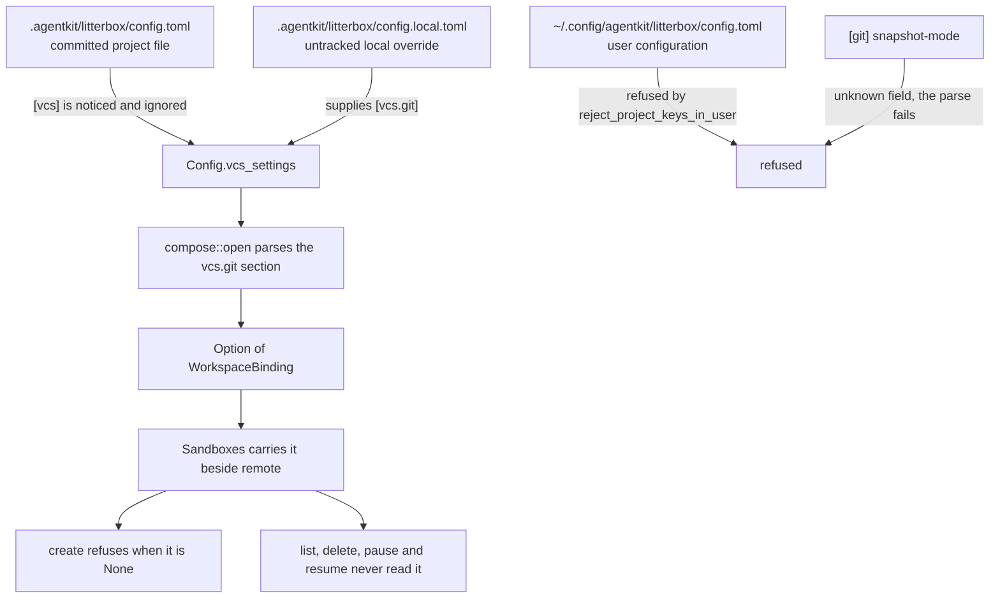
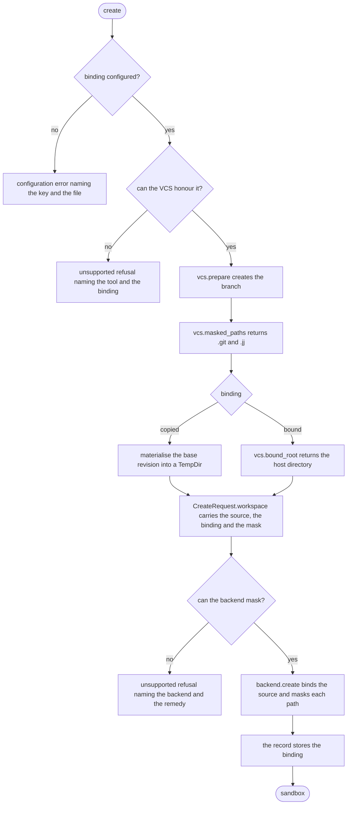

# Hide VCS Metadata From Sandboxes

## Approach

Move the vocabulary, wire the choice, then mask. The binding is a contract type because persistence and configuration both need it and arch-lint forbids either from naming a VCS, so `WorkspaceBinding` and `BindingSupport` move into `sandbox::contract` beside `StoreView` and `SnapshotSelector`, and `vcs` imports them. The `[vcs]` section mirrors `[backends]` exactly, so a machine decides per workspace and the committed project file is noticed and ignored. `[git]` is deleted and `snapshot-mode` moves into `[vcs.git]`, which makes it a workspace setting rather than project configuration. Masking then lands per compute backend, bubblewrap and Docker first, and a backend that cannot mask refuses `Bound` rather than degrading.

Three assumptions this plan carries rather than settles, because this stage runs no experiments. First, how Docker determines that its daemon shares the host filesystem: `backends/docker/compute.rs:630-667` proves the connection is a local unix socket and refuses `tcp://`, but a socket can still front a daemon whose filesystem is not the host's, and no probe has run. A `sandbox-create` against Docker Desktop, or an inspection of the daemon's reported root, settles it. Second, whether a masked path that is a file rather than a directory can be masked the same way: T-002 probed `.jj`, which is a directory, and bubblewrap's `--tmpfs` needs a directory mountpoint, so a linked worktree's `.git` file is unprobed. A probe with a `git worktree` settles it. Third, whether Docker creates the mountpoint for an empty volume when the bound directory holds no `.git` at all. T-002's probe bound a directory that already contained one.

The Seatbelt question is not an assumption here. `policy.rs:173-199` shows the renderer emits no deny rule, so masking is not implementable today, and FR-010 records that Seatbelt refuses `Bound`. The Darwin change depends on a probe of deny-rule ordering, recorded in the spec's non-goals.

## Architecture

Five layers, and one type moves to make them line up.

The contract owns the vocabulary. `WorkspaceBinding::{Copied, Bound}` and `BindingSupport` move from `vcs::capabilities` into `src/sandbox/contract.rs`, beside `StoreView` and `SnapshotSelector`. The move is forced, not stylistic: `arch-lint.toml:104` denies `litterbox-contract` any dependency on `litterbox-vcs`, and `arch-lint.toml:245` denies `litterbox-persistence` the same. `StoredSandbox` lives in persistence and `Config` lives in configuration, and both need the type. `vcs` already allows `litterbox-contract` (`arch-lint.toml:46-47`), so it imports both and re-exports nothing. `Capabilities` keeps its `bindings` field and now names the contract's `BindingSupport`.

Configuration mirrors backends. `ProjectFile` gains `vcs: BTreeMap<String, toml::Value>` beside `backends`, `Config` gains `vcs_settings`, and `CONFIG_KEYS` swaps `git` for `vcs`. The committed project file's `[vcs]` table is noticed and ignored exactly as its `[backends]` table is (`config.rs:445-463`), and `reject_project_keys_in_user` refuses `vcs` in the user configuration beside its existing `git` clause (`config_loader.rs:310-332`). `GitConfig` and its `snapshot_mode` field are deleted, and the mode moves into the `[vcs.git]` table, so `compose` reads it from the same place it reads the binding.

Persistence gains one field. `StoredSandbox` gains `binding: Option<WorkspaceBinding>` with `#[serde(default)]`. `None` is the legacy fact, and an accessor maps it to `Copied`. The enum itself keeps no serde default, so a configuration section that omits the key is a missing value rather than a silent copy.

The VCS contract gains one method. `masked_paths` is documented to return paths relative to the workspace root, because the sandbox sees the workspace at a backend-specific path: `/src` under bubblewrap, `WORKDIR` under Docker. `bound_root(&Workspace) -> Result<PathBuf, Error>` is declared and returns `Unsupported` from `GitVcs`, the same shape as `set_tip` and `synced` today.

The orchestrator holds the choice beside `remote`. `Sandboxes` gains `binding: Option<WorkspaceBinding>`, and `compose::open` parses it from the `[vcs.<tool>]` section and passes it to `with_vcs`. Only `create` reads it, so a machine with no binding configured still lists, deletes, pauses and resumes.

Masking is per backend and never shared. Bubblewrap renders a tmpfs over each masked directory path and a bind over an empty file for each masked file path, inside the bound workspace and after the workspace bind. Docker adds an empty volume per masked path to `HostConfig`, which currently sets no `Binds` at all (`docker/compute.rs:192-205`). Neither mechanism is available to Seatbelt, so it refuses.

## Technologies

| Technology | Role |
|------------|------|
| Rust 2024 | The workspace language and edition; no new dependency is added |
| arch-lint 0.11.0 | Path scopes and deny rules; the contract cannot import `vcs`, which is what forces the binding type into the contract |
| bubblewrap | The Linux mechanism; a tmpfs over a directory, or a bind over an empty file, hides a masked path |
| Docker | The container mechanism; an empty volume at a masked path hides its contents |
| cargo, clippy, just | Test, lint and fixture gates; `just lint` already runs arch-lint and the negative fixture |

## Components

### sandbox (contract)

Owns the binding vocabulary

`src/sandbox/contract.rs` gains `WorkspaceBinding` with `Copied` and `Bound`, and receives `BindingSupport` from `vcs::capabilities`. `Workspace`, the `CreateRequest` payload, gains `binding: WorkspaceBinding` and `masked_paths: Vec<PathBuf>`, the latter relative to the workspace root. The struct keeps `source`, which is a staged directory under `Copied` and the bound directory under `Bound`. No serde default on the enum. FR-001, FR-007.

### config

The `[vcs]` section

`src/config.rs` gains `vcs: BTreeMap<String, toml::Value>` on `ProjectFile` and `vcs_settings` on `Config`, and loses `GitConfig`. `merge` copies the local file's `vcs` map, notices the committed file's table and ignores it, and carries `snapshot_mode` out of the `[vcs.git]` table into a `GitVcs` settings struct the composition point reads. FR-002, NFR-001.

### config_loader

Layering and rejection

`src/config_loader.rs` swaps `git` for `vcs` in `CONFIG_KEYS`, adds a `vcs` clause to `reject_project_keys_in_user`, and leaves `reject_machine_keys_in_local` alone because `vcs` is not in its refuse list and so is accepted in the local override. A configuration that still sets `[git]` fails to parse, because `ProjectFile` derives `deny_unknown_fields`. FR-002, EC-006.

### persistence

The record field

`src/metadata_store.rs` gains `binding: Option<WorkspaceBinding>` on `StoredSandbox` with `#[serde(default)]`, plus an accessor returning `Copied` for `None`. `LoadedSandbox` is unchanged: a record without the field is still `Current`. FR-004, FR-005, AC-003.

### vcs (contract)

The mask contract and the bound root

`src/vcs/mod.rs` documents `masked_paths` as returning paths relative to the workspace root and names `.git` and `.jj`. It gains `bound_root(&Workspace) -> Result<PathBuf, Error>`, which returns the host directory a bound workspace lives in. `Capabilities` keeps `bindings`, now typed from the contract. `src/vcs/capabilities.rs` shrinks to `ConflictModel` and `ExportSupport`. FR-001, FR-006, FR-007, FR-011.

### compose

Reads the section and hands the orchestrator the choice

`src/compose.rs` reads `[vcs.git]` from `vcs_settings`, takes `binding` and `snapshot-mode` out of it, and passes `Some(binding)` or `None` to `Sandboxes::with_vcs`. An absent key is `None`, not a default, so `open` succeeds and `create` refuses. An unparseable value is a configuration error naming the key. FR-002, FR-003.

### orchestrator

Refuses, records and passes the mask

`src/orchestrator/service.rs` gains `binding: Option<WorkspaceBinding>` beside `remote`. `create` refuses when it is `None`, refuses when `vcs.capabilities().bindings` cannot honour it, asks `masked_paths`, and branches: `Copied` materialises into a `TempDir` as today, `Bound` takes `bound_root`. Both build the same `CreateRequest`. `repair` reads the record's binding rather than the configuration. `delete` widens the `prune` condition to `stored.remote || stored.binding() == Bound` (`service.rs:478-482`). FR-003, FR-004, FR-006, FR-012.

### backends/bubblewrap

Masks with a tmpfs

`src/backends/bubblewrap/view.rs` gains masked paths in its render options, emitted after the workspace bind at `view.rs:339-341`: `--tmpfs` over each masked directory, and a bind over an empty file for a masked path that is a file. `backends/bubblewrap/backend.rs` refuses `Bound` when the masked paths cannot be rendered. FR-008, FR-010.

### backends/docker

Masks with an empty volume

`src/backends/docker/compute.rs` gains `binds` and `volumes` on `ContainerSpec` and sets them on `HostConfig`, which today carries neither. One empty volume per masked path, mounted inside the bound workspace. `backends/docker/backend.rs` binds the host directory instead of uploading a tar under `Bound` (`backend.rs:365-374`), and refuses when it cannot guarantee the daemon shares the host filesystem. FR-009, FR-010, EC-005.

### backends/seatbelt

Refuses

`src/backends/seatbelt/backend.rs` reports that it cannot mask and refuses `Bound` with a structured unsupported failure naming the backend, the binding and the remedy. No masking code is written here in this change. FR-010, AC-004.

### testing

The doubles say what was asked

`src/testing/vcs.rs` records `masked_paths` and `bound_root` calls and can be configured to report `Bound` support, so orchestration tests assert the orchestrator asked for the mask and branched on the binding without a repository. `src/testing.rs` gains a masking backend beside `TestBackend` that records the paths it was asked to hide and can be told to refuse. FR-008, FR-009, FR-010.

## Data Flow

Create. `compose::open` reads `[vcs.git]` from the local override and passes `Some(binding)` or `None` to `with_vcs`. `create` refuses a `None` with a configuration error naming the key and the file, and refuses a binding the constructed VCS reports it cannot honour. It then calls `prepare`, asks `masked_paths`, and branches on the binding. Under `Copied` it materialises the base revision into a `TempDir` exactly as today. Under `Bound` it takes `bound_root` and materialises nothing. Both paths build one `CreateRequest` whose workspace carries the source, the binding and the mask, and the record stores the binding.

Repair. The orchestrator builds `VcsWorkspace::from_branch(stored.branch_name)`, takes `tip`, and materialises only when the record's binding is `Copied`. A bound sandbox repairs against its existing host directory. The record is rewritten with its binding preserved, as `remote` already is (`service.rs:352-356`).

Snapshot. Unchanged. The backend downloads the workspace into staging and `vcs.snapshot` commits the filtered tree. Under `Bound` the download reads through the bind, which the plan leaves alone rather than optimising.

Delete. The compute teardown runs first, then `delete_branch`, then `prune` when `stored.remote` or the record's binding is `Bound`, then the record file is removed. `prune` keeps its existing guard, which destroys the bare clone only when no `litterbox/` branch remains (`vcs/git/scm.rs:500-520`), and is extended to remove bound directories that have no record.

Orphans. A failed create removes the bound directory on every path that already removes the branch. A corrupt record cannot be addressed, so `prune` is the only path that finds its directory. A record file removed by hand leaves a directory nothing notices.

## Deployment

No runtime or image change: the same binary, the same data directory, the same record shape plus one field. Configuration is the breaking surface.

A machine that sets `[git] snapshot-mode` fails to load with an unknown-field error, because `ProjectFile` derives `deny_unknown_fields` and the field is gone. No migration code is written and no alias is accepted. The remedy is to move the key to `[vcs.git]` in `.agentkit/litterbox/config.local.toml`. `docs/docs/user/litterbox/reference/config.mdx` documents `[git]` and must be updated in the same change, and `CONTEXT.md` has already been updated to call snapshot mode a workspace setting.

A machine with no `[vcs]` section at all keeps working for every command except `create`, which refuses naming the key and the file.

Land as a short stack, in this order, so the tree stays green at each step: the contract types and the `vcs` method, the configuration section and the loader rejection, the record field and the orchestrator branch, then bubblewrap masking, then Docker masking, then the Seatbelt refusal. The Seatbelt step is a refusal and needs no macOS host.

Gates, all already in `just lint` or the build workflow: `cargo test -p agentkit-litterbox`, `cargo clippy -p agentkit-litterbox --all-targets -- -D warnings`, `arch-lint check`, and `bash hack/arch-lint-negative.sh`. The negative fixture needs no new rule: no scope changes. A manual smoke on a scratch repository covers create with `copied`, create with `bound` refused for Git, a legacy record loading and listing, and delete removing the state.

