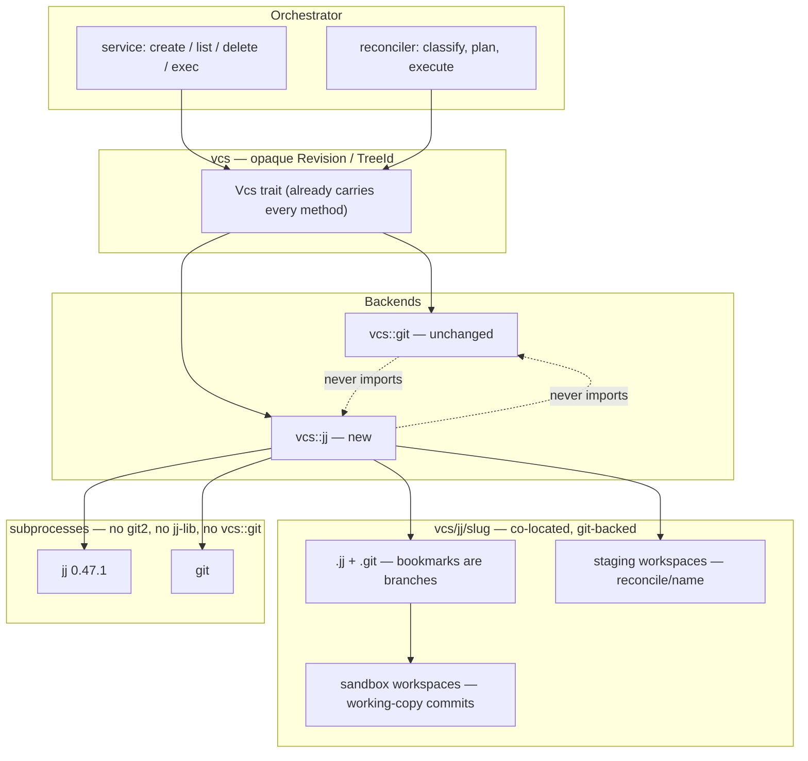

# jj as a Second VCS Backend

## Approach

No requirement is marked `assumption`. The one unknown in earlier drafts — whether jj can stage a merge with `synced` as the forced base — was settled by a probe against jj 0.47.1, and the store model (a co-located clone) was settled the same way. The plan therefore builds against facts, not guesses.

Strategy. Land the selection surface first, then the backend, then the two cross-cutting orchestrator changes, keeping the Git path green throughout. Every change is additive: the `Vcs` trait already carries every method this needs (`vcs/mod.rs:32-211`), Git keeps its implementations and its `Unsupported` returns, and jj fills in its own set. No Git type and no `vcs::git` call crosses into `vcs::jj`.

The backend is a subprocess driver, not a library. jj 0.47.1 is already on `PATH`; `jj-lib` has no stable API. `JjVcs` shells out to the `jj` binary for jj-native operations — clone, workspace, bookmark, snapshot, restore, resolve, abandon, log templates — and to the `git` binary for the Git-object primitives the co-located clone makes natural: materialise via `git archive`, observe via `git write-tree` over a temporary index, tree-of-revision via `git rev-parse <rev>^{tree}`, and `expose` via `git remote add`. The clone's `.git` is the single Git view: bookmarks are branches, so no import or export runs.

Order of work. 1. The selection surface: `[vcs] tool` (required, error at `open`), the `[vcs.jj]` section, `StoredSandbox.vcs`, the compose selection, and the mismatch refusal. 2. The `arch-lint` scope and rules, landed with the first `vcs::jj` file so no empty scope exists. 3. `vcs::jj`: the clone, the subprocess driver, and the `Vcs` implementation, with unit tests. 4. The conflicted-tip hold in the reconciler and the `workspace` block in MCP. 5. Smoke under the jj selector and the Git selector.

## Architecture

Four layers, unchanged from the reconcile ADR, with a second backend slotting in. `orchestrator` names `vcs` only; `vcs` names nothing below it; `vcs::jj` imports `vcs` and `vcs::git_common` and never `vcs::git`, and the reverse never happens. `compose.rs` is the only file that constructs a backend, and it becomes the selection point.

Boundaries. `vcs::jj` contains no git2 and no `vcs::git` import: it reaches Git through the `git` binary and the `git_common` primitives (branch naming, snapshot filter, ignore files). The clone lives at `vcs/jj/<slug>` beside `vcs/git/<slug>`; a project uses one or the other. `StoredSandbox.vcs` records the tool; the orchestrator refuses a record its process cannot serve.

The two cross-cutting changes. The reconciler gains one read — `Vcs::conflicts` on the shared branch — which turns a conflicted tip into a hold, and the MCP result gains the `workspace` block. Both are backend-neutral: Git reports no conflict check today, so its behaviour is unchanged, and the block is derived from the post-plan state every tool already computes.

## Technologies

| Technology | Role |
|------------|------|
| Rust 2024 | The workspace language. No crate is added. |
| the jj binary (0.47.1, pinned minimum) | Every jj-native operation: clone, workspace add, bookmark, snapshot, restore, resolve, abandon, log templates. Already on PATH via nix. |
| the git binary | Git-object primitives over the co-located clone: materialise via archive, observe via write-tree, tree-of-revision via rev-parse, remote add for expose. Already required by the Git backend's host commands. |
| vcs::git_common | Reused for branch naming (branch_name_for), the snapshot filter and ignore files. jj never imports vcs::git. |
| arch-lint 0.11.0 | The new litterbox-vcs-jj scope, deny entries, independent rule and compose allow entry. |

## Components

### vcs::jj::config

Types the [vcs.jj] section.

JjVcsConfig carries binding with deny_unknown_fields and no snapshot-mode; a mode for jj is refused. from_section parses the selected tool's section, mirroring GitVcsConfig. FR-002 and FR-016.

### vcs::jj::clone

Owns the co-located clone and its workspaces.

The path vcs/jj/<slug> is resolved in vcs::jj, not vcs::git::path. The clone is created with jj git clone <user-repo> <dest> when absent. Sandbox workspaces live at workspaces/<name> and staging at reconcile/<name>. A clone-level file lock serialises snapshot, bookmark moves and staging. FR-005, FR-008 and NFR-003.

### vcs::jj::ops (subprocess driver)

Runs jj and git and parses their output.

One runner per binary with a pinned minimum jj version and a version probe. Facts come from jj log --no-graph -T commit_id, git rev-parse <rev>^{tree}, and jj resolve --list -r <rev>. Exit codes and stderr map to vcs::Error. FR-007, FR-009, FR-011 and EC-002.

### JjVcs (the Vcs implementation)

Implements the trait as the second backend.

capabilities: Blocking, op_log true, BindingSupport::Both, GitExport. masked_paths returns .jj; bound_root returns the workspace directory. identity is tree(sandbox_tip) via git rev-parse; materialise unpacks a revision with git archive. prepare clones, bookmarks and adds the workspace. snapshot syncs the copy into the workspace under Copied then jj snapshots; observe returns tree(sandbox_tip) under Bound and git write-tree over a temporary index under Copied. sandbox_tip and set_sandbox_tip read and move the working-copy commit; advance moves the bookmark; synced is a Git ref in the clone. state_path names the clone's .git and expose adds it as a remote. conflicts uses resolve --list. report, stage, finish and discard_stage run the verified sequence. delete_branch forgets the workspace and deletes the bookmark; prune removes stale workspaces and the clone when empty; sandboxes lists the litterbox/* bookmarks and never default. merge, resolve, abort, history and restore stay Unsupported. FR-005 to FR-017.

### compose (selection)

Selects the backend from [vcs] tool.

open reads [vcs] tool; absence is an error at open naming the file and both values. git builds GitVcs as today; jj builds JjVcs from its section and binding. FR-001 and FR-002.

### metadata_store

Records which tool owns a sandbox.

StoredSandbox gains vcs: Option<String> with serde(default); the accessor reads an absent field as git. Create writes it; repair preserves it. FR-003 and EC-001.

### orchestrator (mismatch and binding message)

Refuses records another tool owns.

service.rs refuses, before any VCS call, an operation on a record whose vcs differs from the selected tool, and list reports it. The binding misconfiguration message names the selected tool's section rather than hardcoding [vcs.git]. FR-004.

### orchestrator/reconcile (conflicted-tip hold)

Holds a conflicted shared-branch revision.

classify asks Vcs::conflicts for the shared branch; a non-empty answer holds at synced and the sandbox branch without adopting, and the operation still runs. Error::Unsupported reads as no check (Git today); any other error fails. FR-011.

### mcp (workspace block)

Appends the model-facing block to every single-sandbox tool.

success_with_recovery gains a workspace block (state, reason, synced, branch, sandbox, conflicts, next) from the post-plan state. A conflicted tip reports held with reason 'shared branch is conflicted'. FR-012.

### arch-lint

Keeps the backends apart.

arch-lint.toml adds litterbox-vcs-jj, adds it to the deny lists naming the Git scopes and to the vcs deny, adds it to compose's allow list, and adds the [[independent]] rule over the two backend scopes. hack/arch-lint-negative.sh gains a case per direction. FR-018 and NFR-001.

### tests and smoke

Proves the backend and the fallback.

vcs::jj unit tests cover clone, workspace, bookmark, snapshot and staging against a scratch repository; orchestrator tests with TestVcs cover mismatch and the conflicted-tip hold; an mcp test covers the block. The smoke runs the jj selector end to end and the Git selector under both snapshot-mode values. AC-001 to AC-008 and EC-001 to EC-012.

## Data Flow

A tool call. exec, upload, download or snapshot takes the sandbox lock, then the reconciler reads synced, tip and sandbox_tip through JjVcs (jj log -T commit_id and git rev-parse), asks conflicts for the shared branch (jj resolve --list), classifies and plans. Snapshot for jj syncs the sandbox's copy into its workspace under Copied, then jj snapshots the working copy; advance moves the bookmark, which is the branch. A conflicted tip is held at synced and reported as held.

The host workflow. report reads the two tips and synced and computes the conflict set with synced as the base. stage adds a workspace at reconcile/<name> and runs jj new <synced> then jj restore --from <branch> for the theirs side, jj new <synced> then jj restore --from <sandbox> for the ours side, then jj new <theirs'> <ours'>; the conflict materialises there and matches git merge-tree --write-tree --merge-base=<synced>. finish moves the bookmark, and discard_stage forgets the workspace and abandons the duplicated commits. No jj op restore.

## Deployment

No record migration: a record without vcs reads as Git. The one breaking change is the required selector — a workspace with no [vcs] tool must add [vcs] tool = 'git' before any command runs. Land as five changes, each green: the selection surface; the arch-lint scope and rules with the first vcs::jj file; the backend; the reconciler and MCP changes; the smoke. Gates: cargo test -p agentkit-litterbox, cargo clippy -p agentkit-litterbox --all-targets -- -D warnings, arch-lint check and bash hack/arch-lint-negative.sh. Smoke: the jj selector end to end (create, snapshot, rewrite adoption, dirty hold, conflicted-tip hold, stage, resolve, finish, discard) and the Git selector under both snapshot-mode values.

