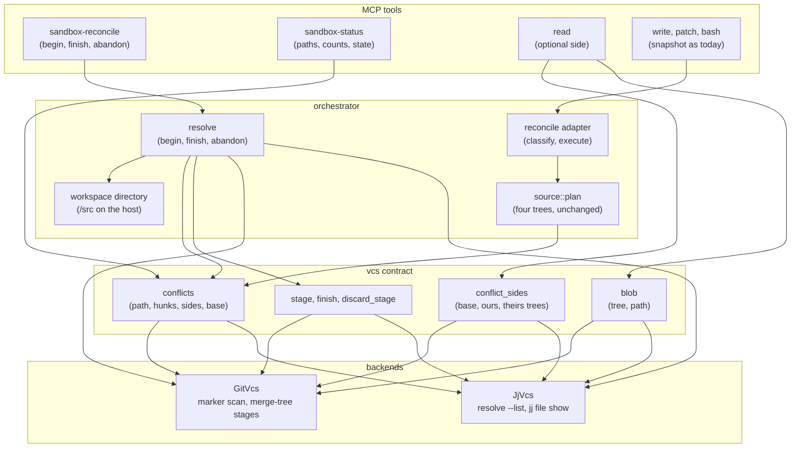

# Agent-side conflict resolution

## Approach

Extend the existing reconciliation path rather than add a parallel one. The four-tree plan in `orchestrator/source.rs` already classifies every sandbox state and already reads `Vcs::conflicts` for the shared branch, so resolution becomes a second consumer of the same classification with three explicit actions: begin, finish and abandon. Begin writes the conflicted revision into the sandbox workspace that already exists. Finish asks the backend whether the working copy still conflicts, reports the per-side difference, and then performs the host write itself. Abandon rebuilds the merge from its recorded parents and writes it again. The contract grows three operations and one field, both backends implement them, and no backend gains a path into the sandbox.

No requirement in the spec is marked `assumption`. Two claims carry the most weight and both come from the map's probes rather than from this plan. Git answers the three sides from `merge-tree` stage entries, which the T-023 output shows as blob ids per stage. jj answers the three sides from the parents of the resolution revision, which T-003 establishes with `jj diff --from <base> --to <ours>`. If either fails during implementation, the per-side report degrades to paths only and FR-007 still holds.

## Architecture

Four layers, each with one job. The MCP tools translate arguments and append the workspace block. `orchestrator/resolve.rs` owns the three actions and the host write. The `vcs` contract gains `blob` and richer `Conflict` values while keeping revisions and trees opaque. The backends answer from git2 and from the `jj` binary as they do today.

The plan in `orchestrator/source.rs` does not change. `Action` gains no resolution variants because resolution is not a planning decision: the plan already says whether the shared branch conflicts, and `begin` reads that state rather than recomputing it.

The workspace directory stays the only tree. Resolution replaces its content, and the snapshot that follows every mutating tool commits to the revision under resolution because `set_sandbox_tip` already points there under `Bound` and `AdoptContent` already rewrites it otherwise.

## Technologies

| Technology | Role |
|------------|------|
| git2 | Reads trees and blobs for the Git backend, and for jj's co-located clone |
| jj | Shelled out to for `resolve --list`, `new` and `squash`; pinned minimum version as the jj ADR does |
| rmcp | Carries the new tool arguments and the workspace block |
| serde and schemars | Derive the MCP argument schemas and the serialized reports |

## Components

### vcs conflict type

Richer conflict values

`vcs::Conflict` gains `hunks`, `sides` and `base`. `sides` counts content sides so jj's two-sided answer and Git's three index stages agree; `base` reports whether a base exists. Every constructor and test in `vcs/mod.rs` and `testing/vcs.rs` follows.

### vcs blob operation

Serves one file from one tree

New `Vcs::blob(tree, path) -> Option<Vec<u8>>`. It is the primitive `read` needs for a side and it keeps tree identities opaque. Git resolves the path inside a tree with git2; jj resolves it against the clone's Git backend, which `tree_id` already uses.

### Git conflict check

Answers whether a tree conflicts

`GitVcs::conflicts` scans the tree a snapshot would commit for lines beginning with the three markers, and counts regions per path. It replaces the current `Unsupported` return at `vcs/git/scm.rs:886`. It reads trees, never the index.

### Git conflict sides

Answers base, ours and theirs

`GitVcs::conflict_sides` reads the stage entries from a `merge-tree` run against the recorded base and returns their blob ids as trees. The T-023 output gives one entry per stage per path.

### jj conflict counts

Keeps the side count

`vcs::jj::ops::conflicts` parses `path    N-sided conflict` and keeps N instead of taking the first token and dropping the rest. Region counts come from the materialised tree.

### jj conflict sides

Answers base, ours and theirs

`JjVcs::conflict_sides` derives the three trees from the revision's parents through `jj diff` ranges, which T-003 established. It replaces the current `Unsupported` return at `vcs/jj/mod.rs:669`.

### orchestrator resolve

Owns begin, finish and abandon

New `orchestrator/resolve.rs`. Begin refuses an open resolution, materialises the conflict and records that a resolution is open with the `synced` revision it began from. The revision under resolution is read fresh from the working copy and never stored, because resolving rewrites it. Finish re-reads the conflict state, builds the per-side report and performs the host write. Abandon rebuilds the merge from its parents and writes it again. It names no ref and no backend.

### workspace materialisation

Changes what the sandbox holds

For Git and jj `Copied` it writes the conflicted tree through `materialise` with the snapshot filter, so ignored paths survive. For jj `Bound` it creates the merge with `jj new <shared> <sandbox>` and never edits an existing revision.

### MCP sandbox-reconcile

Carries the three actions

The tool argument gains `action` with the values `begin`, `finish` and `abandon`, and loses host staging. It returns the revision it started from, or the report and the resulting tip on finish, and always appends the workspace block.

### MCP sandbox-status

The conflict report

New tool. It returns the source state, the revisions, and for each conflicted path the hunk count, the side count and whether a base exists. It returns no region text. The map already names this tool and it does not exist yet.

### MCP read side

One file from one side

`ReadArgs` gains `side` with the values `base`, `ours` and `theirs`. When it is absent the tool runs `cat` in the sandbox as today. When it is present the tool asks the orchestrator for `conflict_sides` then `blob` and returns the text, so the sandbox still sees one tree.

### Host staging demotion

Keeps the operator path

`reconcile` with `--finish` and `--abort` in `cli.rs` keeps staging a linked worktree on the host. The MCP tool stops calling it, so no MCP call creates a host worktree. The orchestrator functions stay where they are.

## Data Flow

Begin. The agent calls `sandbox-reconcile` with `begin`. The orchestrator classifies the sandbox, reads the shared and sandbox revisions and asks `Vcs::conflicts` for the shared branch. When the shared branch is clean the call fails and reports the state. Otherwise it snapshots the workspace, materialises the conflicted revision into the workspace directory, records that a resolution is open with the `synced` revision it began from, and returns the workspace block with the conflicted paths and their counts.

Reading. The agent calls `sandbox-status` and gets paths with hunk and side counts. It calls `read` with `side: ours` for a path and gets that side's bytes, which lets it run a three-way merge instead of editing markers.

Editing. `write`, `patch` and `bash` behave as they do today. Each one plans, runs the tool and snapshots, so the resolution is committed to the revision under resolution.

Finish. The agent calls `sandbox-reconcile` with `finish`. The orchestrator re-reads the conflict state. If the backend still reports a conflict the call fails and names the paths. Otherwise it computes the per-side report from `conflict_sides` and `blob`, performs the host write, and returns the report with the new tip. The write is a merge commit on the host for Git, a bookmark move for a jj divergence and a squash into the introducing revision for a jj conflicted tip.

Abandon. The agent calls `sandbox-reconcile` with `abandon`. The orchestrator rebuilds the merge from the recorded parents, writes it into the workspace directory again, clears the open resolution and reports the restored state. No repository-wide operation runs.

## Deployment

No deployment change. The resolution path is local and lazy, the jj binary is already a prerequisite of the jj backend, and the Git marker scan uses the repository the backend already opened.

