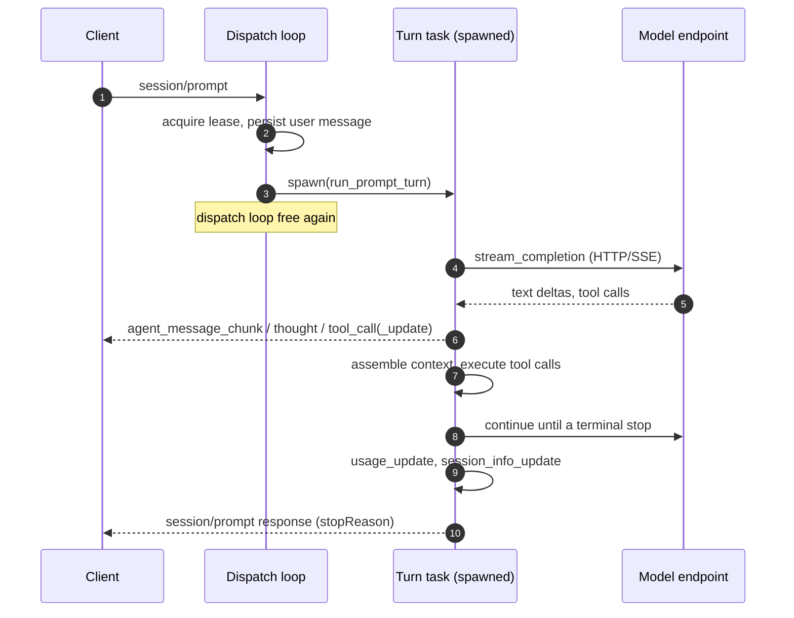
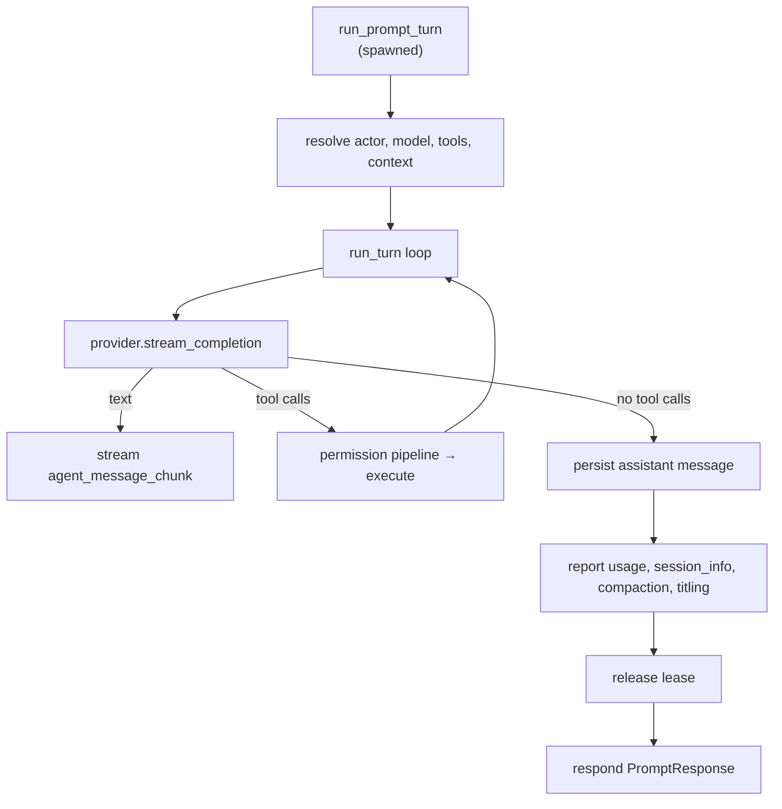
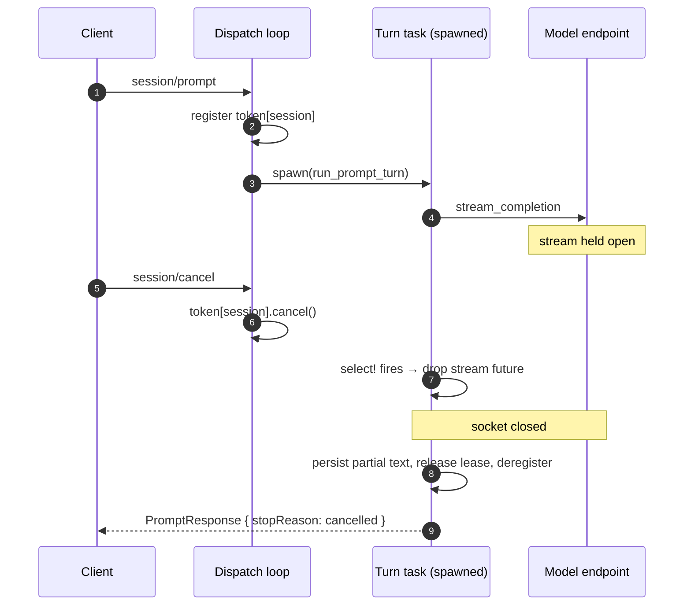

# The prompt turn

A *turn* is one `session/prompt` and everything it causes: the slash-command intercepts, the model requests, the tool calls, and the response that reports how it ended. This page is the account of the turn's control flow and of how a turn is cancelled. It describes the intended design; the cancellation mechanism is specified in `adrs/2026-10-24-tackle-turn-cancellation`.

## Lifecycle

The connection's dispatch loop receives `session/prompt`, acquires the session's one-turn lease, persists the user message, and then **spawns** the turn on its own task. The spawned turn is what the client observes: it streams updates and, when it ends, sends the `session/prompt` response.

The response is sent by the *turn task*, not the dispatch loop, because the turn awaits client messages — a `session/request_permission` for a tool call has to be routed by the dispatch loop while the turn is still running. Running the turn inline on the dispatch task would deadlock on its own permission reply. This detach is the reason cancellation is not simply "the prompt handler returns early".

The turn's terminal state rides the `session/prompt` response as an ACP `stopReason`: `end_turn`, `max_turn_requests`, or `cancelled`.

## The turn loop

Once spawned, a turn resolves the actor, model, tools, and context, then runs the model loop. The loop issues a streamed model request; if the response carries tool calls, each is dispatched through the permission pipeline and the model is asked again, until the model finishes or the request cap trips.

A turn can block in more than one place, and cancellation has to reach each. The streamed model request is the first. **Tool-call execution** is the second: it may await a permission reply or an external tool, so it is raced against the token too — a cancelled tool call drops the in-flight call and cancels its pending `session/request_permission`. **Retry backoff** is the third: rather than race the sleep, the loop treats it as a bounded pause and re-checks the token at the top of every iteration, so a cancel during backoff stops the turn before it issues a fresh request. Cancellation is thus observed around each awaited request, and checked between iterations.

## Cancellation

Cancellation is **cooperative**. A turn is not killed; it is signalled, and it stops at a boundary it controls so it can finalise (persist partial output, release the lease, answer the client). The signal is a `tokio_util` `CancellationToken`, chosen because it offers both shapes a turn needs — a `select!`-able `cancelled()` around the in-flight stream, and a synchronous `is_cancelled()` between iterations — and because it matches the poll-based model the ACP SDK already exposes for `RequestCancellation`.

### Three triggers, one signal

ACP v1 defines three inbound signals that stop an in-flight prompt. All three converge on the same per-turn token, so a turn cannot be cancelled by one path and left running by another.

| Trigger | Wire shape | How it reaches the turn |
| --- | --- | --- |
| `session/cancel` | notification (session id) | a notification handler looks up the session's token and cancels it |
| `session/close` | request (session id) | the close handler cancels the token before running the existing close path |
| `$/cancel_request` | protocol notification (request id) | the SDK marks the request's `Responder` cancellation; the turn races that marker |

`session/cancel` and `session/close` carry a session id rather than a JSON-RPC request id, so tackle keeps a small **session → token** registry while a turn is in flight. `$/cancel_request` needs no registry: the SDK records it on the `Responder` before the handler runs, and the turn races `responder.cancellation()` directly.

`session/close` and `$/cancel_request` produce the same sequence with a different first arrow; the turn's behaviour after the signal is identical.

### Where it lands in code

| Step | Location |
| --- | --- |
| Spawn the turn, register its token | `acp_v1/prompt.rs` (`run_model_turn_case`) |
| Observe cancellation around the turn | `agent/prompt.rs` → `agent/turn.rs` (`stream_completion`) |
| `session/cancel` handler | `acp_v1/server.rs` builder (new `on_receive_notification`) |
| `session/close` signal | `acp_v1/sessions.rs` (`handle_close_session`) |
| `$/cancel_request` bridge | `acp_v1/prompt.rs` (`responder.cancellation()`) |
| Finalise (`cancelled` stop reason) | `acp_v1/prompt.rs` (response mapping) |

### Finalisation

On cancel the turn persists assistant text already streamed, releases its lease, removes its registry entry, and responds with `stopReason: cancelled`. Because the turn task is itself the responder, this is ordinary control flow — the abort boundary is a `select!` the turn owns, not a drop that unwinds it.

### Registry scope

The registry is a session → token map that exists only while a turn is in flight. It is **connection-scoped**, living beside the other per-connection state (the terminal map, the editor toggles, the connection's MCP pool).

Over stdio the scope question does not arise: the client launches the agent as a subprocess, so there is exactly one connection per process and the registry is trivially the only one. Tackle's HTTP transport, by contrast, can serve several connections within one process, so connection scope is a deliberate policy there: a `session/cancel` reaches the turn only when it arrives on the connection that owns it, and a cancel on a different connection is not forwarded.

Connection scope is chosen for both fit and policy. It is the natural home for per-connection facilities; the handlers that need it already hold the connection's negotiation state; and it is released with the connection rather than needing explicit deregistration. It also matches the rest of the transport model — the terminal map and MCP pool are likewise connection-local — and the assumption that the client that opened the session drives its own turn. The registry is keyed by session id, so one connection serving several sessions is still covered. Cancelling a turn from a *different* connection or process is out of scope; see `adrs/2026-10-24-tackle-turn-cancellation`.

## Conformance

The turn's cancellation behaviour is pinned by the acp-tck requirements `ACP-CANCEL-001`, `ACP-CANCEL-002`, `ACP-CLOSE-002`, and `ACP-JSONRPC-007`. The in-repo golden-transcript suite is the fast regression guard these paths are meant to grow into: as it stands it replays only the lifecycle transcript, and the acp-tck baseline still records the cancellation requirements as known gaps pending the mechanism (`adrs/2026-10-24-tackle-turn-cancellation`). See [ACP protocol surface](./acp) for the conformance posture.
