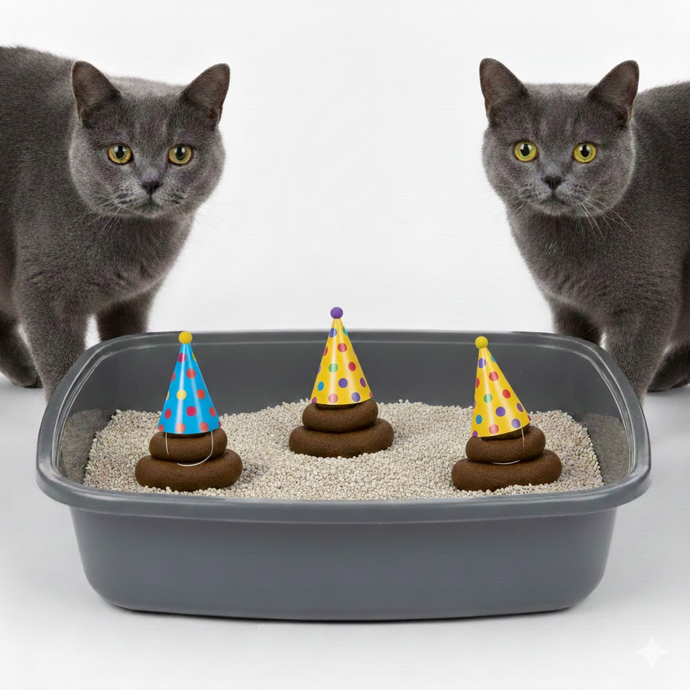
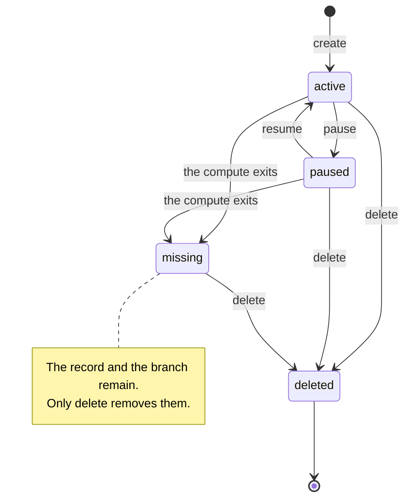
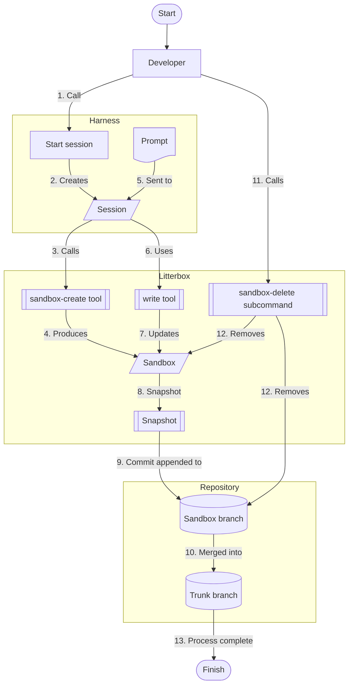

# 👋 Introducing Litterbox

Litterbox couples source control branching with compute sandboxes to provide AI coding agents with dedicated, isolated environments.

Each sandbox runs inside the sandboxing mechanism you choose, with its own working copy. You configure your development harness (such as Cursor, Claude Code, or OpenCode) to restrict operations to Litterbox tools, ensuring all edits and executions occur within that sandbox. After each operation, Litterbox snapshots the sandbox’s working copy and updates the corresponding branch in your host Git repository with the diff.

To allow you to interact with sandboxes, Litterbox can forward ports from servers running inside the sandbox to your local machine. It'll pick unused ports for each sandbox automatically.

## Sandbox lifecycle

A sandbox is a name, a Git branch and a unit of compute. The branch is the durable
half; the compute is the half that can disappear. Litterbox derives the state on
every operation rather than storing it.

Every command expects an `active` sandbox. A `paused` sandbox accepts no work, and
a `missing` sandbox is a record whose compute has exited: the branch and its work
survive, but nothing can run until the sandbox is recovered or deleted. See
[Sandbox lifecycle](./lifecycle) for the operations valid in each state, the
failure classes, and how to recover a missing sandbox.

## Workflow

To better visualise how Litterbox works, let's walk through a simple example of an agent spinning up a sandbox and writing a single file.

## Prerequisites

- A Docker engine, for instance:
  - Docker Desktop or similar
  - Lima or similar
