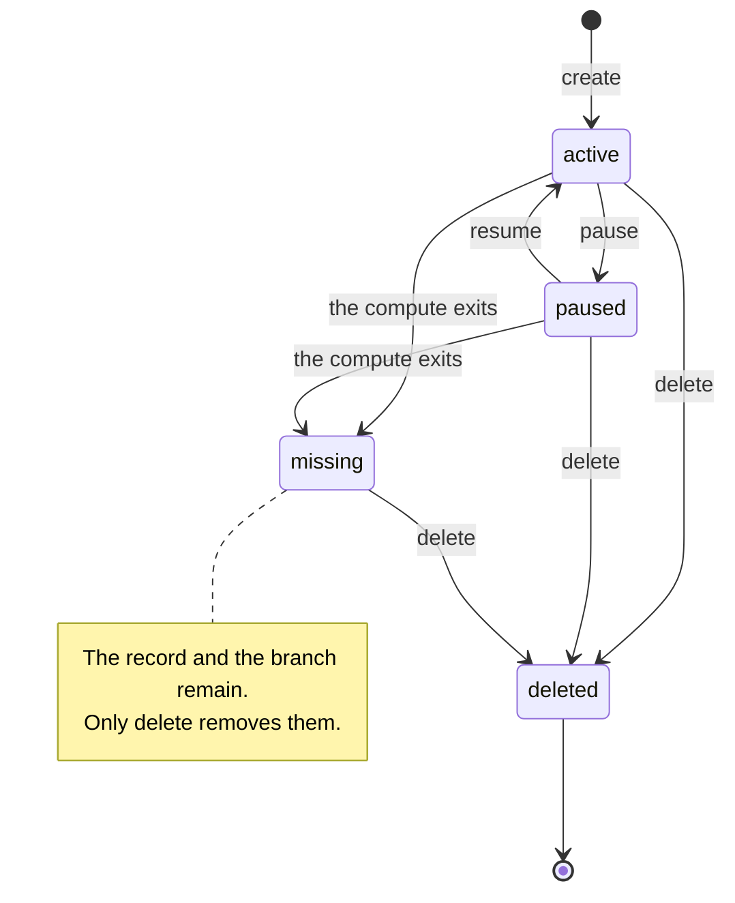

# ♻️ Sandbox lifecycle

A sandbox is a name, a Git branch and a unit of compute. The name is the
identity, and the branch is the durable half: it holds the work. The compute is
the throwaway half, and it can disappear without the sandbox disappearing with
it.

## States

| State     | Meaning                                                                   |
| --------- | ------------------------------------------------------------------------- |
| `active`  | The compute is running and accepts commands.                              |
| `paused`  | The compute exists but is frozen. It accepts no work until it is resumed. |
| `missing` | The record and the branch exist; the compute has exited.                  |
| `unknown` | The backend could not be asked. `list` prints this with the reason.       |
| `error`   | The backend was asked and reported a failure, with the reason.            |

`active`, `paused` and `missing` are derived every time Litterbox looks: the
record's process ids are checked against the running processes. Nothing is
stored as "missing". `unknown` and `error` are reporting states rather than
lifecycle states — they describe an answer about the backend, not a phase the
sandbox moves through.

## The lifecycle

A sandbox is created `active`. Pausing and resuming move it between `active` and
`paused`, and both are safe to repeat: pausing an already-paused sandbox and
resuming an already-active one do nothing. The compute can exit at any time — a
reboot, a killed process, a full disk — and the sandbox becomes `missing`
without Litterbox being told. The next operation that needs live compute repairs
it from the branch and workspace, and reports the repair.

## Operations by state

### Command line

| Command  | `active`                   | `paused`                            | `missing`                                  |
| -------- | -------------------------- | ----------------------------------- | ------------------------------------------ |
| `list`   | reported as `active`       | reported as `paused`                | reported as `missing`; the listing exits 0 |
| `shell`  | runs the command           | exits 4, `conflict`, naming the resume command | repairs the sandbox, warns, then runs |
| `pause`  | freezes the sandbox        | succeeds, changing nothing          | exits 3, not found                         |
| `resume` | succeeds, changing nothing | thaws the sandbox                   | exits 3, not found                         |
| `delete` | refused without `--force`  | removes the record and the branch   | refused without `--force`; with it, removes record, workspace and branch |

### MCP

| Tool                                                   | `active`           | `paused`                            | `missing`          |
| ------------------------------------------------------ | ------------------ | ----------------------------------- | ------------------ |
| `bash`, `read`, `write`, `patch`, `ls`, `glob`, `grep` | runs               | invalid params, `conflict`, naming the resume command | repairs, appends a recovery block, then runs |
| `sandbox-ports`                                        | the recorded ports | the recorded ports                  | the recorded ports |
| `sandbox-create`                                       | conflict           | conflict                            | repairs and reports the recovery |

`sandbox-create` is not an operation on an existing sandbox: it takes a new
name, and any name already in use — `active`, `paused` or `missing` — is a
conflict. `sandbox-ports` answers from the record, so the same ports come back
whether or not the compute is alive; a backend that does not forward ports
reports the operation as unsupported.

:::warning Paused sandboxes are refused early

A command sent to a paused sandbox is refused before any namespace is opened or
joined. The command returns immediately with `conflict` and names the resume
command. A `timeout` is irrelevant because nothing runs. Resume the sandbox
first.

:::

The MCP surface still has no tool to list, inspect, pause, resume or delete a
sandbox. Those are command-line operations. An agent that finds a missing
sandbox now recovers it on the next command tool call, and sees the repair in a
structured recovery block.

## When a client asks for the wrong thing

Litterbox classifies a failure by what it means, not by which backend or which
state produced it. The command line's exit code and the MCP error class both
come from that one classification.

| Situation                                    | Class         | Command line | MCP                                     |
| -------------------------------------------- | ------------- | ------------ | --------------------------------------- |
| The name has no record                       | `not-found`   | exit 3       | `invalid_params`, `class: not-found`    |
| The record exists but the compute has exited | `not-found`   | exit 3 (or a repair) | `invalid_params`, `class: not-found`    |
| Creating a name that is already in use       | `conflict`    | exit 4       | `invalid_params`, `class: conflict`     |
| A command addressed to a paused sandbox      | `conflict`    | exit 4       | `invalid_params`, `class: conflict`     |
| The backend does not provide the operation   | `unsupported` | exit 5       | `invalid_request`, `class: unsupported` |
| Permission was refused                       | `denied`      | exit 6       | `invalid_request`, `class: denied`      |
| The backend cannot run on this host          | `unavailable` | exit 7       | `invalid_request`, `class: unavailable` |
| The operation ran and failed                 | `failed`      | exit 1       | `internal_error`, `class: failed`       |

Two cases are deliberately not errors:

- **Inspecting a missing sandbox succeeds.** It reports `missing`, because that
  is the honest answer and it is what `list` shows.
- **A missing sandbox is repaired on the next operation.** The CLI warns on
  stderr; MCP appends a structured recovery block. The branch is never deleted
  by a repair.
- **Deleting a missing sandbox requires `--force`.** The branch may hold
  unmerged work. With `--force`, the record, workspace and branch are removed
  and the command states exactly what it removed.

## Recovering a missing sandbox

A missing sandbox repairs itself on the next command, upload, download or
snapshot. The repair reuses the workspace, keeps the branch, and starts new
compute against the same name. If the workspace is gone, it is materialised
from the branch and the sandbox's provisioning steps run again.

If the branch is gone, repair refuses and names the next command:
`litterbox delete --force <name>`, then create it again. A corrupt record is not
guessed at; `litterbox delete --force <name>` removes it and reports any compute
it could not stop.

The branch remains the durable copy. It is a normal branch: inspect it, merge or
cherry-pick from it, and only then delete the sandbox.
