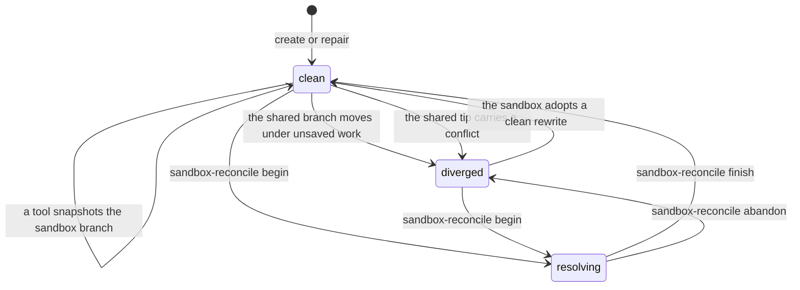

# ♻️ Sandbox lifecycle

A sandbox is a name, a pair of Git refs and a unit of compute. The name is the
identity. The shared branch `litterbox/<name>` is the user's branch, and the
sandbox branch `refs/litterbox/workspaces/<name>` holds the sandbox's own work.
The compute is the throwaway half, and it can disappear without the sandbox
disappearing with it.

## States

A sandbox has a compute state and a source state. They are independent.

| Compute state | Meaning                                                                   |
| ------------- | ------------------------------------------------------------------------- |
| `active`      | The compute is running and accepts commands.                              |
| `paused`      | The compute exists but is frozen. It accepts no work until it is resumed. |
| `missing`     | The record and the branches exist; the compute has exited.                |
| `unknown`     | The backend could not be asked. `list` prints this with the reason.       |
| `error`       | The backend was asked and reported a failure, with the reason.            |

| Source state | Meaning                                                                                       |
| ------------ | --------------------------------------------------------------------------------------------- |
| `clean`      | The shared branch is where the sandbox last agreed, and the workspace matches its own branch.  |
| `diverged`   | The shared branch advance is held: it moved under unsaved work, or its tip carries a conflict. |
| `resolving`  | A `sandbox-reconcile` resolution is open in the sandbox.                                      |

`active`, `paused` and `missing` are derived every time Litterbox looks: the
record's process ids are checked against the running processes. Nothing is
stored as "missing". `unknown` and `error` are reporting states rather than
lifecycle states — they describe an answer about the backend, not a phase the
sandbox moves through.

`clean`, `diverged` and `resolving` come from the record and the refs. A
`diverged` sandbox runs normally; only the advance of the shared branch waits.
A `resolving` sandbox is also `diverged` in the sense that the advance waits, but
`resolving` is reported because a resolution is the active workflow.

## The lifecycle

A sandbox is created `active` and `clean`. Pausing and resuming move it between
`active` and `paused`, and both are safe to repeat: pausing an already-paused
sandbox and resuming an already-active one do nothing. The compute can exit at
any time — a reboot, a killed process, a full disk — and the sandbox becomes
`missing` without Litterbox being told. The next operation that needs live
compute repairs it from the sandbox branch and workspace, and reports the
repair.

The source state is orthogonal:

## Operations by compute state

### Command line

| Command   | `active`                   | `paused`                            | `missing`                                  |
| --------- | -------------------------- | ----------------------------------- | ------------------------------------------ |
| `list`    | reported as `active`       | reported as `paused`                | reported as `missing`; the listing exits 0 |
| `shell`   | runs the command           | exits 4, `conflict`, naming the resume command | repairs the sandbox, warns, then runs |
| `pause`   | freezes the sandbox        | succeeds, changing nothing          | exits 3, not found                         |
| `resume`  | succeeds, changing nothing | thaws the sandbox                   | exits 3, not found                         |
| `status`  | reports the source state   | reports the source state            | reports the source state                   |
| `reconcile` | stages, finishes or aborts the host merge | unchanged; it does not join | unchanged                     |
| `delete`  | refused without `--ignore-running` | removes the record and branches; `--ignore-unmerged` when work would be lost | removes the record and branches; `--ignore-unmerged` when work would be lost |

### MCP

| Tool                                                   | `active`           | `paused`                            | `missing`          |
| ------------------------------------------------------ | ------------------ | ----------------------------------- | ------------------ |
| `bash`, `read`, `write`, `patch`, `ls`, `glob`, `grep` | runs               | invalid params, `conflict`, naming the resume command | repairs, appends a recovery block, then runs |
| `sandbox-ports`                                        | the recorded ports | the recorded ports                  | the recorded ports |
| `sandbox-create`                                       | conflict           | conflict                            | repairs and reports the recovery |
| `sandbox-status`                                       | reports the source state | reports the source state       | reports the source state |
| `sandbox-reconcile`                                    | begins, finishes or abandons a resolution | invalid params, `conflict`, naming the resume command | repairs, then begins, finishes or abandons |

`sandbox-create` is not an operation on an existing sandbox: it takes a new
name. A name whose compute is `active` or `paused` is a conflict, including when
its source state is `diverged` or `resolving`. A name whose compute is `missing`
is repaired and keeps its source state. `sandbox-ports` answers from the record, so the
same ports come back whether or not the compute is alive; a backend that does
not forward ports reports the operation as unsupported.

## Operations by source state

### Command line

| Command   | `clean`                    | `diverged`                  | `resolving`                 |
| --------- | -------------------------- | --------------------------- | --------------------------- |
| `list`    | `clean`                    | `diverged`                  | `resolving`                 |
| `shell`   | runs; a snapshot advances the shared branch | runs; a snapshot stays on the sandbox branch | runs; edits are the resolution |
| `pause`   | compute only               | compute only                | compute only                |
| `resume`  | compute only               | compute only                | compute only                |
| `status`  | clean                      | diverged, with the reason   | resolving, with the conflicts |
| `delete`  | no unmerged flag           | `--ignore-unmerged`         | `--ignore-unmerged`         |

### MCP

| Tool                | `clean`                    | `diverged`                  | `resolving`                 |
| ------------------- | -------------------------- | --------------------------- | --------------------------- |
| command tools       | run; a snapshot advances the shared branch | run; a snapshot stays on the sandbox branch | run; edits are the resolution |
| `sandbox-status`    | clean                      | diverged, with the reason   | resolving, with the conflicts |
| `sandbox-reconcile` | begin fails; nothing to resolve | begins when the divergence conflicts and the shared tip is clean; fails otherwise | begin fails; finish and abandon close it |
| `sandbox-create` on a missing name | repair lands clean | repair keeps the divergence | repair keeps the resolution |

Neither `diverged` nor `resolving` refuses a command tool. The sandbox keeps
working; only the shared branch does not advance.

:::warning Paused sandboxes are refused early

A command sent to a paused sandbox is refused before any namespace is opened or
joined. The command returns immediately with `conflict` and names the resume
command. The same applies to the three `sandbox-reconcile` actions, which join
the workspace. A `timeout` is irrelevant because nothing runs. Resume the
sandbox first.

:::

`status` does not join, so it answers while the sandbox is paused. It reports
`resolving` with the conflicts in the working copy, or `diverged` with the
reason, without starting compute.

The MCP surface still has no tool to list, inspect, pause, resume or delete a
sandbox. Those are command-line operations. An agent that finds a missing
sandbox recovers it on the next command tool call, and sees the repair in a
structured recovery block.

## When a client asks for the wrong thing

Litterbox classifies a failure by what it means, not by which backend or which
state produced it. The command line's exit code and the MCP error class both
come from that one classification.

| Situation                                    | Class         | Command line | MCP                                     |
| -------------------------------------------- | ------------- | ------------ | --------------------------------------- |
| The name has no record                       | `not-found`   | exit 3       | `invalid_params`, `class: not-found`    |
| The record exists but the compute has exited | `not-found`   | exit 3 (or a repair) | `invalid_params`, `class: not-found`    |
| Creating a name that is already in use       | `conflict`    | exit 4       | `invalid_params`, `class: conflict`     |
| A command addressed to a paused sandbox      | `conflict`    | exit 4       | `invalid_params`, `class: conflict`     |
| A delete guard has not been overridden       | `denied`      | exit 6       | `invalid_request`, `class: denied`      |
| The backend does not provide the operation   | `unsupported` | exit 5       | `invalid_request`, `class: unsupported` |
| Permission was refused                       | `denied`      | exit 6       | `invalid_request`, `class: denied`      |
| The backend cannot run on this host          | `unavailable` | exit 7       | `invalid_request`, `class: unavailable` |
| The operation ran and failed                 | `failed`      | exit 1       | `internal_error`, `class: failed`       |

Two cases are deliberately not errors:

- **Inspecting a missing sandbox succeeds.** It reports `missing`, because that
  is the honest answer and it is what `list` shows.
- **A missing sandbox is repaired on the next operation.** The CLI warns on
  stderr; MCP appends a structured recovery block. Neither branch is deleted by
  a repair.

## Recovering a missing sandbox

A missing sandbox repairs itself on the next command, upload, download or
snapshot. The repair reuses the workspace. If the workspace is gone, it
materialises the **sandbox branch**, `refs/litterbox/workspaces/<name>`, because
that is where the agent's own work lives. The recovery block reports
`source: sandbox`.

When the sandbox branch is absent, repair falls back to the shared branch and
reports `source: shared` with a `fallback` naming the missing ref and the
recovery. This is the case for a record written before the branch split. In Git,
`git fsck --lost-found` in the store may still list the sandbox work, and
`git update-ref refs/litterbox/workspaces/<name> <commit>` restores the ref. In
jj, `jj op log` names the commit and `jj workspace add --name <name> --revision
<commit>` re-attaches the workspace. Continuing from the shared branch is the
alternative; pushing the sandbox branch is not a recovery.

If both refs are gone, repair refuses and names the delete command.

An open resolution is different. Its revision and its recorded `ours` parent
are only addressable through the sandbox ref. If that ref is gone, repair
refuses rather than clearing the resolution, and both `status` and
`sandbox-status` answer with `resolving`, `sandbox: null`, the recorded
`synced`/`ours` and a `next`:

- **Git:** in the VCS store, `git fsck --lost-found` lists the dangling
  resolution merge whose parents are `ours` and the shared tip. Restore it with
  `git update-ref refs/litterbox/workspaces/<name> <commit>`. If the merge is
  gone, restore the ref at `ours`, abandon the open resolution with
  `sandbox-reconcile abandon`, then run `sandbox-reconcile begin`.
- **jj:** in the clone, `jj op log` or `jj log -r 'all()'` names the commit.
  Re-attach it with `jj workspace add --name <name> --revision <commit>`. If it
  is gone, add the workspace at `ours`, abandon the open resolution with
  `sandbox-reconcile abandon`, then run `sandbox-reconcile begin`.
- Do not push the sandbox branch to the shared branch: that publishes a
  conflicted tree and is not a recovery.
- If neither commit is recoverable, inspect the shared branch and run
  `litterbox delete <name> --ignore-unmerged`, adding `--ignore-invalid` when
  the record cannot be read, then create it again.

## Deleting a sandbox

`delete` has three independent guards. Each has its own flag, and a refusal
names every flag the record needs. Passing one flag does not satisfy another.

| Guard       | Holds when                                                                 | Flag                 |
| ----------- | -------------------------------------------------------------------------- | -------------------- |
| `running`   | The compute is `active`.                                                   | `--ignore-running`   |
| `invalid`   | The compute is unknown, the backend cannot be asked, or the record is unreadable. | `--ignore-invalid`   |
| `unmerged`  | The sandbox branch has work the shared branch does not, a resolution is open, or a staging workspace exists. | `--ignore-unmerged`  |

A `paused` or `missing` sandbox needs no compute flag. With every required flag,
delete stops compute when it can, removes the staging workspace, the shared
branch, the sandbox branch and the synced ref, and removes the record. It prints
each path and ref it removed, and says when compute could not be stopped. A flag
whose condition did not hold is accepted and reported as unused.

The branch remains the durable copy until it is deleted. It is a normal branch:
inspect it, merge or cherry-pick from it, and only then delete the sandbox.
