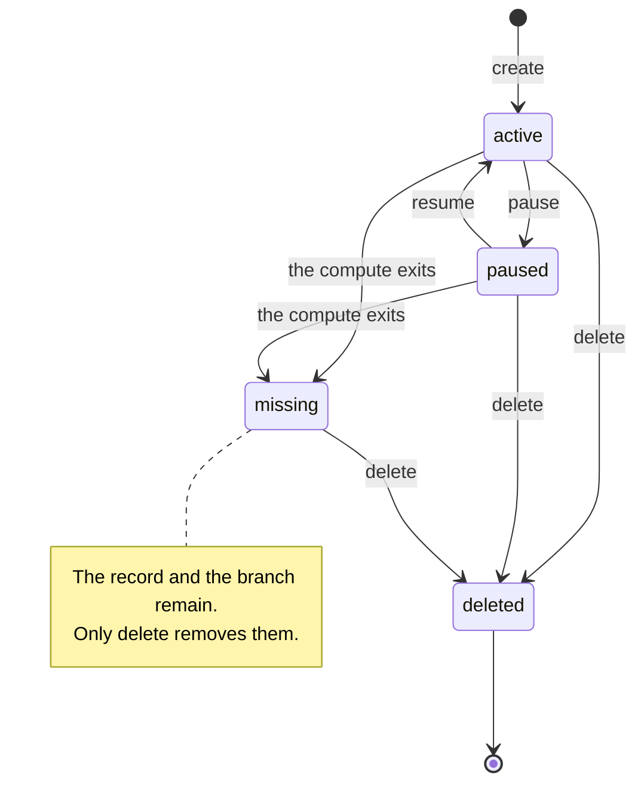

# ♻️ Sandbox lifecycle

A sandbox is a name, a Git branch and a unit of compute. The name is the
identity, and the branch is the durable half: it holds the work. The compute is
the throwaway half, and it can disappear without the sandbox disappearing with
it.

## States

| State     | Meaning                                                                 |
| --------- | ----------------------------------------------------------------------- |
| `active`  | The compute is running and accepts commands.                            |
| `paused`  | The compute exists but is frozen. It accepts no work until it is resumed. |
| `missing` | The record and the branch exist; the compute has exited.                |
| `unknown` | The backend could not be asked. `list` prints this with the reason.     |
| `error`   | The backend was asked and reported a failure, with the reason.          |

`active`, `paused` and `missing` are derived every time Litterbox looks: the
record's process ids are checked against the running processes. Nothing is
stored as "missing". `unknown` and `error` are reporting states rather than
lifecycle states — they describe an answer about the backend, not a phase the
sandbox moves through.

## The lifecycle

A sandbox is created `active`. Pausing and resuming move it between `active` and
`paused`, and both are safe to repeat: pausing an already-paused sandbox and
resuming an already-active one do nothing. The compute can exit at any time — a
reboot, a killed process, a full disk — and the sandbox becomes `missing`
without Litterbox being told. Nothing transitions out of `missing` today except
`delete`.

## Operations by state

### Command line

| Command  | `active`                         | `paused`                                  | `missing`                                |
| -------- | -------------------------------- | ----------------------------------------- | ---------------------------------------- |
| `list`   | reported as `active`             | reported as `paused`                      | reported as `missing`; the listing exits 0 |
| `shell`  | runs the command                 | blocks until the sandbox is resumed       | exits 3, not found                       |
| `pause`  | freezes the sandbox              | succeeds, changing nothing                | exits 3, not found                       |
| `resume` | succeeds, changing nothing       | thaws the sandbox                         | exits 3, not found                       |
| `delete` | refused without `--force`        | removes the record and the branch         | removes the record and the branch        |

### MCP

| Tool                                                       | `active`            | `paused`                            | `missing`       |
| ---------------------------------------------------------- | ------------------- | ----------------------------------- | --------------- |
| `bash`, `read`, `write`, `patch`, `ls`, `glob`, `grep`     | runs                | blocks until the sandbox is resumed | `not found`     |
| `sandbox-ports`                                            | the recorded ports  | the recorded ports                  | the recorded ports |

`sandbox-create` is not an operation on an existing sandbox: it takes a new
name, and any name already in use — `active`, `paused` or `missing` — is a
conflict. `sandbox-ports` answers from the record, so the same ports come back
whether or not the compute is alive; a backend that does not forward ports
reports the operation as unsupported.

:::warning Paused sandboxes accept no work

A command sent to a paused sandbox joins its frozen cgroup, so it does not run
and does not return until the sandbox is resumed. A `timeout` does not help,
because the timer is frozen along with the command. Resume the sandbox first.

:::

The MCP surface has no tool to list, inspect, pause, resume or delete a
sandbox. Those are command-line operations, which is why an agent that finds a
missing sandbox can report it but cannot recover from it.

## When a client asks for the wrong thing

Litterbox classifies a failure by what it means, not by which backend or which
state produced it. The command line's exit code and the MCP error class both
come from that one classification.

| Situation                                   | Class          | Command line | MCP                                   |
| ------------------------------------------- | -------------- | ------------ | ------------------------------------- |
| The name has no record                      | `not-found`    | exit 3       | `invalid_params`, `class: not-found`  |
| The record exists but the compute has exited | `not-found`    | exit 3       | `invalid_params`, `class: not-found`  |
| Creating a name that is already in use      | `conflict`     | exit 4       | `invalid_params`, `class: conflict`   |
| The backend does not provide the operation  | `unsupported`  | exit 5       | `invalid_request`, `class: unsupported` |
| Permission was refused                      | `denied`       | exit 6       | `invalid_request`, `class: denied`    |
| The backend cannot run on this host         | `unavailable`  | exit 7       | `invalid_request`, `class: unavailable` |
| The operation ran and failed                | `failed`       | exit 1       | `internal_error`, `class: failed`     |

Two cases are deliberately not errors:

- **Inspecting a missing sandbox succeeds.** It reports `missing`, because that
  is the honest answer and it is what `list` shows.
- **Deleting a missing sandbox succeeds.** The compute is already gone, so the
  removal cannot lose anything. Deleting a sandbox that is already deleted is
  also a success, so a retried teardown converges.

## Recovering a missing sandbox

Today the only way out of `missing` is `litterbox delete`. That removes the
record **and the branch**, so any work that was only on the branch is lost.

Creating the same name again fails as a conflict, because the branch and the
state directory are still there. There is no reconciliation path that respawns
compute from an existing branch.

If a sandbox has gone missing and you want to keep its work, do not delete it.
The branch is a normal branch: inspect it, merge or cherry-pick from it, and
only then delete the sandbox.
