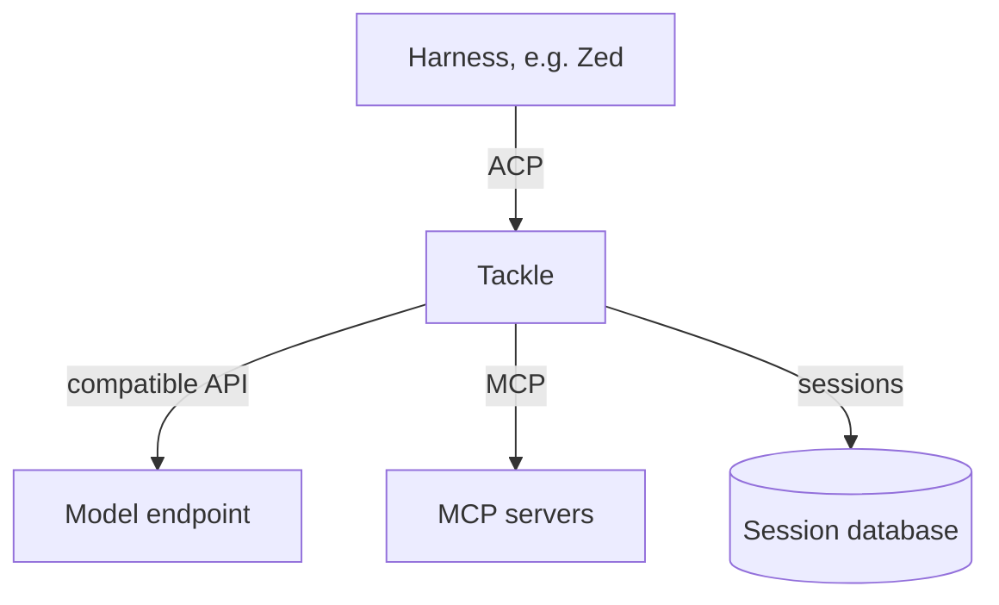

# 👋 Introducing Tackle

Tackle is an agentic harness for coding agents built on [Agent Client Protocol](https://agentclientprotocol.com) (ACP) you can use from a client such as your text editor. It provides the agent sessions end to end: it talks to any compatible model endpoint, connects to MCP servers for tools, and persists every session — prompts, model turns, tool calls, and usage — in a local session database you can fork, compact, and resume.

## How it works

1. Your harness starts a session with Tackle over stdio or HTTP.
2. Tackle proxies model requests to your configured endpoint, streaming tokens back to the harness.
3. Tool calls are dispatched to MCP servers from the project configuration.
4. Everything is persisted in the session database, ready to fork or resume.

## Key features

- **ACP sessions over stdio and HTTP**: wire up any ACP-compatible client, such as Zed. RPCs exposed by the ACP client are automatically made available as tools, allowing filesystem and terminal access via your editor without any additional tools.
- **Highly scriptable design** allows customisation of post-turn actions such as compaction and session titling, tool permisison policies; not just prompts and personas.
- **Persistent sessions**, where sessions are stored as a DAG of messages, allowing for forking of sessions at any point.
- **MCP tools**, which can be toggled on and off at any point during a session using `/mcp`, with support for interactive workflows via elicitation forwarding.
- **Direct tool invocation** via `/!tool`, bypassing the model and permissions.
- **Observability** via OpenTelemetry spans for turns, tool calls, and token usage, with type-level redaction of sensitive payloads.
