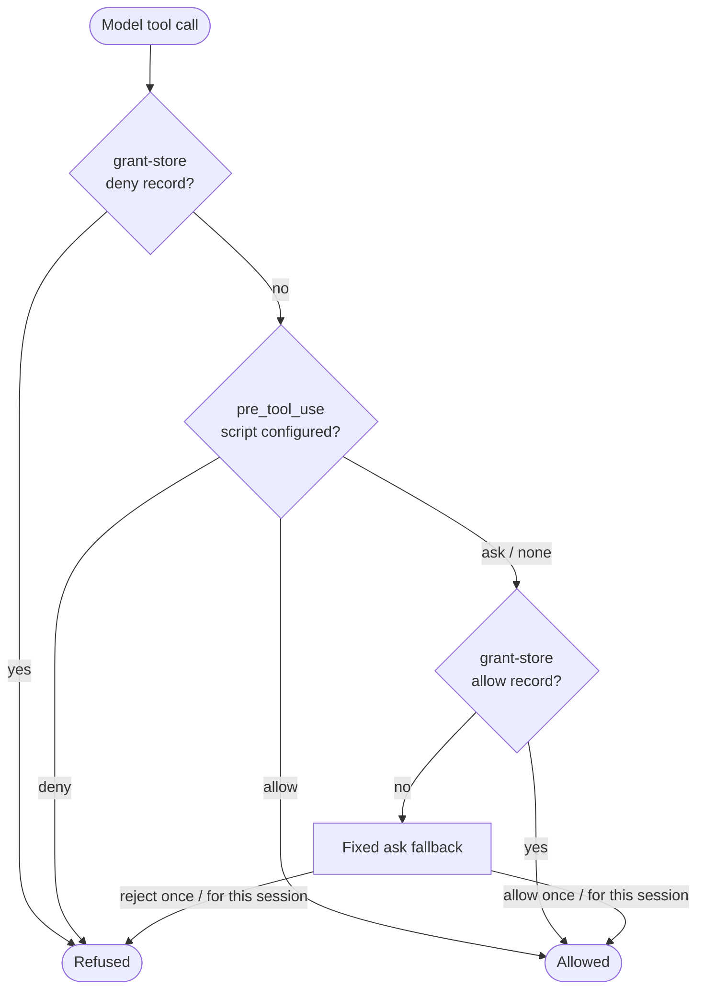

# 🔐 Permissions

Every tool call the model makes passes through the permission pipeline in a fixed order. Direct invocations via `/!` imply user consent and bypass it.

## The pipeline

Every model tool call runs the same fixed sequence:

The policy script sees whether a grant already exists; its `allow` and `deny` are final. The ask fallback is not configurable, and it runs regardless of whether the session is user-attended.

## Answering a prompt

The ask fallback presents four options:

| Option                  | Effect                                      |
| ----------------------- | ------------------------------------------- |
| Allow once              | This call proceeds; nothing is remembered   |
| Allow for this session  | A grant is recorded for this invokable      |
| Reject once             | This call is refused; nothing is remembered |
| Reject for this session | A standing rejection is recorded            |

A rejection is fed back to the model as the tool result, so it can adapt rather than retry blindly.

## Grants are in-memory and session-scoped

A grant is keyed by session, actor, and invokable, and it is gone when the session closes, when the process exits, and when a session is resumed after a restart.

## Cancellation

There is no harness-side timeout and no headless auto-reject. If a client cancels a permission request, or times out on its own, the outcome is **reject once**: no grant is written and the next ask asks again.

## Direct invocation

Typing `/!tool-name` runs a tool directly, with no model request and **no permission prompt**. You are the authority for your own action, so the pipeline is not consulted. This applies to MCP tools and to client-capability tools alike.

## Client tools and elicitation

The client's own tools (`client.fs.*`, `client.terminal.*`) take the same pipeline as MCP tools — there is one gate, not one per source.

MCP **elicitations**, which allows a server to ask the user a question mid-call, are surfaced through the same ACP permission request, but are a separate concern: answering one with "allow for this session" never grants a tool permission. Elicitation prompts are attributed to their originating server.

## Policy scripts

A `pre_tool_use` script is your hook for everything the fixed fallback cannot express: blanket denials by invokable name, argument inspection, or allowing a class of call outright. It cannot act — only decide. A script that errors or times out **fails closed to ask**, with the error surfaced.

See [Scripts](./scripts) for the event payload and a worked example.
