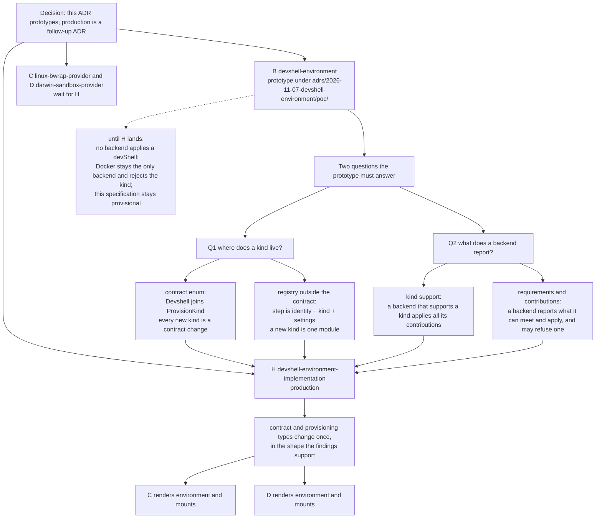
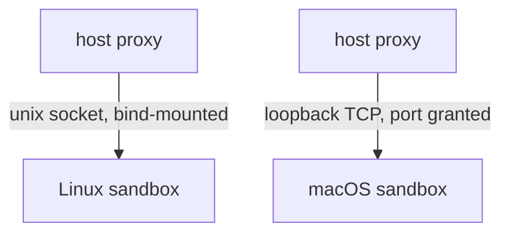

# Handover: `nix-devshell-sandbox`

Map complete: 26 tickets, none open. Detail in `evidence/`, decisions in `map.toon`.

`sandbox-provisioning` is implemented at
`adrs/2026-11-05-sandbox-provisioning`. It owns identity-named, typed steps, an
ordered provision list on each backend, the FR-021 amendment that a project may
name a backend to declare compatibility but not select one, machine overrides,
the `setup-command` migration and the doctor/preflight report.

Next is `devshell-environment`, which is a prototype, not production: adding a
kind raises two questions the spec cannot answer without evidence, and both
change types that already exist. Its findings feed
`devshell-environment-implementation`, and the two native backends depend on
that implementation rather than on the prototype. The devShell preparation does
not realise derivations: readiness checks the devShell is already valid in the
store, and create refuses if it is not. Automatic mechanism selection is
deferred to its own ADR (`automatic-backend-selection`). Proxy is the longest
pole for a usable sandbox: without it both native backends are offline-only.

## ADRs

What the prototype decision changes: the prototype answers two questions, the
production ADR consumes the answers, and the backends wait for the shape rather
than guess it. Until production lands, no backend applies a devShell and Docker
remains the only backend, rejecting the kind.

Around it: `sandbox-provider-contract` (A) and `sandbox-provisioning` (G) are
implemented; `egress-proxy` (E) and `automatic-backend-selection` (F) depend
only on A.

No "Nix provider" ADR: a devShell is an environment, not a backend.

## Prototypes

The three spikes remain in the tree; they are the worked evidence behind the
decision, not throwaway scratch.

| Prototype | Where | What it proves |
|---|---|---|
| bwrap isolation | `adrs/2026-10-31-linux-bwrap-sandbox/` | View built from unprivileged user namespaces; a Rust build runs with no network and a read-only store; the hostile half is denied (T-003, T-004, T-016) |
| bwrap lifecycle and limits | `adrs/2026-10-31-linux-bwrap-lifecycle/` | systemd user scope freeze/thaw, `MemoryMax` and `TasksMax`; the no-systemd process-group fallback (T-009, T-010) |
| Seatbelt | `adrs/2026-10-31-darwin-app-sandbox/` | `sandbox_init` applies an SBPL profile to an unsigned binary; a devShell build runs with no baseline addition (T-001, T-002, T-017) |

Each keeps its `poc/` and its `findings.md`; reproduce commands are at the top of
each findings file. T-024's holder-survival probe is beside the map at
`evidence/T-024-holder-survival.sh`.

## Decision

bwrap on Linux, `sandbox_init` on macOS, no virtualisation. Linux runs a holder
(`sleep infinity` in the namespaces) and every command `setns`es into it. macOS
has no namespace, so the profile is applied per command. Environment is captured
on the host; `nix` stays outside. Egress is a host-side proxy.

## Linux

- Addressable pid is bwrap's `child-pid` on `--json-status-fd`, not `$!`.
- `setgroups` is denied in the userns: `nsenter` needs `--preserve-credentials`.
- `--wd` resolves outside; use `--wdns`.
- `--disable-userns` does not block `setns`. It does prevent nested pid namespaces,
  which pause enumeration depends on.
- Killing pid 1 kills the pid namespace, including `setsid` escapees.
- Joined commands are children of the client, so `SIGSTOP` on the holder pauses
  nothing.
- Assign each joined pid to the sandbox scope before `exec`; freeze and limits then
  cover everything, and `cgroup.kill` tears it down atomically.
- No cgroups: pause is stop-and-rescan to fixpoint, not a one-pass sweep (a forker
  wrote 806 bytes while "paused"). A same-uid peer can livelock it.
- Delegation is not a boundary; the sandbox owns its subtree.

## Darwin

- `sandbox_init`, not the entitlement API (needs a signed bundle). Deprecated:
  longevity is a carried risk.
- No namespaces: shared pids and network, cross-command client traffic works.
- Listener reachability untested; profile emits neither `network-bind` nor
  `network-inbound`.
- No freeze, no limits, no sandbox-level state. `setsid` escape survives.
- Builds a devShell with **zero** baseline additions; 524 denials, all tolerated.

## Capture

`print-dev-env` exports, plus the `shellHook`'s additions **and overrides**,
computed under a sanitized caller (`env -i HOME=… PATH=…`). 85 + 16 = 91.

- Additions-only loses `PATH`'s `$CARGO_HOME/bin` prepend; a normal caller folds
  its own `RUSTFLAGS` in.
- Never copy `nix develop --command env`: carries `SSH_AUTH_SOCK`,
  `BITWARDEN_SSH_AUTH_SOCK`, `DOCKER_HOST`, `DBUS_SESSION_BUS_ADDRESS`,
  `WAYLAND_DISPLAY`, and is corrupted by hook stdout.
- 109 bash functions lost.
- Provider post-processes: `HOME`, `TMPDIR`, `TMP`, `TEMP` into the workspace;
  `NIX_BUILD_TOP` must stay **set** (clang wrapper reads it unguarded).

## Store

Bind the devShell closure: 238 paths of 57,534, same test passes. Derived, not
minimal (carries Windows/Apple std libs). O(n) mounts. Runtime `dlopen` of an
undeclared dep still fails, as on the host.

## Network

The network facet is a transport-typed endpoint, not a boolean. `AF_UNIX` in a
granted workspace still fails on macOS: `connect(2)` is `network-outbound` with a
`remote unix-socket` filter, plus `system-socket`. Published ports are out of scope.

## Excluded

`nix` inside the sandbox. With the daemon socket a sandboxed command grew the host
store and the daemon accepted builds outside the sandbox; without it, nothing
evaluates. Withhold it.

## Contract notes

- Facets are capability families a mechanism implements; a backend is not tied
  to a host platform. The core trait holds only the invariants.
- Readiness at provider and facet level, each returning reason and remedy.
- Missing facet: compile error. Runtime-unavailable: startup error, never a
  silent downgrade.
- Environment provenance reports the origin, variable names and change kinds,
  and the steps that ran; it never carries a value.
- Never rewrite store paths; only workspace references move.
- The old provider leaks are closed: the registry is the only place a backend is
  constructed, the CLI and MCP reach it through the orchestrator, and records
  carry backend-owned data under the contract's `data` field.
- Provisioning support is a static `Backend::provision_support` report; host
  readiness stays in `Backend::readiness`.

## Tests

Modules, not crates. Select by `-p` and by test target:
`cargo test -p agentkit-litterbox --lib sandbox::darwin`, `--test darwin`. Ubuntu
keeps `cargo test --locked`. The macOS job runs only those selections, on `paths:`
triggers. On the dedicated runner, unavailable is a failure, not a skip. The
devShell works on `aarch64-darwin`, so it reuses `nix develop ./nix`.

## Risks

1. `sandbox_init` deprecation.
1. A closure larger than the toolchain's is untested.
1. Non-cgroup pause fixpoint is livelockable.
1. Delegation is not a boundary.
1. macOS listener reachability untested.
1. `--disable-userns` is load-bearing for pause enumeration.
