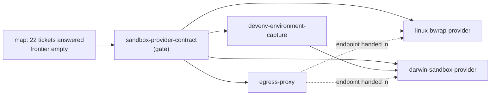
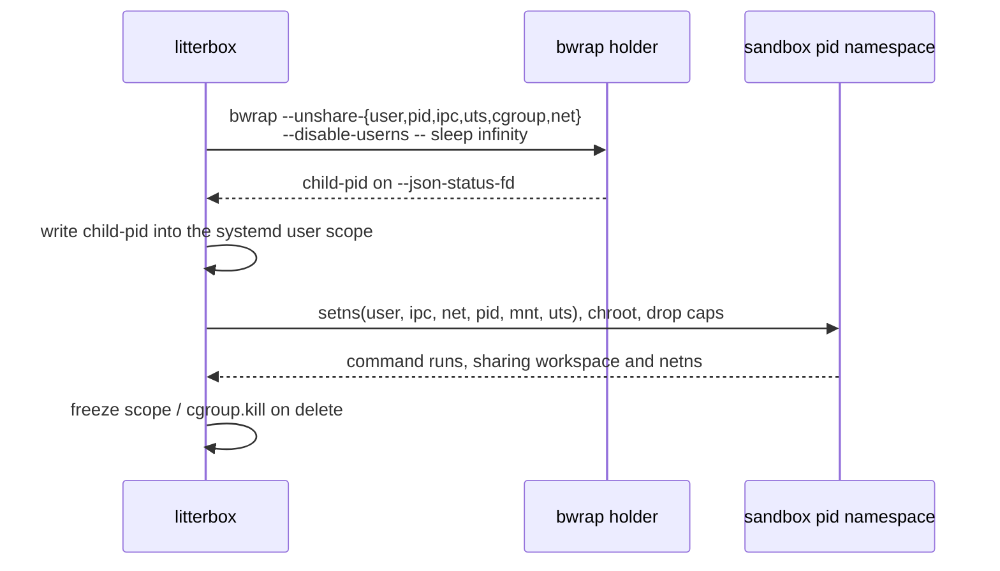
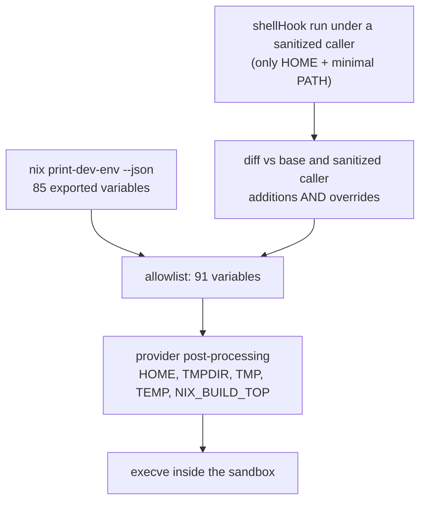
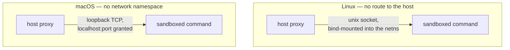

# Handover: `nix-devshell-sandbox`

The map is complete. Twenty-two tickets, none open, every answer backed by
`evidence/`. The destination is proven on both platforms: a Nix devShell's
environment, captured on the host, builds inside a user-space sandbox with no
container runtime and no virtualisation.

This file is the resumable summary. A session that starts cold should be able to
read this and the map, and continue at "Next actions" without re-probing
anything. Everything here is justified in `evidence/`; nothing is a guess that
the map did not settle.

## Where this sits

## The decision in one paragraph

Bubblewrap on Linux, `sandbox_init` on macOS, no virtualisation. Linux runs a
**holder** — the Kubernetes pause-container shape, as Flatpak's `enter` does it —
and every command `setns`es into it, which restores shared pid and network
context, gives `pause` a sandbox-level meaning through the holder's cgroup, and
closes the `setsid` escape because killing pid 1 kills the namespace. macOS has
nothing to hold open: the profile is a per-process property and commands already
share the host's pids and network. In both cases the environment comes from a
host-side capture of the devShell, and `nix` itself is deliberately unavailable
inside the sandbox. Egress is a host-side proxy: a bind-mounted unix socket on
Linux, a granted loopback port on macOS.

## Linux: holder plus join

| Finding | Consequence |
|---|---|
| The addressable pid is bwrap's `child-pid`, not the process you spawned | the holder must read `--json-status-fd`; targeting `$!` leaves you in the host's namespaces |
| `setgroups` is denied in bwrap's user namespace | an `nsenter`-based join needs `--preserve-credentials`; a native join just drops caps like Flatpak |
| `--wd` resolves in the outer namespace | use `--wdns`, or `chdir` after the join |
| `--disable-userns` does not block joining | it stops creating a *further* userns, not `setns` from outside |
| Killing pid 1 kills the whole pid namespace | the `setsid` escape that defeated process groups is closed |
| Joined commands are children of the client, not the holder | `SIGSTOP` on the holder pauses nothing; only a cgroup freeze covers them |

**Lifecycle.** Assign every joined pid to the sandbox scope before `exec`.
Freeze and limits then cover every command, and `cgroup.kill` tears the scope
down atomically. Without cgroups, pausing is a stop-and-rescan fixpoint over
`/proc` by pid-namespace inode — a one-pass sweep is *not* a pause (a sustained
forker wrote 806 bytes while "paused"), and the fixpoint can be livelocked by a
same-uid peer signalling its stopped neighbours. Cgroups are the primitive;
enumeration is the fallback. Delegation is not a security boundary: the sandbox
owns its subtree and can move itself out.

## Darwin: a per-command helper

`sandbox_init` with an SBPL profile, not the App Sandbox entitlement API, which
needs a signed bundle. No namespaces are created at all, so every command shares
the host's pid space and network stack, and the workspace is an ordinary host
directory. There is no sandbox-level state: `pause` means signalling a command's
process group, and there is no freeze or resource limit.

Consequences that differ from Linux:

- Cross-command client traffic works for free; sandboxed *listener* reachability
  is untested because the profile emits neither `network-bind` nor
  `network-inbound`.
- `sandbox_init` is deprecated and undocumented. That longevity risk is carried,
  not resolved.
- The `setsid` escape survives here too — there is no pid namespace to die.

## Environment capture

The single most subtle part, and the one most easily got wrong.

- **Take overrides, not just additions.** The hook prepends `$CARGO_HOME/bin` to
  `PATH` and builds `RUSTFLAGS` from the caller's own `RUSTFLAGS`. An
  additions-only diff loses the first and imports the second.
- **Sanitise the caller first**, or caller state leaks in through string
  interpolation.
- **Never copy `nix develop --command env`.** It is the devShell *on top of your
  whole session*: `SSH_AUTH_SOCK`, `BITWARDEN_SSH_AUTH_SOCK`, `GNUPGHOME`,
  `DOCKER_HOST`, `DBUS_SESSION_BUS_ADDRESS`, `WAYLAND_DISPLAY`, `XDG_RUNTIME_DIR`.
  Each is a path straight out of the confinement. It is also corrupted, because
  the hook prints banners to stdout where `env -0` is writing.
- **109 bash functions are lost.** Fine for compilers; fatal for `genericBuild`
  and anything calling stdenv phases.
- **The workload sees 93 against 91 captured**, the two being `LC_CTYPE` and
  `PWD` that the shell sets. Nothing is dropped.
- **Darwin needs the capture post-processed, not just applied.** Repointing
  `HOME`, `TMPDIR`, `TMP`, `TEMP` and `NIX_BUILD_TOP` into the workspace is what
  makes the linker work; `NIX_BUILD_TOP` must stay *set* because the clang
  wrapper reads it unguarded.

## Store view

The bind set is the devShell environment's Nix closure, one `--ro-bind` per path:
**238 paths of the host's 57,534**, and the same `cargo test` passes. This
replaces a hand-maintained, host-specific baseline discovered by failure, and it
removes the class of bug the macOS spike hit when a read baseline missed a
sibling store path. It is *derived*, not minimal — it carries Rust std libs for
Windows and Apple targets — and it is O(n) mounts, comfortable at 238.

Runtime `dlopen` of a dependency the derivation never declared still fails. That
is the same contract `nix run` offers, and it fails legibly.

## Network

The two platforms do not share a transport, and the macOS result rules out the
Linux one: a unix socket inside a *granted* workspace still fails with `EPERM`,
because `connect(2)` on `AF_UNIX` is `network-outbound` with a `remote unix-socket`
filter and needs `system-socket` as well. So the network facet is a
**transport-typed endpoint** — a socket path or a port — not a boolean.

Published ports are out of scope for the native backends; egress is the proxy's
job and it is a separate ADR.

## Deliberately excluded

`nix` inside the sandbox. It executes, but only usefully with the daemon socket
and network, and with the socket a sandboxed command grew the host store with a
root-owned, host-executable path and the daemon accepted build requests that run
outside the sandbox. That is host-store growth and out-of-sandbox execution —
not mutation of existing immutable paths, which content addressing makes hard —
and `T-004` already names the daemon as a write channel. Withhold it. Projects
that need `nix` at build time fail with their own error, which is legible.

## The ADR structure

Five ADRs: one gate, four leaves.

| ADR | Owns | Does not own | Depends on |
|---|---|---|---|
| `sandbox-provider-contract` | core trait, facet traits per platform family, provider- and facet-level readiness, neutral handle, one factory, `EnvironmentProvenance`, the network endpoint type, the CLI/MCP de-leaking | any mechanism, proxy behaviour, capture procedure | — |
| `devenv-environment-capture` | sanitized-baseline differential, noise and scratch sanitisation, secret denylist, golden capture test | how a provider applies it, path rewriting | contract |
| `linux-bwrap-provider` | holder, setns join, cgroup assignment, pid-namespace fallback, closure bind set, golden argv, userns readiness | environment capture, proxy | contract, capture |
| `darwin-sandbox-provider` | per-command helper, SBPL renderer, closure → `file-read*`, environment post-processing, golden profiles, `sandbox_init` readiness | environment capture, proxy | contract, capture |
| `egress-proxy` | transport per platform, destination policy, configuration surface, port/socket allocation, lifecycle | how a provider reveals the endpoint | contract (endpoint type only) |

There is **no "Nix devShell provider" ADR**: the devShell is an environment, not
a backend. That is a simplification the map earned.

Interface first. The proxy's only dependency on the contract is one type — the
endpoint the provider makes reachable — so it can be built in parallel with both
providers once the contract exists. Writing it first would invent that seam
inside the proxy and ask the contract to adopt it backwards.

## Contract design notes

Carried from the review of the current interface, and from the answers above:

- **Facets are platform-specific.** `posix`, `linux`, `darwin` modules, `win32`
  later, no neutralising. The core trait holds only the invariants: canonicalised
  paths, fail-closed, workspace-only writes, descendants confined, no caller
  flags.
- **Two readiness levels.** Provider readiness ("is bwrap usable here at all",
  "does `sandbox_init` resolve", "is there a Docker context") and facet readiness
  ("is there cgroup delegation", "is a proxy endpoint present"). Both return a
  reason and a remedy, because that is what turns a failure into an instruction.
- **`Available` is not a capability enum.** A missing facet is a compile error at
  the call site; a runtime-unavailable one is a startup error naming its remedy,
  never a silent downgrade.
- **Environment is a provider-owned descriptor**, not a bag of variables, because
  Darwin must rewrite and sanitise what Linux applies with less work.
- **Never rewrite store paths.** `/nix/store` is mounted at its own path; only
  references to the *workspace* move if it is bound elsewhere.
- **The leak to fix:** `main.rs:427` and `mcp.rs:561` each build
  `DockerSandboxProvider` directly, and `main.rs:252`/`main.rs:276`
  (`pause --all-envs`, `pause --all-repos`) bypass the provider entirely and call
  `DockerCompute`. The contract also still speaks Docker: `container_id`,
  `inspect_container`, `ContainerInspection`, `container_name_for_slug`.

## Testing

- **Modules, not crates.** The contract's only consumers live in
  `agentkit-litterbox`; a crate would add an edge for nothing.
  `arch-lint` scopes by path, not crate.
- **Select by package or target, not by feature.**
  `cargo test -p agentkit-litterbox --lib sandbox::darwin` for unit tests, and a
  `--test darwin` target for anything that needs a real sandbox. The Ubuntu job
  keeps `cargo test --locked`; the Darwin module compiles to nothing there.
- **A macOS job runs only `-p`/`--test` selections**, modelled on
  `tackle.conformance.yaml`, triggered on `paths:` for the Darwin and contract
  modules rather than every PR.
- **On the dedicated runner, unavailable is a failure, not a skip.** Locally it
  skips; a green macOS job that skipped everything is worse than a red one.
- **The devShell works on `aarch64-darwin`**, so the job reuses
  `nix develop ./nix`. It proves the devShell, not the rest of the workspace's
  crates.

## Carried risks

1. `sandbox_init` is deprecated, undocumented, and the named profiles are already
   rejected when building against SDK 27 or later. Declare the symbol ourselves
   and report unavailable rather than running unconfined.
1. A devShell whose closure exceeds the toolchain closure is untested.
1. The non-cgroup pause fixpoint can be livelocked by a same-uid peer.
1. cgroup delegation is resource management, not a boundary.
1. macOS sandboxed-listener reachability is untested.
1. A process that reparents beyond the pid namespace would need privilege; barred
   by `--disable-userns`, which is therefore load-bearing for pause enumeration.

## Next actions

1. `adr.specify` the gate: `sandbox-provider-contract`. Brief only — decision,
   direction, established facts. No tickets, no evidence paths, no mention of a
   map.
1. Then, in parallel: `devenv-environment-capture`, `linux-bwrap-provider`,
   `darwin-sandbox-provider`, `egress-proxy`.
1. Longest pole for a *usable* sandbox is `egress-proxy`: without it both native
   backends are offline-only.
