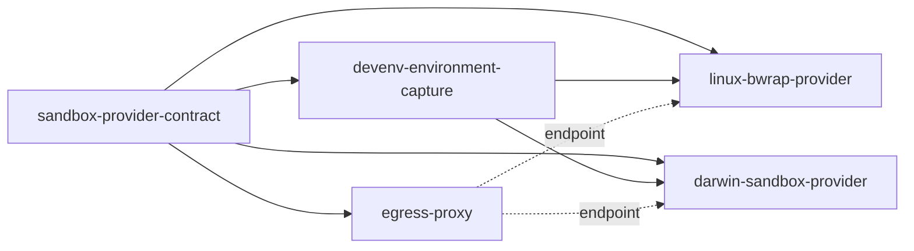
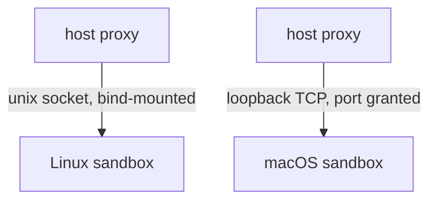

# Handover: `nix-devshell-sandbox`

Map complete: 22 tickets, none open. Detail in `evidence/`, decisions in `map.toon`.

**Next:** `adr.specify` `sandbox-provider-contract` with a brief only. Then capture,
linux, darwin, proxy in parallel. Proxy is the longest pole for a usable sandbox:
without it both native backends are offline-only.

## ADRs

No "Nix provider" ADR: a devShell is an environment, not a backend.

## Decision

bwrap on Linux, `sandbox_init` on macOS, no virtualisation. Linux runs a holder
(`sleep infinity` in the namespaces) and every command `setns`es into it. macOS
has no namespace, so the profile is applied per command. Environment is captured
on the host; `nix` stays outside. Egress is a host-side proxy.

## Linux

- Addressable pid is bwrap's `child-pid` on `--json-status-fd`, not `$!`.
- `setgroups` is denied in the userns: `nsenter` needs `--preserve-credentials`.
- `--wd` resolves outside; use `--wdns`.
- `--disable-userns` does not block `setns`. It does prevent nested pid namespaces,
  which pause enumeration depends on.
- Killing pid 1 kills the pid namespace, including `setsid` escapees.
- Joined commands are children of the client, so `SIGSTOP` on the holder pauses
  nothing.
- Assign each joined pid to the sandbox scope before `exec`; freeze and limits then
  cover everything, and `cgroup.kill` tears it down atomically.
- No cgroups: pause is stop-and-rescan to fixpoint, not a one-pass sweep (a forker
  wrote 806 bytes while "paused"). A same-uid peer can livelock it.
- Delegation is not a boundary; the sandbox owns its subtree.

## Darwin

- `sandbox_init`, not the entitlement API (needs a signed bundle). Deprecated:
  longevity is a carried risk.
- No namespaces: shared pids and network, cross-command client traffic works.
- Listener reachability untested; profile emits neither `network-bind` nor
  `network-inbound`.
- No freeze, no limits, no sandbox-level state. `setsid` escape survives.
- Builds a devShell with **zero** baseline additions; 524 denials, all tolerated.

## Capture

`print-dev-env` exports, plus the `shellHook`'s additions **and overrides**,
computed under a sanitized caller (`env -i HOME=… PATH=…`). 85 + 16 = 91.

- Additions-only loses `PATH`'s `$CARGO_HOME/bin` prepend; a normal caller folds
  its own `RUSTFLAGS` in.
- Never copy `nix develop --command env`: carries `SSH_AUTH_SOCK`,
  `BITWARDEN_SSH_AUTH_SOCK`, `DOCKER_HOST`, `DBUS_SESSION_BUS_ADDRESS`,
  `WAYLAND_DISPLAY`, and is corrupted by hook stdout.
- 109 bash functions lost.
- Provider post-processes: `HOME`, `TMPDIR`, `TMP`, `TEMP` into the workspace;
  `NIX_BUILD_TOP` must stay **set** (clang wrapper reads it unguarded).

## Store

Bind the devShell closure: 238 paths of 57,534, same test passes. Derived, not
minimal (carries Windows/Apple std libs). O(n) mounts. Runtime `dlopen` of an
undeclared dep still fails, as on the host.

## Network

The network facet is a transport-typed endpoint, not a boolean. `AF_UNIX` in a
granted workspace still fails on macOS: `connect(2)` is `network-outbound` with a
`remote unix-socket` filter, plus `system-socket`. Published ports are out of scope.

## Excluded

`nix` inside the sandbox. With the daemon socket a sandboxed command grew the host
store and the daemon accepted builds outside the sandbox; without it, nothing
evaluates. Withhold it.

## Contract notes

- Facets are platform-specific (`posix`, `linux`, `darwin`, later `win32`). The
  core trait holds only the invariants.
- Readiness at provider and facet level, each returning reason and remedy.
- Missing facet: compile error. Runtime-unavailable: startup error, never a
  silent downgrade.
- Environment is a provider-owned descriptor, because Darwin must rewrite it.
- Never rewrite store paths; only workspace references move.
- Leak to fix: `main.rs:427` and `mcp.rs:561` build `DockerSandboxProvider`;
  `main.rs:252`/`276` bypass the provider for `pause --all-*`. Contract types
  still say `container_id`, `inspect_container`, `ContainerInspection`.

## Tests

Modules, not crates. Select by `-p` and by test target:
`cargo test -p agentkit-litterbox --lib sandbox::darwin`, `--test darwin`. Ubuntu
keeps `cargo test --locked`. The macOS job runs only those selections, on `paths:`
triggers. On the dedicated runner, unavailable is a failure, not a skip. The
devShell works on `aarch64-darwin`, so it reuses `nix develop ./nix`.

## Risks

1. `sandbox_init` deprecation.
1. A closure larger than the toolchain's is untested.
1. Non-cgroup pause fixpoint is livelockable.
1. Delegation is not a boundary.
1. macOS listener reachability untested.
1. `--disable-userns` is load-bearing for pause enumeration.
